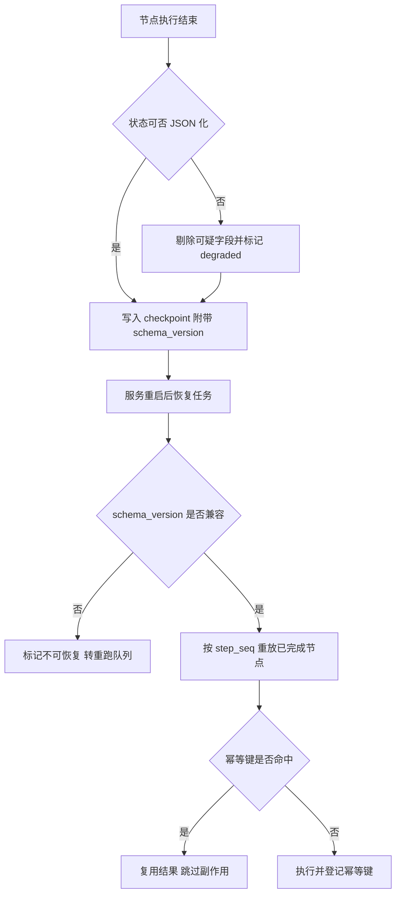

# Agent 长任务断点恢复：状态序列化失败与恢复后副作用重放怎么兜底

## 为什么会有这个问题

框架的 checkpointer 通常把整个 state 字典原样落盘，而运行期很容易把 HTTP client、数据库 session、回调闭包、锁对象这类不可序列化的东西顺手塞进 state，写入时才炸；更隐蔽的是「能存进去但恢复不回来」：类字段改名、枚举值增删、发布回滚导致旧 checkpoint 用新代码反序列化，结果是半恢复的状态继续往下跑。常见误区是认为选个支持 pickle 的存储就解决了持久化，实际上可序列化不等于可恢复、可重放，恢复语义（哪些 step 已完成、副作用是否发生过）和序列化格式是两件事，必须分开设计。

## 怎么做

1. 状态分层：把 state 拆成 persistent（纯数据，字段白名单，Pydantic 建模）、runtime（client、连接池、回调，只活在进程内）、derived（可由前两者重算的中间结果）。persistent 里出现非数据对象视为 bug，在 CI 里加一条 state 模型的 JSON 化单测守住。
2. 写入前守卫并降级：dump 后跑一次严格 JSON 校验，失败时剔除可疑字段、打 degraded 标记并上报指标，而不是让整个 step 抛异常中断任务；degraded 的 checkpoint 要能标识出来，便于后续排查。
3. 版本化与迁移：checkpoint 必须带 schema_version，加载时走 migration 注册表逐版本升级；无法迁移的直接判为 dead-letter 进重跑队列，禁止「缺字段也硬跑」。
4. 副作用幂等：用 (thread_id, node, step_seq, tool_name, args_hash) 生成幂等键，工具入口先查已完成记录再执行；发消息、下单这类不可幂等动作改成 outbox 模式，先落库再异步投递，恢复时只补投未确认的记录。
5. 恢复链路可观测：单独埋 resume_attempt、resume_success、replay_steps、duplicate_side_effect 四个指标，恢复过程用独立 trace/span 标记，和正常执行区分开，否则故障会被平均掉。
6. 演练：定期做「杀进程 + 回滚版本」的混沌测试，验证恢复路径，而不是等大促发布时才发现。

## 关键代码

```python
from pydantic import BaseModel, Field
import hashlib, json, logging

class AgentState(BaseModel):
    schema_version: int = 2
    thread_id: str
    step_seq: int = 0
    plan: list[dict] = Field(default_factory=list)
    tool_results: dict[str, dict] = Field(default_factory=dict)
    scratch: dict = Field(default_factory=dict)

def safe_dump(state, checkpointer):
    payload = state.model_dump(mode='json')
    try:
        json.dumps(payload, allow_nan=False)
    except (TypeError, ValueError) as e:
        logging.warning('checkpoint_degraded thread=%s err=%s', state.thread_id, e)
        payload['scratch'] = {}
        payload['degraded'] = True
    checkpointer.put(state.thread_id, payload)

def idem_key(thread_id, node, seq, tool, args):
    raw = '|'.join([thread_id, node, str(seq), tool, json.dumps(args, sort_keys=True)])
    return hashlib.sha256(raw.encode()).hexdigest()[:32]

def run_tool(ctx, name, args):
    key = idem_key(ctx.thread_id, ctx.node, ctx.step_seq, name, args)
    hit = ctx.done_store.get(key)
    if hit is not None:
        return hit
    result = ctx.tools[name](**args)
    ctx.done_store.put(key, result)
    return result
```

## 真实场景

某项目的长链路 Agent 单任务 10~40 步，包含检索、外部工具调用、写工单库，跑在 K8s 上，滚动发布时 Pod 会被杀掉。现象有两类：一部分任务恢复后立刻抛 TypeError，报某个字段不是 JSON 可序列化类型；另一部分恢复是成功的，但把「发送通知」「提交工单」又执行了一遍，用户收到重复消息。监控上 checkpoint 写入成功率接近 100%，但 resume_success_rate 只有六成左右，重复副作用没有独立指标，是靠客诉才发现的。排查路径：先在 dump 前加严格 JSON 校验，定位是哪个节点往 state 里塞了 client 与回调；再对比恢复前后的 step 序列，看哪些 step 没有幂等记录；最后检查旧 checkpoint 缺 schema_version 导致字段错位，恢复出来的 plan 是上一版结构。

## 示意图



## 面试官追问

1. **Q：** 直接用 pickle 把整个 state 存下来不行吗？

   **A：** 能存不等于能恢复。pickle 依赖类路径，代码重构一次或回滚一版就解不开；跨语言、跨版本不可读，反序列化本身还是攻击面。生产上应当显式 schema + 版本号，运行期资源不落盘、恢复时重建，宁可多写一点迁移代码，也不要赌类结构不变。

2. **Q：** 恢复之后怎么确认没有重复执行副作用？

   **A：** 两个手段叠加：一是幂等键 + 完成记录表，恢复时以 step_seq 为游标重放，命中记录直接取结果；二是把不可幂等的外部动作收敛到 outbox，先落库再异步投递，恢复只补投未确认的。再加一个 duplicate_side_effect 计数器做兜底观测。


来源：https://github.com/guocong-bincai/ai-interview-guide/blob/main/docs/23-agent-observability/README.md
