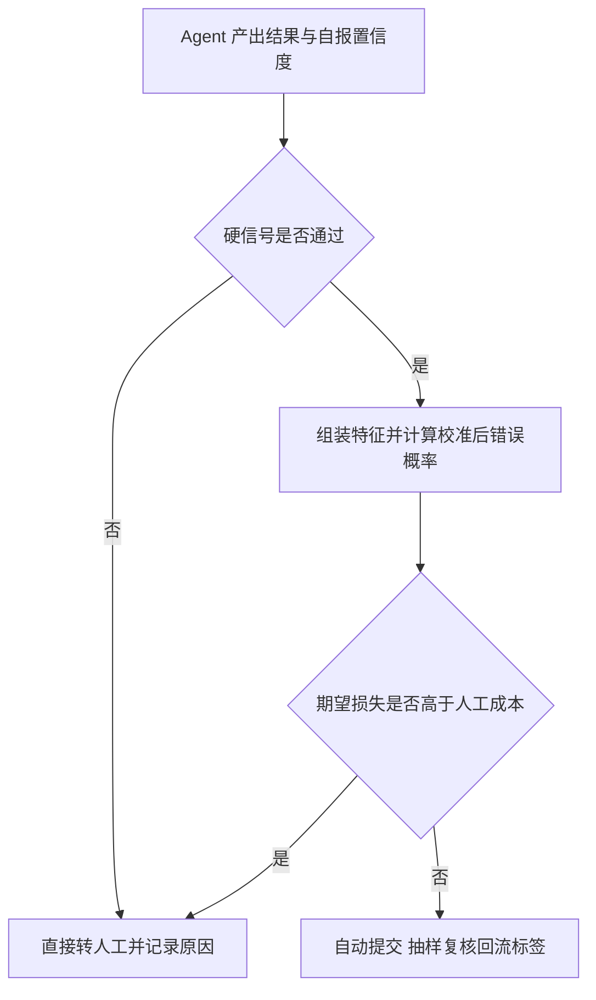

# 自报置信度不可信时，Agent 的人工接管闸门该怎么设计

## 为什么会有这个问题

模型在输出里写的 confidence 是生成出来的一个 token，不是真实的正确概率，在分布外输入和长尾样本上系统性偏高，而且会被 prompt 里的措辞带偏（你要求它保守，它就整体下压，区分度反而更差）。用它当唯一阈值会导致两类错误同时发生：高风险任务给了 0.9 被自动放过，简单任务给了 0.6 被反复转人工，人工队列被低价值请求淹没。本质问题是「用一个未校准的打分去卡一个代价不对称的决策」，正确做法是把自报分数降级成特征之一，先用可验证信号做硬拦截，再用带标签数据把分数校准成 P(correct)，最后按期望损失而不是固定阈值决定是否升级。

## 怎么做

1. 先做 hard gate 再谈打分：schema 校验、工具返回码、引用能否解析回原文、金额/权限/必填字段的规则断言，任一失败直接转人工，不进入置信度排序。这一步能拦掉大部分确定性错误，且完全不需要模型自评。
2. 特征化：把 self_confidence 当作一个普通特征，与 evidence_coverage（检索证据覆盖度）、多次采样的答案一致性、工具调用成功率、同类历史样本通过率拼成特征向量。
3. 收集标签：每条轨迹记录特征与最终是否正确，标签来自人工复核结果和延迟回填（用户是否二次追问、工单是否被返工）。注意采样偏差，被自动通过的样本也要抽样复核，否则校准器只见过难样本。
4. 校准与验证：用 isotonic regression 或 Platt scaling 拟合 P(correct)，用分桶准确率和 ECE 验证，确认高分区间的实际准确率确实高；校准器要按 intent/场景分桶训练，全局一个模型常常被大类样本带偏。
5. 按期望损失定阈值：escalate 当且仅当 (1-p) * cost_error > cost_human，不同意图配不同代价；同时把人工接管分档（轻量确认 / 全量重做），压低单次人工成本，比一味调阈值更有效。
6. 闭环监控：跟踪 escalation_rate、override_rate（人工推翻模型的比例）、miss_rate（自动通过后被判错的比例）、人工处理时延，定期重训校准器并做漂移告警。

## 关键代码

```python
from sklearn.isotonic import IsotonicRegression

def features(t):
    return [[t.self_conf, float(t.schema_ok), float(t.tool_ok),
             t.evidence_coverage, float(t.samples_agree)]]

calibrator = IsotonicRegression(out_of_bounds='clip')
# calibrator.fit(X_train, y_correct)

def route(t, cost_error, cost_human):
    if not t.schema_ok or not t.tool_ok:
        return 'human', 1.0, 'hard_gate'
    p_err = 1.0 - float(calibrator.predict(features(t))[0])
    if p_err * cost_error > cost_human:
        return 'human', p_err, 'loss_gate'
    return 'auto', p_err, 'pass'
```

## 真实场景

某项目的工单处理 Agent 在输出 JSON 里带一个 confidence 字段，规则是低于 0.8 转人工。上线后两个现象同时出现：自动提交的工单里仍有一批分类错误，这些错误样本的自报值普遍在 0.9 以上；同时大量简单咨询被转人工，人工队列积压、SLA 变差。翻日志发现 confidence 分布几乎挤在 0.85~0.95，几乎没有区分度。排查路径：把历史轨迹按最终是否正确做标注，画 reliability diagram，发现高置信区间的实际准确率远低于自报值；再算各信号与结果的相关性，发现工具返回码和 schema 校验的区分能力明显强于自报分数，于是改成硬信号先拦、校准分数后判。

## 示意图



## 面试官追问

1. **Q：** 冷启动阶段没有标注数据，阈值怎么定？

   **A：** 先用 hard gate 兜住确定性失败，这部分不依赖标签；同时把自动通过的请求做高比例抽样人工复核，用复核结果当第一批标签。无标签期用保守阈值，优化目标优先保漏放率而不是转人工率，等标签积累到能拟合校准器再放松。

2. **Q：** 业务方要求把转人工率压到 5%，怎么处理？

   **A：** 把指标翻译成代价语言：画出不同阈值下漏放率与转人工率的权衡曲线，说明 5% 对应的漏放率是多少，让业务显式接受。若不接受，就只能降低单次人工成本（分层接管、只确认关键字段）或提升信号质量，单纯压阈值等于把风险转移到线上。


来源：https://github.com/guocong-bincai/ai-interview-guide/blob/main/docs/21-multimodal-agents/README.md
