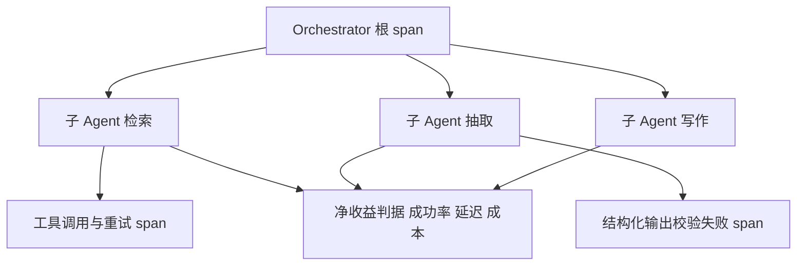

# 多 Agent 编排：跨 Agent 的 trace 传播与净收益判据怎么落地

## 为什么会有这个问题

单 Agent 的调用链是一条线性 span，父子关系天然成立；一旦改成 orchestrator 加多个子 Agent 并行 fan-out，链路就变成运行时才确定的 DAG，父子关系只能靠代码显式传递。最常见的错误认知是「每个 Agent 都打了 run_id 就能还原链路」，但实际并发下常见三种断链：一是子 Agent 跑在线程池里，contextvars 不跨线程自动传播，子 span 全变成孤立 trace；二是 trace 上下文被塞进 prompt 靠模型转述，模型改写或截断后彻底丢；三是重试没有 attempt 区分，同一 subtask 的 span 重复上报无法去重。断链的直接后果不是看日志不方便，而是无法把 token、延迟、失败归因到具体子任务，于是「多 Agent 到底比单 Agent 多赚了什么」这个决策问题永远回答不了，只能靠感觉保留架构。

## 怎么做

1. 建立 trace 传播契约：规定每次 Agent 调用必须携带 trace_id / span_id / parent_span_id / subtask_id / attempt 五个字段，通过函数参数或 contextvars 传递，严禁放进 prompt 让模型转述。
2. 在 orchestrator 层先建任务表再派发：subtask_id、assigned_agent、依赖关系、状态机（pending/running/done/failed），span 挂在 subtask 上而不是挂在 Agent 上，这样同一 Agent 承担多个子任务时能分开统计。
3. 每次 LLM 调用与工具调用都记用量：model、prompt_tokens、completion_tokens、cached_tokens、tool 调用次数与耗时，逐层向上聚合到 subtask 和 trace 根，得到单任务成本。
4. 给失败分类而不是只记异常栈：error_kind 至少区分 tool_error / schema_error / timeout / invalid_arg / handoff_conflict，聚合后看 top 失败模式，才能判断是编排问题还是单 Agent 能力问题。
5. 定义净收益判据并用同一离线集做对照：以单 Agent 为 baseline，比较任务成功率、P95 端到端延迟、单任务 token 成本、失败可恢复率四项；只有成功率提升稳定超过业务阈值、且成本与延迟在预算内，才保留多 Agent 拆分，否则回退成单 Agent 加工具。
6. 控制可观测性自身的成本：span 元数据全量存，prompt 与 response 按比例采样存；设置 trace 存储预算上限，避免可观测性开销反超推理开销。
7. 并发派发时优先用 asyncio.gather（会复制当前 context），必须用线程池时提交任务要显式 copy_context().run(...)，用进程池则把 trace 上下文序列化后作为参数传入。
8. 上线后做持续判定：按 trace 抽样走单 Agent 对照路径或离线重放日志，设置成本护栏，超出预算自动降级为单 Agent 编排。

## 关键代码

```python
import contextvars, time, uuid
from dataclasses import dataclass, field

_span: contextvars.ContextVar = contextvars.ContextVar("span", default=None)

@dataclass
class Span:
    agent: str
    subtask_id: str
    trace_id: str
    span_id: str
    parent_id: str | None
    start: float = field(default_factory=time.time)
    latency_ms: int = 0
    usage: dict = field(default_factory=dict)
    error_kind: str | None = None

def _new_id() -> str:
    return uuid.uuid4().hex[:16]

async def run_subagent(agent, subtask_id, fn, *args):
    parent = _span.get()
    s = Span(agent=agent, subtask_id=subtask_id,
             trace_id=parent.trace_id if parent else _new_id(),
             span_id=_new_id(),
             parent_id=parent.span_id if parent else None)
    token = _span.set(s)
    try:
        return await fn(*args)
    except Exception as e:
        s.error_kind = type(e).__name__
        raise
    finally:
        s.latency_ms = int((time.time() - s.start) * 1000)
        sink.emit(s)   # 上报 field: trace_id span_id parent_id subtask_id
        _span.reset(token)
```

## 真实场景

某项目的调研 Agent 采用 orchestrator 加三个子 Agent（检索、抽取、写作）并行。症状是 P95 延迟明显高于改造前的单 Agent，成功率却只小幅提升，且监控面板只看得到整体 trace 失败率，定位不到具体子 Agent。排查路径：第一步在 orchestrator 日志里发现子 Agent 的 span 没有 parent_id，原因是子 Agent 被丢进线程池执行，contextvars 丢失，所有子 span 成了独立 trace；第二步补上显式传播后，看到绝大部分 token 消耗集中在抽取子 Agent 的结构化输出校验重试上；第三步按 error_kind 聚合，确认失败集中在 schema_error 与 invalid_arg，属于输出格式问题而非检索质量问题；第四步用受控输出约束加单次重试上限，成本与延迟回落，多 Agent 拆分才真正体现出成功率收益。整个排查能走通，靠的就是 trace 不断链加上按 subtask 的用量归因。

## 示意图



## 面试官追问

1. **Q：** 子 Agent 被放进线程池或进程池后 trace 断了，你会在哪一层修？

   **A：** 优先在派发层修而不是在 Agent 内部修。线程池用 copy_context().run(...) 包裹提交的任务，让子线程拿到父 context 的副本；进程池无法共享内存，就在提交时把 trace_id / parent_span_id / subtask_id 显式序列化进任务参数。更稳的做法是不依赖隐式上下文，orchestrator 派发时统一传入一个 TraceContext 对象，Agent 实现里只读不重建，这样换执行模型也不会断。

2. **Q：** 净收益如果只做过一次离线 A/B，线上怎么持续证明多 Agent 还值得留？

   **A：** 把判据做成在线指标而不是一次性结论：按 trace 记录路由决策和每个子任务的用量，定期对同一批线上请求做影子重放走单 Agent 路径对照；同时设预算护栏，当单任务成本或 P95 延迟超过阈值时自动降级为单 Agent 加工具链。关键是把架构决策和指标绑定，让回退成为配置行为而不是一次重构。


来源：https://github.com/cdavid817/agent-interview/blob/main/docs/02-capabilities/multi-agent/evaluation.md
