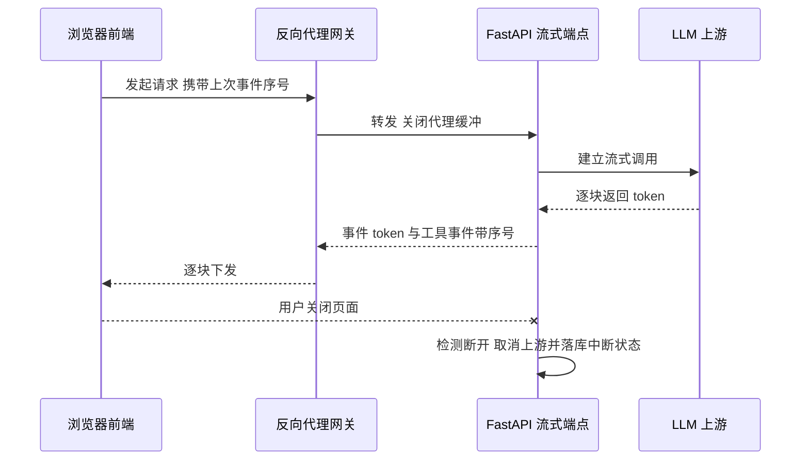

# Agent 流式输出：线上退化成假流式与工具中间态错乱怎么定位

## 为什么会有这个问题

流式的价值是首 token 时间与感知延迟，但整条链路上任何一环做缓冲，都会退化成「等模型全部生成完再一次性吐出」。最常见的错误认知是「返回 StreamingResponse 就是流式」：实际上 GZipMiddleware 会攒块压缩、Nginx 默认 proxy_buffering on、部分网关会聚合 SSE 再转发，把异步生成器包在被 await 完的中间件里同样会失去逐块下发。Agent 场景还多两层复杂度：一是流里混着 token delta、tool_call 开始与参数、tool_result、step 边界、最终消息等多种事件，前端要增量渲染；二是工具调用可能在中途失败，此时部分文本已经流给用户，需要「修正」语义而不是覆盖，否则前端渲染态与最终消息不一致。再加上断线重连与客户端关闭页面，后端如果感知不到断开，上游 LLM 仍在生成，白烧配额。

## 怎么做

1. 分层定位是否真流式：先 curl -N 直连应用端口看是否逐块返回，再逐层加反向代理和网关复测；同时看响应头有没有 Content-Encoding: gzip、Transfer-Encoding: chunked，以及是否被加了 X-Accel-Buffering。
2. 定义事件契约：为事件类型建 schema（token / tool_start / tool_args / tool_result / step / correction / done / error），每条带 message_id 与全局单调 seq，correction 用于修正已下发的中间态，不再覆盖文本。
3. 显式关闭缓冲：响应头带 X-Accel-Buffering: no、Cache-Control: no-cache、Connection: keep-alive；对 text/event-stream 绕过压缩中间件；代理侧关闭 proxy_buffering 并调大 proxy_read_timeout。
4. 处理客户端断开：用 request.is_disconnected() 或捕获 CancelledError，主动 aclose 上游 LLM 流，并把已生成部分以中断状态落库，避免重复计费。
5. 断线续传：把 message_id 与最近 seq 及事件窗口写进 Redis，重连带 Last-Event-ID 从 seq+1 重放；窗口做有界，超出则让前端拉一次完整消息做 reconcile。
6. 保证最终一致：前端在 done 事件上用完整消息覆盖渲染态，过程中的 token 与 tool 中间态只作为预览，避免工具失败后留下矛盾内容。
7. 用契约测试守住：对流式端点写集成测试，断言至少收到两个 chunk、seq 单调、done 唯一、工具失败时必有 correction；CI 常跑，防止依赖升级或中间件调整把流式打回一次性返回。

## 关键代码

```python
from fastapi import FastAPI, Request
from fastapi.responses import StreamingResponse
import asyncio, json

app = FastAPI()

def sse(event: str, data: dict, seq: int) -> str:
    body = json.dumps(data, ensure_ascii=False)
    return f"id: {seq}\nevent: {event}\ndata: {body}\n\n"

@app.post("/agent/stream")
async def agent_stream(req: Request, body: ChatIn):
    async def gen():
        seq, message_id = 0, new_id()
        try:
            async with llm.stream(body.messages) as stream:
                async for chunk in stream:
                    if await req.is_disconnected():
                        raise asyncio.CancelledError
                    seq += 1
                    if chunk.type == "token":
                        yield sse("token", {"text": chunk.text}, seq)
                    elif chunk.type == "tool_call":
                        yield sse("tool_start", {"name": chunk.name}, seq)
            seq += 1
            yield sse("done", {"message_id": message_id, "status": "ok"}, seq)
        except asyncio.CancelledError:
            await persist_partial(message_id, seq)
            raise

    return StreamingResponse(
        gen(), media_type="text/event-stream",
        headers={"X-Accel-Buffering": "no", "Cache-Control": "no-cache"},
    )
```

## 真实场景

某项目把 Agent 对话从一次性返回改成 SSE。症状一：本地 curl -N 能看到逐 token 输出，上线后用户仍要等整段返回。排查路径是直连 Pod 端口正常，经过入口代理后变成一次性下发，响应头里出现 Content-Encoding: gzip 且代理开了压缩聚合；对 text/event-stream 关掉压缩并加 X-Accel-Buffering: no 后恢复正常。症状二：用户刷新页面后同一条回答出现两遍，原因是重连没有带 Last-Event-ID、也没有按 message_id 做 reconcile；同时发现用户关闭页面后上游仍在生成，占用配额，补上 is_disconnected 判断与上游流关闭后消失。症状三：工具调用报错时，前端已经渲染出「查询结果」区块却与最终消息矛盾，改为下发 correction 事件、并在 done 时用完整消息重渲染一次后收敛。

## 示意图



## 面试官追问

1. **Q：** 为什么不能直接对 SSE 响应开 gzip？

   **A：** 压缩需要攒够一块数据才输出，在 chunked 传输下会破坏逐块语义；部分网关还会因为统一压缩把 SSE 聚合成一个完整响应再转发，直接退化为非流式。虽然个别实现支持压缩后立即 flush，但引入了中间件与代理的额外不确定性，流式端点应当显式 bypass 压缩，压缩收益远小于流式体验损失。

2. **Q：** 多个子 Agent 并行时，各自的输出怎么合并到前端的一条流里？

   **A：** 不要让子 Agent 各自直连客户端，改由 orchestrator 做单写者：子 Agent 的流打上 subtask_id 标签后 fan-in 到一个 asyncio.Queue，SSE 生成器从队列消费并分配全局单调 seq。保序只保证同一 subtask 内部，跨 subtask 允许交错但带标签，前端按 subtask 分区渲染；这样既不会出现多流抢写导致的 seq 冲突，也方便在 done 事件里一次性收敛成最终消息。


来源：https://github.com/run-llama/llama_index/issues/22749
