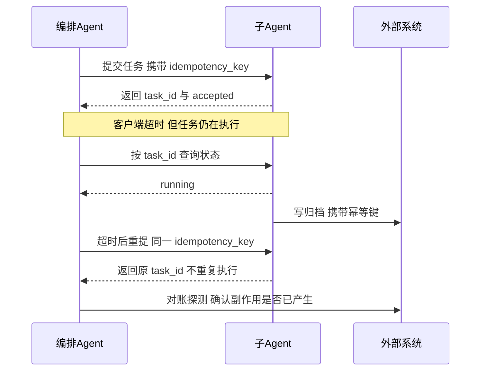

# A2A 委派超时：子 Agent 已执行完却拿不到结果，幂等重放与状态对账怎么做

## 为什么会有这个问题

跨 Agent 委托本质是不可靠的远程调用：委托方只拿得到 task_id 和一次 HTTP 超时，而子 Agent 的执行时间由 LLM 生成加多次工具调用决定，常常是分钟级，远超网关或 SDK 的超时阈值。最常见的错误认知是「超时等于没执行」，于是直接重新委托，结果副作用被执行两遍（重复归档、重复扣款、重复发消息）。第二个错误是状态机里只有成功/失败两态，把「结果未知」折叠进失败，监控据此自动重跑，把偶发超时放大成系统性重复。第三是子 Agent 没有幂等键入口，重复提交就是新任务，无法去重。更麻烦的是，即使有了幂等键，「已执行但结果丢失」这一步仍需要靠外部系统的对账探测来确认，而不是靠重试。

## 怎么做

1. 把委派拆成三段职责：submit 只负责拿 task_id 并立即返回 accepted；状态查询是独立只读接口；结果拉取是幂等读。委托方永远不再同步等最终结果，超时只代表「没拿到结果」。
2. 委托方生成幂等键 idem = hash(parent_run_id + step_id)，随 submit 传递；子 Agent 侧对该键建唯一索引，重复提交直接返回原 task_id 与原状态，不重新执行。
3. 状态机必须显式包含 unknown（截止时间已到但无法确认），不能折叠进 failed；只有 failed 才允许自动重放，unknown 只允许对账查询后人工或降级处理。
4. 副作用改成两段提交：执行前写 intent 记录（幂等键加参数摘要），执行后写 outcome。恢复时先查 outcome，没有 outcome 但有 intent 的步骤走外部资源探测（查单、查消息发送记录）对账，而不是盲目重试。
5. 委托方做带退避的对账循环：指数退避加 jitter，设置最大截止时间，超时后按 idempotency_key 兜底反查一次，仍 unknown 则升级人工或走降级分支。
6. 可观测性把 parent_run_id、task_id、idempotency_key 三者贯穿 trace；核心指标看 unknown 占比、重放命中率、委派链路 p99，而不是只看成功率。

## 关键代码

```python
import hashlib, random, time

def idem_key(parent_run_id: str, step_id: str) -> str:
    return hashlib.sha256(f"{parent_run_id}:{step_id}".encode()).hexdigest()[:32]

def delegate(client, run_id: str, step_id: str, payload: dict, deadline_s: int = 600) -> dict:
    key = idem_key(run_id, step_id)
    task = client.submit(payload, idempotency_key=key)  # 子 Agent 侧唯一索引，重复提交返回同一 task
    end, backoff = time.time() + deadline_s, 1.0
    while time.time() < end:
        st = client.get_task(task.task_id)  # 只读状态接口，不进执行队列
        if st.state in ("succeeded", "failed", "cancelled"):
            return {"state": st.state, "result": st.result, "key": key}
        time.sleep(backoff + random.random() * 0.2)
        backoff = min(backoff * 2, 30.0)
    return {"state": "unknown", "task_id": task.task_id, "key": key}

def run_side_effect(store, run_id: str, step, execute, probe=None):
    key = idem_key(run_id, step.id)
    if (out := store.get_outcome(key)) is not None:
        return out
    store.put_intent(key, step.digest)          # 先落意图，再执行
    if store.get_intent(key) and probe and probe():   # 已执行但结果丢失，走对账
        return store.get_outcome(key)
    out = execute()
    store.put_outcome(key, out)
    return out
```

## 真实场景

某项目里编排 Agent 委派子 Agent 完成「生成合规报告并归档」，子 Agent 端检索加生成长度在 80 到 180 秒之间，而委托方 HTTP 客户端超时设的是 60 秒。上线后偶发同一份报告被归档两次，且两次归档的时间差正好是一个客户端超时周期。排查路径：先确认子 Agent 侧是否收到两次 submit（是，两条 trace 仅 trace_id 不同、参数完全一致），说明是重放而非用户重复操作；再看监控把 ReadTimeout 计为 failed 并触发自动重跑，说明 unknown 态缺失；最后看归档接口无去重键，说明副作用层没做幂等。修复动作是三步：submit 带 idempotency_key 并在子 Agent 侧建唯一索引；状态机引入 unknown，超时不再计为失败；归档前按 report_id 做存在性检查，执行前写 intent 记录。

## 示意图



## 面试官追问

1. **Q：** 如果子 Agent 是第三方黑盒、不支持传幂等键，怎么防止重复副作用？

   **A：** 把幂等责任上移到副作用层：执行前后各探测一次外部资源状态（查单、查消息 ID、查文件是否已存在），探测得到明确「已存在」就直接复用结果；探测不到又无法确定时，该步骤标记为 non-retryable，超时只上报人工而不自动重放，同时把该工具纳入「必须人工确认」清单。根本原则是：不可探测的副作用不允许自动重试。

2. **Q：** 长任务用轮询查状态会不会把子 Agent 打爆？

   **A：** 优先用 SSE 或回调通知，轮询只做兜底；退避从 1s 起指数增长、上限 30s、带 jitter 防止同步尖峰；状态查询走只读副本或缓存（同一 task_id 短 TTL 缓存），与执行队列物理隔离，避免查询流量挤占执行资源。


来源：https://github.com/guocong-bincai/ai-interview-guide/blob/main/docs/13-multi-agent-systems/README.md
