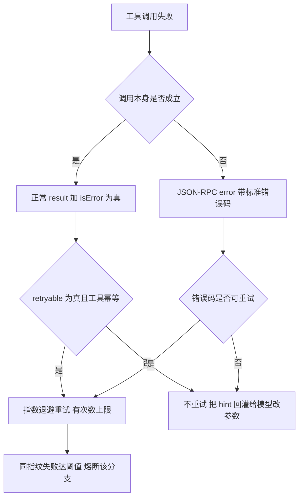

# MCP 工具失败：JSON-RPC error 与 isError 混用引发的重试风暴怎么止住

## 为什么会有这个问题

MCP 走 JSON-RPC 2.0，错误天然分两层：协议层 error（-32700 解析失败、-32601 方法或工具不存在、-32602 参数非法、-32603 内部错误，以及 -32000 到 -32099 的服务端自定义码）和工具执行层结果里的 isError 标记。问题在于两层的语义边界没人强制：把业务失败（余额不足、参数语义不对）当成 -32603 抛出，客户端 SDK 会当作传输故障自动重试；把真正的服务端崩溃包成 isError 的文本，模型看到「内部错误」就在 ReAct 循环里换个参数继续试。两边一叠加就是重试风暴：SDK 重试乘上 Agent 循环重试，一次会话打出上百次工具调用，把上游限流拖垮。更隐蔽的是错误信息只给一句 message，客户端无法判断 retryable，只能默认重试，也就无法做熔断决策。

## 怎么做

1. 先划清语义边界：协议层 error 只用于「这次调用本身不成立」——方法或工具不存在、参数 schema 不合法、鉴权失败、服务不可用；工具确实执行了但业务失败，一律返回正常 result 加 isError:true。
2. 错误结构化：isError 的 content 里放 {"code","retryable","hint","details"}。hint 面向模型（说明该改哪个字段、合法取值范围），details 里带 trace_id 面向人；不要把堆栈或原始异常文本丢给模型。
3. 客户端按类型决定重试：retryable=true 且工具幂等才允许指数退避重试并设上限；retryable=false 直接终止并把 hint 回灌给模型改参数；未知 code 默认不重试，只上报。
4. 在 Agent 循环层加指纹熔断：同一 run 内以 tool_name 加参数摘要为指纹，同指纹失败 N 次终止该分支；同一工具的整体失败率超阈值时把它从本次候选工具集中摘掉并降级。
5. 服务端日志必须带 jsonrpc id、tool name、trace_id、耗时、错误分类；客户端把 error.data 原样透传到 trace，不要吞成一句 tool failed。
6. 监控按错误码分布看：工具失败率、重试占比、平均尝试次数、参数非法型失败占比。后者持续偏高通常不是模型笨，而是工具 description 或 schema 描述不足。

## 关键代码

```python
RETRYABLE_CODES = {-32603, -32001}

def call_tool(client, name, args, max_attempts=3):
    fp = fingerprint(name, args)
    for attempt in range(1, max_attempts + 1):
        try:
            res = client.call("tools/call", {"name": name, "arguments": args})
        except JsonRpcError as e:
            if e.code == -32602 or breaker.hit(fp):
                raise ToolFatal(name, e.code, e.message)      # 参数错 或 已熔断 不重试
            if e.code in RETRYABLE_CODES and attempt < max_attempts:
                time.sleep(min(2 ** attempt, 10) * (0.5 + random.random()))
                continue
            raise ToolFatal(name, e.code, e.message)
        if res.get("isError"):
            payload = json.loads(res["content"][0]["text"])
            if payload.get("retryable") and attempt < max_attempts:
                time.sleep(min(2 ** attempt, 10)); continue
            breaker.record(fp)
            raise ToolBusinessError(payload["code"], payload.get("hint"))
        return res

def handle_tools_call(req):
    tool = registry.get(req.params["name"])
    if tool is None:
        return error(req.id, -32601, "unknown tool")
    if (fields := tool.schema.check(req.params.get("arguments", {}))):
        return error(req.id, -32602, "invalid params", data={"fields": fields})
    try:
        out = tool.run(req.params["arguments"])
    except ToolBusinessError as e:
        return result(req.id, {"isError": True, "content": [{"type": "text", "text": json.dumps(
            {"code": e.code, "retryable": e.retryable, "hint": e.hint})}]})
    except Exception:
        return error(req.id, -32603, "internal error", data={"trace_id": current_trace()})
    return result(req.id, {"isError": False, "content": out})
```

## 真实场景

某项目里 Agent 调用内部的订单查询 MCP 工具。工具端把所有上游异常都统一包成 -32603 抛出，包括上游 401 和参数缺字段；客户端 SDK 视 -32603 为传输类错误自动重试 3 次，Agent 又在 ReAct 循环里再试。典型现象是单次会话对同一工具打出上百次调用，QPS 突增后触发上游限流，连带其他工具一起超时。排查路径：先看服务端日志里同一 jsonrpc id 反复到达，确认是重试而非用户行为；再看错误 message 全是 -32603、没有可判定的 code，说明客户端根本无法区分可重试与不可重试；最后核对 Agent 侧无指纹熔断，同参数失败会一直循环。修复是把业务失败改成 isError 加 retryable=false 并附 hint、参数校验改回 -32602、客户端加指纹熔断与尝试上限。

## 示意图



## 面试官追问

1. **Q：** 怎么区分是模型参数填错，还是工具 schema 描述不清导致的调用失败？

   **A：** 看同一工具参数非法型失败占比与错误字段分布。若失败集中在一个字段且模型反复换写法去猜，通常是工具 description 缺单位、缺枚举、缺示例，应改 schema（加 enum、把格式和单位写进描述、附一个正确调用样例），而不是在系统提示词里反复强调。反之若失败字段分散且与用户输入强相关，才是模型理解问题。

2. **Q：** 工具需要执行超过 60 秒时，怎么和 JSON-RPC 的错误处理配合？

   **A：** 不要靠拉长 HTTP 超时。改成异步任务模式：tools/call 立即返回 task id，后续用状态查询或服务端通知拿结果。客户端侧超时记为 unknown 而不是失败，配合幂等键避免误重放；真正的失败由任务的终态返回，并沿用同一套 code 与 retryable 语义，保证两层的判定逻辑一致。


来源：https://github.com/guocong-bincai/ai-interview-guide/blob/main/docs/14-mcp-skill-systems/README.md
