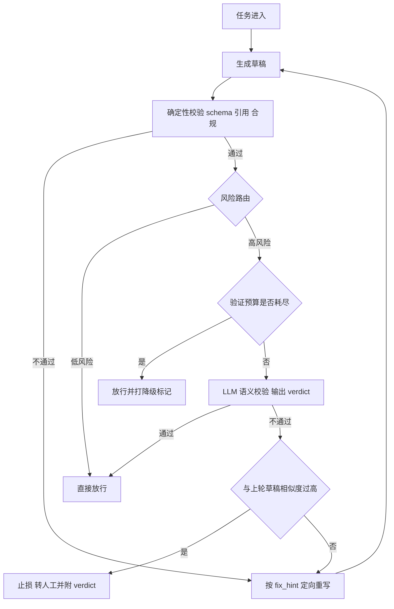

# Critic Agent 反复打回同一份草稿：重写震荡、验证预算与异构校验怎么设计

## 为什么会有这个问题

Critic/Verifier 不是一次性的检查，它把「生成」变成「生成—判定—重写」的闭环：每 reject 一次就多一次生成调用，成本随轮次线性增长，尾部延迟被严重放大。更常见的错误认知是「多一个 critic 一定更准」，但实践中 generator 与 verifier 往往是同模型、同上下文、同风格偏好，两者错误高度相关，verifier 真正能纠的是「可判定错误」（schema 不合法、引用 id 不存在、缺必填字段、违反策略），对开放式质量却容易退化成「表达不够专业」这类风格改写，改完语义不变。由于 false reject 率几乎没人度量，线上就出现「成本翻倍、质量曲线不动」的典型现象；而连续 reject 还会引起重写震荡，同一份草稿被反复改写，最终 P95 延迟和 token 双双超标。

## 怎么做

1. 先做分层校验：把 schema 校验、引用存在性、敏感词/合规、单测执行等确定性检查放在最前面，这类检查拦截了绝大多数硬错误且不花钱；LLM judge 只负责语义类判断，并且必须输出结构化 verdict（passed / reason_code / fix_hint / confidence），禁止自由文本。
2. 按风险路由验证：只对写操作、对外发送、金额与合规相关的高风险样本启用语义校验；低风险任务走确定性校验后直接放行，用路由把验证成本压在真正需要的地方。
3. 给验证设预算和熔断：默认 max_verifier_rounds=1，限制验证消耗的时间与 token；当连续两轮 reject 且草稿相似度（如 Jaccard/embedding 距离）超过阈值，判定为震荡，立即止损并降级为「带 verdict 的人工复核」或「带警告返回」，而不是继续重写。
4. 降低错误相关性：verifier 与 generator 异构化——换模型、换上下文（verifier 只看 rubric 与待验证片段而非全对话）、或者用可执行工具（跑测试、回查检索原文）替代 LLM 判断，这样验证才提供独立信息量。
5. 用收益判据决定去留：做离线回放与小流量 A/B，观察任务成功率、人工返工率、P95 延迟、每「被采纳结果」的成本；同时用人工抽检标签算 verifier 的 precision/recall，重点是 false reject 率——它直接决定成本浪费。
6. 补齐观测：trace 上记录 verifier_round、verdict.reason_code、judge 模型与 prompt 版本、每轮 diff 相似度，方便事后按 reason_code 拆解「哪类打回是无效的」。

## 关键代码

```python
from dataclasses import dataclass

@dataclass
class Verdict:
    passed: bool
    code: str
    fix_hint: str = ""

def validate(task, draft, budget):
    for chk in HARD_CHECKS:                 # schema / 引用 / 合规，不花钱
        v = chk(draft)
        if not v.passed:
            return v
    if not risky(task):                     # 低风险直接放行
        return Verdict(True, "skipped")
    if budget.exhausted():
        return Verdict(True, "budget_exhausted")
    return llm_judge(task, draft, rubric=RUBRIC)

def run(task, budget):
    draft, v, prev = generate(task), None, None
    for _ in range(max_rounds(task)):
        v = validate(task, draft, budget)
        if v.passed or v.code == "budget_exhausted":
            break
        if prev is not None and jaccard(prev, draft) > 0.9:
            return draft, "needs_human", v      # 重写震荡，止损
        prev = draft
        draft = rewrite(task, draft, v.fix_hint, budget)
    return draft, "ok", v
```

## 真实场景

某项目在报告生成 Agent 后串了一个 critic，上线后端到端 P95 明显变长、每任务 token 成本接近翻倍，但人工抽检的通过率与未加 critic 时基本持平。排查路径：先按 verdict.reason_code 统计打回原因，发现大部分集中在「措辞/专业度」这类主观项；再取打回前后的草稿算相似度，多数超过 0.9，即改的是同义表达；最后用人工抽检标签对齐，算出 false reject 比例偏高，说明成本主要消耗在无效重写上。改造方向是把 critic 收缩到硬校验 + 高风险样本，并加相似度熔断，之后延迟回落到接近基线，人工返工率没有变差。

## 示意图



## 面试官追问

1. **Q：** 怎么证明这个 verifier 值得保留，而不是纯粹的成本？

   **A：** 不要用「每请求成本」，要用「每被采纳结果的成本」：对比有/无 verifier 时的任务成功率、人工返工率与返工工时，换算成等效人力成本再做比较。同时对高风险子集单独看漏检率（verifier 放过但人工判错的样本），低风险子集看 false reject 率。如果质量增益只出现在少数高风险场景，就把它收敛成路由而不是全局串联。

2. **Q：** verifier 和 generator 用同一个模型是不是就废了？

   **A：** 不一定废，但独立信息量会显著下降，尤其开放式质量判断容易变成风格共识。可行的异构手段：换模型家族、给 verifier 裁剪上下文（只看 rubric 和片段，避免被 generator 的长篇叙述锚定）、引入可执行校验（跑单测、回查引用原文、schema 与数值一致性检查）。判断标准是 verifier 抓到的错误中，generator 自评抓不到的比例有多少。


来源：https://github.com/guocong-bincai/ai-interview-guide/blob/main/docs/13-multi-agent-systems/README.md
