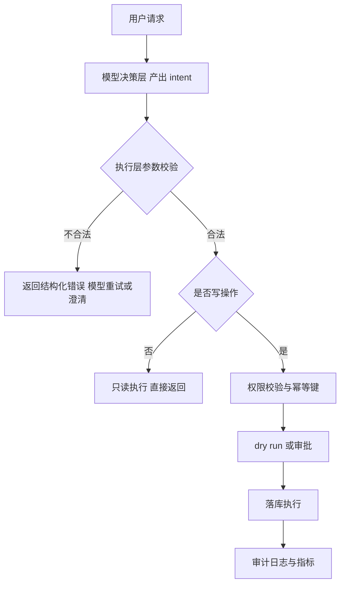

# 工具从 8 个涨到 40 个后误选与越权执行：工具准入标准、描述契约与决策执行分离怎么落地

## 为什么会有这个问题

工具是模型唯一的行动接口，但它能被正确使用的前提，完全取决于描述文本和参数 schema；而模型对语义相近的工具没有可靠的区分能力。很多团队把内部细粒度函数原样暴露（get_order / search_order / update_order_note），工具数量随业务线性增长，模型在几十个近似选项里做选择，误选和参数幻觉几乎必然发生。更危险的是把决策与执行混在一起：工具内部直接写入副作用，模型一次错误的 function call 就变成真实写操作。常见错误认知是『在 system prompt 里写清楚不要调用危险工具就行』——prompt 只是概率性约束，执行层的确定性校验才是真正的边界。

## 怎么做

1. 准入判定：只暴露意图级动作（业务动词），要求参数可枚举或可校验、结果可幂等或可补偿；不可逆且没有补偿路径的操作不直接暴露，改造成『提交申请』类工具。把多个细粒度函数合并成一个带 action 枚举的粗粒度工具，让模型做选择题而不是记忆题。
2. 描述契约：每个工具写清做什么、何时该用、何时不该用（给出负例）、参数语义与取值范围、返回结构与失败语义；同一个字段在各工具中的含义必须一致。描述里带负例能显著降低相邻工具的混淆。
3. 分层挂载：按 Agent 角色只挂 5–12 个工具，其余通过 tool retrieval 预筛或转交给子 Agent；用命名空间前缀（order.* / user.*）帮模型建立语义分组，避免同名工具互相干扰。
4. 执行层收口：模型只产出 tool_name + args 的 intent，执行层做严格 schema 校验、权限判断、预算控制、幂等键、写操作 dry-run 或审批；校验失败返回结构化错误让模型自我修正，而不是直接抛 500。
5. 度量与回归：采集工具调用分布、参数校验失败率、误选样本、人工纠正率；描述每次改动都跑固定评测集，看是否引入回退，否则改描述等于盲改 prompt。

## 关键代码

```python
from pydantic import BaseModel, Field, ValidationError
from enum import Enum

class OrderAction(str, Enum):
    query = 'query'
    cancel = 'cancel'

class OrderArgs(BaseModel):
    action: OrderAction
    order_id: str = Field(pattern=r'^SO\d{10}$')
    reason: str | None = Field(default=None, max_length=200)

WRITE_ACTIONS = {OrderAction.cancel}

def execute_tool(name: str, raw: dict, ctx) -> dict:
    if name != 'order_op':
        return {'ok': False, 'error': 'unknown_tool'}
    try:
        args = OrderArgs(**raw)
    except ValidationError as e:
        return {'ok': False, 'error': 'invalid_args', 'detail': e.errors()}
    if args.action in WRITE_ACTIONS:
        if not ctx.has_permission('order:write'):
            return {'ok': False, 'error': 'forbidden'}
        key = f'{ctx.trace_id}:{name}:{args.action}:{args.order_id}'
        if not ctx.idempotency.acquire(key):
            return {'ok': False, 'error': 'duplicate'}
        return ctx.apply(args)
    return ctx.read(args)
```

## 真实场景

某项目接入订单与售后能力后，工具从 8 个涨到 40 余个。线上出现三类症状：用户问『订单到哪了』时偶尔触发了修改备注类工具；参数里出现 schema 之外的枚举值，服务端直接 500；客户端重试导致同一个取消动作重复提交。排查路径是：先从 trace 里按 tool_name 聚合调用分布，找出被误选的高频工具对；再统计 invalid_args 的错误占比和具体出错字段；最后对比工具描述文本，发现三个订单相关工具的描述都以『订单相关操作』开头，参数名一个叫 id 一个叫 order_no。修复方向是把三个工具合并为带 action 枚举的单一工具、补负例描述、执行层加 schema 校验与幂等键。

## 示意图



## 面试官追问

1. **Q：** 工具描述改了一版，怎么证明没有引入回退？

   **A：** 把线上真实请求采样成带标注的评测集（请求 → 期望工具与关键参数），每次改描述或增删工具都跑一遍，重点看误选率和参数校验失败率两个指标；同时灰度对比转人工率和错误率。没有评测集就改描述，等于盲改 prompt，问题只会在下一个流量高峰暴露。

2. **Q：** 先查后写的两步操作怎么保证一致性？

   **A：** 不要把两步都交给模型自由编排。把『查+写』收敛成一个服务端事务型工具，或让模型只产出写意图并携带业务主键，由执行层先校验前置条件再落库；需要用户确认的写操作走确认态或审批，模型只负责发起意图，不负责决定是否最终生效。


来源：https://github.com/didilili/ai-agents-from-zero/blob/main/17-Tools%E5%B7%A5%E5%85%B7%E8%B0%83%E7%94%A8.md
