# 多 Agent 互相委派形成环：任务签名环检测、预算随链递减与降级策略

## 为什么会有这个问题

多 Agent 的委派关系是运行时由模型判断生成的，不是启动时固定的 DAG。A 认为该交给 B，B 判断信息不足又把任务踢回 A，或者任务描述被改写后重新触发上游 Agent，就会形成逻辑上的环。它比死循环更难发现：每一跳都合法、每个 Agent 都在正常工作，只有从整体 trace 看才会发现路径在重复。常见错误认知是『给每个 Agent 设 max_iterations 就够了』——计数是各自独立的，扇出叠加后总量仍然爆炸，而且环的代价是 token 和延迟，不是显式报错。

## 怎么做

1. 委派上下文强制透传：每次委派带 trace_id、delegation_path（祖先 Agent 加任务签名）、剩余预算（步数、token、时长），预算沿链递减而不是每层重置，让环在早期就耗尽预算而不是烧到全局超时。
2. 任务签名做环检测：把目标与关键约束规范化后哈希，判断 (callee, signature) 是否已出现在祖先路径上；用签名而不是原文，避免措辞漂移导致去重失效。
3. 静态加动态双层护栏：编排图启动时做拓扑校验，禁止硬编码回边；运行时设深度上限、同签名重复次数上限、全局预算，三者任一触发即中断。
4. 命中后的降级策略：不要直接抛错，而是升级到 Supervisor、用已有部分结果合成答复或转人工，并把 cycle_detected 作为一等事件打点，形成可统计的指标。
5. 可观测：trace 里用 span 的 parent 关系还原调用树，统计每层扇出、重复签名率、平均委派深度；异常会话可按 trace_id 完整回放定位断点。

## 关键代码

```python
import hashlib, json

def task_sig(goal: str, constraints: dict) -> str:
    norm = json.dumps({'goal': goal.strip(), 'c': constraints}, sort_keys=True, ensure_ascii=False)
    return hashlib.sha1(norm.encode()).hexdigest()[:12]

def delegate(parent, callee: str, goal: str, constraints: dict) -> dict:
    sig = task_sig(goal, constraints)
    path = parent.delegation_path + [(callee, sig)]
    if (callee, sig) in parent.delegation_path:
        return {'status': 'cycle_detected', 'path': path, 'action': 'escalate'}
    if len(path) > parent.limits.max_depth:
        return {'status': 'depth_exceeded', 'path': path, 'action': 'escalate'}
    child_budget = parent.budget.spend_child()
    if child_budget.remaining_steps <= 0:
        return {'status': 'budget_exhausted', 'path': path, 'action': 'summarize_partial'}
    return callee.run(goal=goal, constraints=constraints,
                      delegation_path=path, budget=child_budget,
                      trace_id=parent.trace_id)
```

## 真实场景

某项目用分诊 Agent 把会话路由到订单 Agent 与售后 Agent。上线后少量会话耗时是均值的数倍、token 消耗异常高，且最终没有有效答复。排查时按 trace_id 拉出调用树，发现『售后 → 订单 → 售后』反复出现；再看每次委派的任务描述措辞都略有不同（『请确认该订单是否已发货』对『查询该订单物流状态』），简单的字符串去重完全失效；而单 Agent 的步数上限一次都没有被触发。修复方向是把任务签名改成目标加约束的结构化摘要、预算随委派递减、命中重复签名时升级给 Supervisor 汇总已有结果。

## 示意图

```mermaid
flowchart TD
    A[Agent A 收到任务] --> B[计算任务签名]
    B --> C{签名是否已在祖先路径}
    C -->|是| D[判定为环 升级 Supervisor]
    C -->|否| E{深度与预算是否足够}
    E -->|否| F[降级 用已有结果合成答复]
    E -->|是| G[委派给下游 Agent 预算递减]
    G --> H[下游 Agent 执行]
    H --> I[写入 trace 记录 delegation path]
```



## 面试官追问

1. **Q：** 任务签名怎么设计，既不误杀合法的多轮往返，又不漏掉环？

   **A：** 签名应编码『要达成的目标加关键约束』，而不是整段自然语言。合法的往返通常目标在变化（先澄清再执行），签名会不同；环的特征是同一目标被反复重新委派。可以再叠加一个短窗口计数：同签名在最近若干跳内出现两次以上才拦截，给合法重试留余量。

2. **Q：** 为什么不能只靠全局超时兜底？

   **A：** 超时只能止损不能定位，而且环往往是慢速的：每跳都在二三十秒的合理区间内，全局超时触发时预算已经烧掉了。超时也不告诉你环发生在哪一层，排障成本很高。环检测加预算递减能在早期以很低成本拦住，并且留下可统计的事件。


来源：https://github.com/cdavid817/agent-interview/blob/main/docs/02-capabilities/multi-agent/conflict-reliability.md
