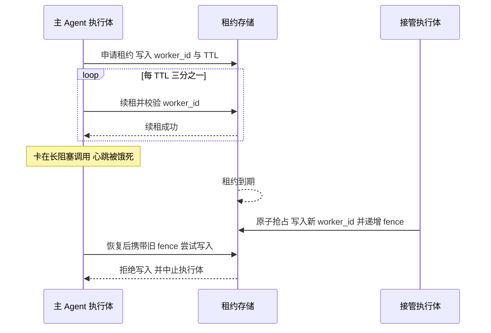

# 多 Agent 心跳超时导致的「假死」误判：如何推导阈值、保证接管互斥并用 fencing 兜底

## 为什么会有这个问题

心跳的本质是「推进能力信号」，不是「进程存活信号」。Agent 单步耗时呈现明显的长尾：一次 LLM 推理可能几十毫秒也可能几十秒，工具调用可能卡在外部 HTTP 或大文件解析，等待人工审批更是不可预估。用固定的 TTL 去判活，长尾必然被误判成假死；更危险的是误判之后的处理：多数实现直接「超时后重新派单」，而重跑并不等于接管——旧执行体可能只是被阻塞，恢复后仍会继续写状态，于是两个执行体同时推进同一个 task，产生重复下单、重复发消息、重复扣减这类不可逆副作用。常见错误认知有两个：一是把心跳当成 ping（只要进程在就发），二是认为超时之后重启任务即可（缺少互斥与写入校验，重启就是双写）。

## 怎么做

1. 把心跳从 ping 改成 progress heartbeat：每次心跳携带 step 序号、当前阶段（thinking / tool_running / waiting_human）、最近一次产出摘要。对于合法长任务要发「忙等心跳」，让观察者能区分「卡住」与「正在干长活」。
2. 阈值按阶段分别推导，不要全局一个数：统计各类阶段的耗时分位数（LLM 首 token、单个工具执行、人工审批），TTL 取 max(该阶段 p99 × 安全系数, 下限)；waiting_human 不走超时，改为显式的挂起状态并从判活范围中剔除。
3. 用租约替代超时判定：任务由 lease 持有，续租即心跳；续租失败时执行体立即自我终止（self-fence），不再写任何业务状态，而不是「再试一次」。
4. 接管互斥：抢占时必须用原子 compare-and-set 替换持有者，并把 fence 单调递增；所有下游写入都带上当前 fence，存储侧或业务侧校验并拒绝过旧 fence 的写入。
5. 把误判做成指标：统计「被判死后又重新发心跳」的次数与比例、任务重启次数、重复副作用条数；接管初期可先做影子接管（只读对账，确认旧执行体确实停滞后再写），降低误杀损失。

## 关键代码

```python
import time

LEASE_TTL = 15.0            # 由该阶段 p99 单步耗时推导，不用全局常量
RENEW_EVERY = LEASE_TTL / 3

class LeaseLost(Exception):
    pass

def renew_loop(redis, task_id, worker_id, stop_evt):
    key = f"lease:{task_id}"
    while not stop_evt.is_set():
        ok = redis.eval(
            "if redis.call('get', KEYS[1])==ARGV[1] then "
            "return redis.call('expire', KEYS[1], ARGV[2]) else return 0 end",
            1, key, worker_id, int(LEASE_TTL))
        if not ok:
            raise LeaseLost(task_id)      # 已被接管，立刻停手，不写任何状态
        stop_evt.wait(RENEW_EVERY)

def take_over(redis, task_id, new_worker):
    # 原子抢占并递增 fence，旧持有者的写入会被存储侧拒绝
    lua = ("local cur = redis.call('get', KEYS[1]) "
           "if cur then return -1 end "
           "local f = redis.call('incr', KEYS[2]) "
           "redis.call('set', KEYS[1], ARGV[1], 'EX', ARGV[2]) "
           "return f")
    return redis.eval(lua, 2, f"lease:{task_id}", f"fence:{task_id}",
                      new_worker, int(LEASE_TTL))

def write_with_fence(store, task_id, fence, payload):
    return store.cas_write(task_id, payload, min_fence=fence)
```

## 真实场景

某项目的多 Agent 编排里，子 Agent 接到一个耗时较长的外部工具（批量抓取 / 大文件解析），心跳线程与业务执行共享同一个事件循环或线程，长同步调用把心跳饿死，主控在固定阈值后判定「假死」并重新派单。随后旧执行体从阻塞中恢复继续提交结果，两个执行体都对同一资源写入，出现重复工单；而监控上「失败率」毫无变化，只有「任务重启次数」和「下游幂等冲突数」同时抬头。排查路径：先看心跳间隔分布与该阶段实际耗时分位数是否错配（错配即阈值问题，不是任务问题）；再看重启时间点是否高度集中在含长工具调用的 step 上；最后检查续租失败后是否存在「继续写」的代码路径、写接口是否根本没有 fence 或幂等键。

## 示意图



## 面试官追问

1. **Q：** 心跳发不出去，是该把 TTL 调大还是改架构？

   **A：** 先定位阻塞源。若心跳与业务在同一线程 / 事件循环，任何同步长调用都会饿死心跳，调大 TTL 只是把误判往后推，长尾一旦超过新阈值又会复发。正确做法是把心跳放到独立线程或独立进程，或改成「外部观察者轮询进度表」，让心跳不再依赖业务线程的调度机会；阈值只解决「多快发现」，架构才解决「能不能发现」。

2. **Q：** 接管之后如何保证两个执行体不会都以为自己还活着？

   **A：** 靠 fence 而不是靠时钟：持有者每次写之前校验自己的 fence 仍然是最新的，被接管后写入直接被拒并抛错中止；同时抢占必须是原子的 CAS，不能让两个接管者同时成功。若规模更大，用 etcd / Redis 做领导者选举，把「谁是当前执行体」变成全局唯一事实，而不是各进程本地判断。


来源：https://github.com/cdavid817/agent-interview/blob/main/docs/02-capabilities/multi-agent/conflict-reliability.md
