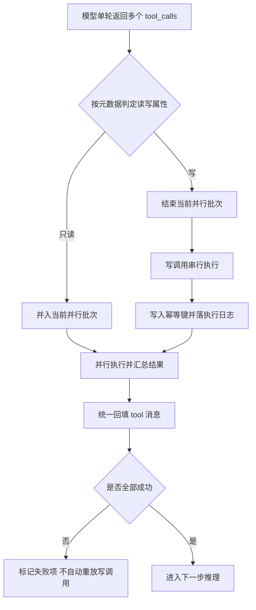

# 单轮多个 tool_calls 的隐式依赖：只读并行、写串行与幂等键如何落地

## 为什么会有这个问题

模型在一轮里返回多个 tool_calls 是为了压延迟，但它并不理解副作用顺序：create_order 与 pay_order、update 与随后的 get 校验，在模型眼里只是「同一次输出」。框架如果统一用 asyncio.gather 全部并行，写操作并发会破坏业务不变量——出现部分成功、读到中间态、同一资源被扣两次；而如果因为其中一个失败就整体重试，就会把已经成功的写再执行一遍。常见错误认知有两个：一是认为同一轮的 tool_calls 之间没有依赖（它们只是同批输出，不代表彼此独立），二是认为失败即重试（写操作天生不可盲目重放）。

## 怎么做

1. 先给工具补元数据：read_only / destructive / idempotent，并按资源维度标注（order、user、inventory）。没有显式声明的工具一律按写处理，保证缺省是安全侧。
2. 调度规则：连续的只读调用合批并行；写调用严格串行并保持模型输出顺序；写之后针对同一资源键的读必须排队到写完成之后。依赖不靠模型声明，而是由「读写属性 + 资源键」推导，模型声明的依赖只作为补充且要校验存在性，校验不过则降级为串行。
3. 写调用统一带幂等键：idempotency_key = hash(task_id, step, tool_name, normalized_args)，同一 key 的第二次调用直接返回首次结果，而不是再打一次下游。
4. 失败语义分开：只读失败可以指数退避有界重试并去重；写失败不回滚、不自动重试，把结构化错误（错误码、是否已生效、幂等键）回填给模型，让它决定下一步。
5. 可观测性：为每个 tool_call 记录 start / end、资源键、幂等键、是否命中幂等，便于定位「部分成功」；同一 step 内工具 span 时间是否重叠，本身就是并行是否越界的直接证据。

## 关键代码

```python
import asyncio

READ_ONLY = {"search_docs", "get_order", "query_stock"}

def schedule(tool_calls):
    plan, batch = [], []
    for c in tool_calls:
        if c.name in READ_ONLY:
            batch.append(c)
            continue
        if batch:
            plan.append(("parallel", batch)); batch = []
        plan.append(("serial", [c]))
    if batch:
        plan.append(("parallel", batch))
    return plan

async def run(plan, ctx):
    results = {}
    for mode, calls in plan:
        if mode == "parallel":
            done = await asyncio.gather(*(read(c, ctx) for c in calls),
                                        return_exceptions=True)
        else:
            done = [await write_idempotent(calls[0], ctx)]
        for c, r in zip(calls, done):
            results[c.id] = r      # 失败同样回填，交由模型决策而非自动重放
    return results

def key_of(task_id, step, call):
    return f"{task_id}:{step}:{call.name}:{call.args_hash()}"
```

## 真实场景

某项目为了降延迟，把 Agent 一轮内的 tool_calls 直接 gather。线上出现偶发的「订单已创建、状态仍 pending 且库存被扣两次」；trace 里同一 step 下两个写调用的 span 起始时间几乎重合，重试后问题加剧，而单请求平均延迟只改善了一点点。排查路径：按 trace 拉同一 step 内所有 tool span，看时间是否重叠、重叠的是不是写工具；查写工具是否带幂等键、命中率是否为 0；再看失败回填逻辑里是否存在「整体重试本轮」的代码路径；最后核对资源键标注，常见根因是读工具被误标成写（无谓串行）或写工具没标可写（被并行了）。

## 示意图



## 面试官追问

1. **Q：** 让模型自己在 tool_call 里声明 depends_on 靠谱吗？

   **A：** 不可靠，模型经常漏写或写错 id，而且声明本身也可能指向不存在的调用。工程上以工具元数据加资源键推导为主路径，模型声明只作为补充；一旦声明的依赖无法解析，就降级为串行而不是忽略——宁可慢一点，也不能乱序执行写。

2. **Q：** 写操作全串行会明显拖慢整体吗？

   **A：** 影响有限，因为真正的时延大头通常是只读检索与 LLM 推理。若确实存在多资源写，可以按 resource_key 分桶：桶间并行、桶内串行，既不破坏单资源不变量，也保留了并发收益。切忌为了并行把不同资源的写混在一起做全局 gather，那等于放弃顺序保证。


来源：https://github.com/didilili/ai-agents-from-zero/blob/main/17-Tools%E5%B7%A5%E5%85%B7%E8%B0%83%E7%94%A8.md
