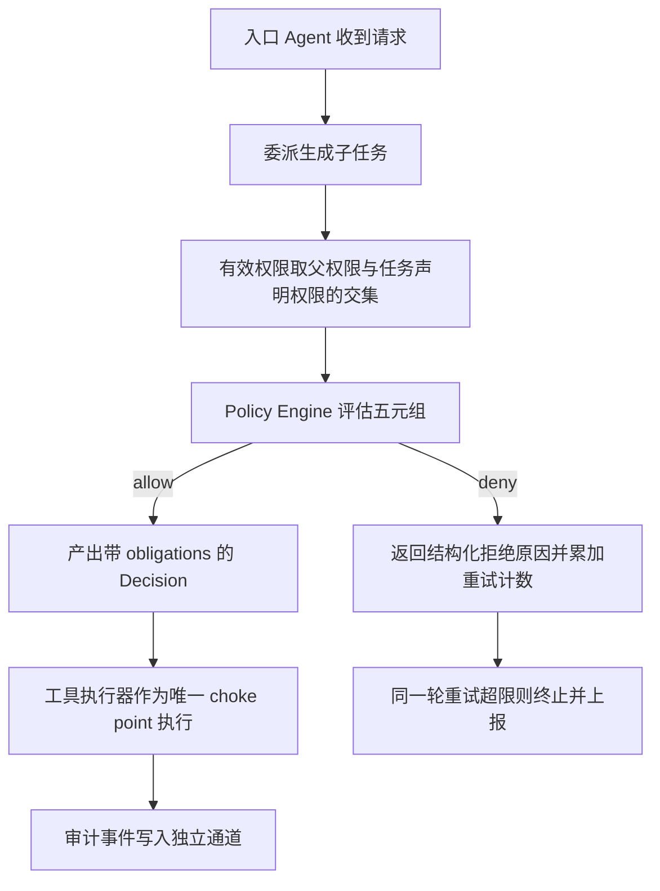

# 委派链上的权限放大：Policy Engine 的授权收敛与可回放审计怎么设计

## 为什么会有这个问题

多 Agent 系统里权限常常是按「入口身份」一次性授予的，子 Agent 在委派时直接继承甚至叠加父级 scopes，形成 ambient authority（环境权限）放大。另一个常见错误是把 Policy Engine 写成 prompt 里的一句「不要执行危险操作」，或写成散落在各个 tool 里的 if-else。这样做的后果是：决策输入没有被固化（谁发起、在哪个会话、对哪个资源、基于哪条策略），allow 无法回放，deny 无法解释；策略缓存按 agent_id 命中却忽略了参数维度；更危险的是，模型在收到 deny 之后换个参数重试，就能绕过被拒的那条路径。审计只记录 allow/deny 结果而不记录决策依据，等于出事之后查不出是哪一层委派放的行。

## 怎么做

1. 把决策输入固化成五元组：subject（含委派链）、action、resource（归一化键）、有效 scopes、policy_version。Policy Engine 做成无状态纯函数 evaluate(request) -> Decision{effect, policy_id, obligations}，模型侧不参与判定。
2. 委派时权限单调收敛：子 Agent 的有效 scopes = 父 scopes ∩ 任务声明 scopes ∩ 工具白名单，TTL 取两者最小值，随委派生成 capability token 向下传递。禁止任何形式的并集或「继承父会话全部权限」。
3. 工具执行器作为唯一 choke point：模型只能产出意图，真正执行必须过 Policy Engine。deny 返回结构化原因（缺哪个 scope、命中哪条策略）供模型自我修正，但同一 turn 内相同 (tool, args) 的重试要计数，超限直接终止并上报，防止换参试探。
4. 审计与决策解耦：审计写入走独立进程或独立 sink，Agent 只能 append 自己的 trace，不能写审计通道。审计记录决策输入 hash、policy_version、obligations 的实际执行结果（如脱敏是否生效），保证可按事件回放。
5. 缓存以 (policy_version, subject, action, resource_key) 为 key，resource_key 必须归一化（路径折叠、大小写、租户前缀）。策略热更新时整体升版本号失效；执行前用 policy_version 二次校验，版本不一致则重新评估，避免飞行中的旧决策生效。

## 关键代码

```python
from dataclasses import dataclass
from typing import Literal

@dataclass(frozen=True)
class Request:
    subject: str
    action: str
    resource: str
    scopes: frozenset
    policy_version: str

@dataclass(frozen=True)
class Decision:
    effect: Literal["allow", "deny"]
    policy_id: str
    policy_version: str
    obligations: tuple

def delegate(parent_scopes, parent_ttl, task_scopes, task_ttl, allowlist):
    return {
        "scopes": frozenset(parent_scopes) & frozenset(task_scopes) & frozenset(allowlist),
        "ttl": min(parent_ttl, task_ttl),
    }

def evaluate(req: Request, rules) -> Decision:
    for r in rules:
        if not r.match(req.action, req.resource):
            continue
        if not req.scopes >= r.required_scopes:
            return Decision("deny", r.id, req.policy_version, ("scope_insufficient",))
        return Decision("allow", r.id, req.policy_version, r.obligations)
    return Decision("deny", "default", req.policy_version, ("no_matching_policy",))

def execute(tool, args, req, rules, retry_counter):
    d = evaluate(req, rules)
    if d.effect == "deny":
        retry_counter.bump(req.subject, req.action, args)
        if retry_counter.over(req.subject, req.action, args):
            raise PermissionError("retry_exhausted")
        return {"denied": d.policy_id, "obligations": d.obligations}
    return tool.run(args, obligations=d.obligations)
```

## 真实场景

某项目的客服 Agent 上线后，被发现能调用原本只开放给运营侧的批量数据导出工具。审计日志里只有一条 allow，看不到是哪一层授权的。排查后得到两条线索：一是主 Agent 委派子任务时把父 session 的 scopes 全量透传，子 Agent 又叠加了工具白名单，实际权限是并集；二是策略缓存 key 只有 agent_id，同一个 Agent 第一次被允许导出后，后续不同资源参数全部命中缓存直接放行。修复方向：委派改为交集收敛 + capability token 带 TTL，缓存 key 加入归一化资源与 policy_version，审计补齐五元组与策略版本，并对 deny 后的重试加计数上限。

## 示意图



## 面试官追问

1. **Q：** 策略热更新时，已经生成但还没执行的 allow 决策怎么处理？

   **A：** Decision 里携带 policy_version，执行器在真正调用工具前做一次版本比对：版本不一致就重新评估，评估失败则拒绝并记录 stale_decision 指标。不要靠失效缓存来保证，因为决策可能已经在队列或另一个 Agent 手里。

2. **Q：** 如何保证审计日志不被 Agent 自己污染？

   **A：** 审计写入与 Agent 运行时物理隔离：Agent 只能写自己的 trace span，审计 sink 由独立的 sidecar 或服务消费执行器事件生成，Agent 无写权限。同时审计记录要带决策输入 hash，事后可重算比对，防止记录被篡改或缺失。


来源：https://github.com/guocong-bincai/ai-interview-guide/blob/main/docs/13-multi-agent-systems/README.md
