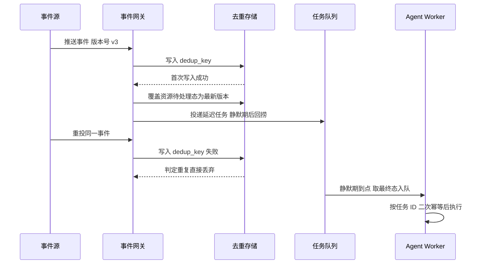

# 主动式 Agent 的事件入口：重复投递与事件风暴下如何做到不丢不重

## 为什么会有这个问题

MCP Triggers / Events 让 Agent 从被动响应变成主动感知，但事件源本身就是 at-least-once：webhook 会重投，队列会重放，文件监听会乱序。Agent 的触发不像普通消费者那样天然幂等——一次触发往往引发多次工具调用和写副作用，而且推理成本远高于一次普通的消息处理。最常见的错误认知是把「消息去重」等同于「触发去重」：一个 PR 在十分钟内推了十次，去重键各不相同，于是十次全都放行。反过来，用时间戳做去重键又会把合法的两次变更合并掉，造成丢事件。加上事件风暴时的无限堆积，最终表现为重复评论、API 限流、任务雪崩。

## 怎么做

1. 事件规范化：统一成 {source, resource_id, version, payload}，用 source + resource_id + version 构造 dedup_key，落 Redis/DB 做 SETNX 带 TTL。优先用单调递增的 version 而不是 timestamp，避免时钟与乱序问题。
2. 资源级防抖与聚合：同一 resource 在静默窗口内只保留最终态，窗口结束回捞一次；对持续高频的资源设窗口上限，超时强制 flush，防止永远等不到静默期。
3. 触发与执行解耦：事件先转成触发决策，再入队为任务，任务 ID 复用 dedup_key；worker 侧再做一次幂等检查，做到 at-least-once + 幂等 = 业务上的 effectively-once。
4. 背压与配额：按 tenant / agent 维度做令牌桶，队列水位超阈值时降级为摘要触发或直接丢弃并打点，绝不允许无限堆积。丢弃要可解释，记录 dropped 原因。
5. 可观测：trace 从 event_id 贯穿到工具调用；分别统计 duplicate、debounced、dropped、executed 四类计数，用这些比例反过来调窗口与配额，而不是拍脑袋定参数。

## 关键代码

```python
import hashlib, time

def dedup_key(event) -> str:
    raw = f"{event.source}:{event.resource_id}:{event.version}"
    return hashlib.sha1(raw.encode()).hexdigest()

async def on_event(event, store, queue, window=30.0):
    if not await store.setnx(dedup_key(event), 1, ttl=86400):
        return "duplicate"
    await store.upsert_pending(event.resource_id, event, ttl=window * 4)
    await queue.enqueue_delayed(
        task_id=f"flush:{event.resource_id}:{int(event.ts // window)}",
        delay=window,
        payload={"resource_id": event.resource_id},
    )
    return "accepted"

async def flush(resource_id, store, queue):
    event = await store.pop_pending(resource_id)
    if event is None:
        return "noop"
    await queue.enqueue(task_id=f"run:{dedup_key(event)}", payload=event.payload)
    return "enqueued"

async def worker(task, agent):
    if await task.store.seen(task.task_id):
        return "skip"
    await task.store.mark(task.task_id)
    return await agent.run(task.payload)
```

## 真实场景

某项目接了代码仓库 webhook 来触发代码评审 Agent。凌晨一次批量 rebase 造成事件风暴，同一分支短时间内涌入大量 push 事件，去重键各不同，Agent 为同一分支起了几十个评审任务，重复刷评论并撞上模型 API 限流；同时有用户反馈部分变更没有触发评审，排查发现去重键里用了 timestamp，同一秒内的两次不同变更被误判为重复丢弃。修复路径：去重键换成 version、加资源级静默窗口聚合、入队任务 ID 复用 dedup_key、worker 二次幂等，并在网关加租户令牌桶与 dropped 打点。

## 示意图



## 面试官追问

1. **Q：** 静默窗口设多长，依据什么定？

   **A：** 按资源的自然收敛时间和事件间隔分布来定：观察同一 resource 的 P95 事件间隔，窗口取略大于该值，并设置窗口上限兜底长尾。上线后看 debounced 与 dropped 的比例以及「用户感知延迟」两个指标互相校正，不要一次拍死。

2. **Q：** 事件乱序或者版本回退时怎么处理？

   **A：** 用 version 单调比较：低于资源已处理版本的直接丢弃并计数 stale_event；无法比较版本的源，在资源维度维护状态机，只接受合法的状态跃迁，非法跃迁记录并告警，避免用「最后到达者胜出」这种隐式规则。


来源：https://github.com/guocong-bincai/ai-interview-guide/blob/main/docs/14-mcp-skill-systems/README.md
