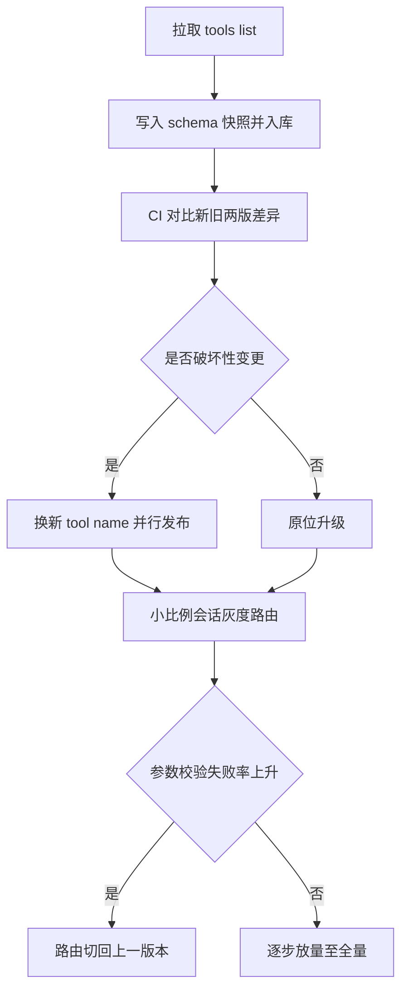

# MCP Server 独立发版后工具 schema 漂移：Registry 升级把线上 Agent 批量打挂，如何做契约兼容与快速止血

## 为什么会有这个问题

MCP 把工具能力外置成独立服务后，Server 的发版节奏和 Agent 的解耦了，但 Agent 侧真正依赖的是 tools/list 返回的 name、description、inputSchema 三件套。现实中 Server 发版常顺手改字段名、把可选字段改成必填、收窄枚举或改返回结构，而 Agent 侧要么在会话开始时拉一次工具清单并长缓存（甚至写进 prompt cache），要么按 tool name 做本地路由表，根本没有版本语义可以感知变化。常见错误认知是「Registry 里写了版本号就安全」——实际客户端多数按 name 拉 latest，或者 pin 了 Server 版本却没 pin 工具契约，模型看到的仍是旧描述、生成的仍是旧参数，执行层直接校验失败。更糟的是失败被当成「模型不会用工具」，于是加 prompt、加 few-shot，把问题越掩盖越深。

## 怎么做

1. 把工具契约变成可 diff 的 artifact：每次发布前抓 tools/list 快照存进 git，CI 对新旧快照做结构化 diff，并把差异分级（必填新增、枚举收窄、类型变更、字段重命名为 breaking；可选字段新增、枚举扩展、返回字段新增为非 breaking），breaking 未声明就直接卡发布。
2. 运行时显式寻址 + 版本锁：工具引用写成 server@version#tool=name 的形式，禁止隐式 latest；同时保证 N-1 版本与 N 版本并行可路由，为蓝绿/回滚留出物理条件。
3. 执行层强校验替代模型自觉：tool call 前用 JSON Schema / pydantic 校验 arguments，失败第一次把校验错误回灌给模型做一次自愈重试，第二次仍失败则抛结构化错误并降级（走兜底工具或转人工），避免重试风暴。
4. 按版本灰度放量：新版本先路由到小比例会话，观测 tool_call 失败率、参数校验失败率、平均重试轮次、任务完成率四个指标，任何一项劣化立即把路由切回 N-1。
5. 发布纪律写进规范：破坏性变更必须换 tool name（search → search_v2）而不是原地改，让模型描述和路由表都能区分；字段只增不删，必填只能从「有默认值的可选字段」升级而来。

## 关键代码

```python
import math
from jsonschema import Draft202012Validator

def diff_tools(old, new):
    issues = []
    for name, nt in new.items():
        ot = old.get(name)
        if ot is None:
            issues.append(f'added_tool:{name}')
            continue
        o, n = ot['inputSchema'], nt['inputSchema']
        added = set(n.get('required', [])) - set(o.get('required', []))
        if added:
            issues.append(f'required_added:{name}:{sorted(added)}')
        for k, nv in n.get('properties', {}).items():
            ov = o.get('properties', {}).get(k, {})
            if ov.get('enum') and set(nv.get('enum', [])) < set(ov['enum']):
                issues.append(f'enum_narrowed:{name}.{k}')
            if ov.get('type') and nv.get('type') != ov['type']:
                issues.append(f'type_changed:{name}.{k}')
    return issues

def call_tool(registry, tool_ref, args, retries=0):
    version, name = tool_ref.split('#tool=')
    schema = registry.schema(version, name)
    errs = [e.message for e in Draft202012Validator(schema['inputSchema']).iter_errors(args)]
    if errs and retries < 1:
        return registry.reask(name, errs)
    if errs:
        raise ToolContractError(tool_ref, errs)
    return registry.invoke(version, name, args)
```

## 真实场景

某项目把知识检索类 MCP Server 从 1.3 升到 1.4，把 query 字段改名为 q，并新增必填的 scope。Agent 侧工具清单有十分钟 TTL 缓存，prompt 里还是旧描述。发布后短时间内 tool_call 失败率明显跳升，日志里集中出现 'scope' is a required property 与 unknown field query，模型重试一到两轮后开始绕开工具、凭记忆直接作答，用户看到的症状是「答得挺顺但引用了不存在的文档」。排查路径：先按 tool name 与 server 版本二维打点，定位失败集中在单一 Server 的新版本 → 取出两版 tools/list 快照做 diff，确认是 breaking 变更 → 路由整体切回 1.3 止血 → 事后改成版本显式寻址 + 蓝绿并行，并把 schema diff 加进 CI 门禁。

## 示意图



## 面试官追问

1. **Q：** 为什么不让模型自己适配新 schema，非要客户端做校验和版本路由？

   **A：** 模型每次会话只看到一次工具描述，长尾会话仍跑在旧描述上，而且工具多时描述本身占大量 token，不可能频繁刷新；依赖模型自愈会带来重试放大、延迟上升和偶发的「假装调用成功」。执行层校验是确定性的，能立刻把问题变成可观测的失败率指标，而版本路由是唯一能在分钟级止血的手段。

2. **Q：** 你用什么标准判定一次 schema 变更是 breaking？

   **A：** 用「旧客户端按旧 schema 生成的合法参数，在新 schema 下是否仍然合法且语义不变」来判定：必填字段增加、枚举收窄、类型变更、字段重命名、返回结构删字段都算 breaking；可选字段新增、枚举扩展、返回字段新增、描述文案调整不算。无法判断语义是否变化时，一律按 breaking 处理，换新 tool name 并行发布。


来源：https://github.com/guocong-bincai/ai-interview-guide/blob/main/docs/14-mcp-skill-systems/README.md
