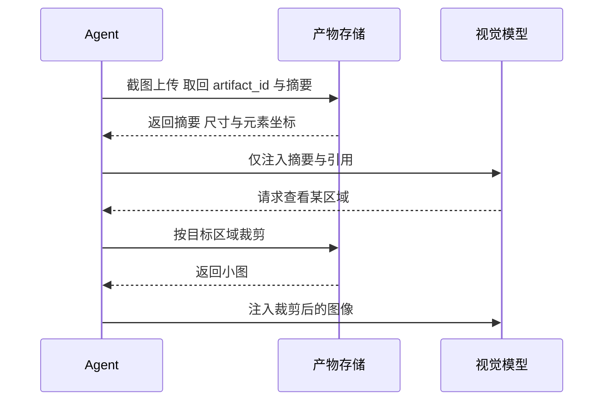

# 多模态 Agent 把截图原样塞进上下文：视觉 token 膨胀、历史重放与分辨率取舍怎么治

## 为什么会有这个问题

VLM 的图像成本不是常数，而是由分辨率与切块策略决定（切块数乘以每块 token，再加基础开销），同一张图在不同 provider 上可能差出数倍。真实痛点是 Agent 多轮循环里每一步都产生新截图，而多数实现是直接把图片 base64 append 进 messages 且从不裁剪历史，于是每一轮都把全部历史图像重新送一遍，token 随轮次近似平方增长，延迟和费用同步放大，最终撞上下文上限。更隐蔽的问题是盲目压缩：把整图等比缩小后小字、图标、禁用态读不出来，模型「看到但读不准」，表现为参数编造或反复点同一个位置。常见错误认知是「一张图就是一次性的固定成本」，以及「降分辨率总是省钱的」——实际上裁剪比缩放更省也更准。

## 怎么做

1. 先量化再优化：按 provider 的图像计费规则写一个估算函数（宽高、切块大小、每块 token），给每个会话设 image_token_budget，超出即拒绝注入新图或强制压缩，把预算变成硬约束而不是事后看账单。
2. 把图像从消息体里挪出去做 artifact：工具产出的截图落到对象存储，返回 artifact_id 加尺寸元数据和 OCR/结构摘要；默认进上下文的是摘要与引用，模型需要细节时再通过 view_artifact 主动取图。
3. 按任务选表示层级：文字密集的表格、表单用高分辨率加区域裁剪（先定位目标 bounding box 再裁，token 少且识别准）；布局与场景理解用低分辨率整图；不要用整图缩放代替裁剪。
4. 历史压缩：轮次结束后把图像替换成带 id 的文本占位，仅保留最近一到两张原图，保证可回溯但不再重复计费。
5. 监控四个指标：每会话 image token 占比、上下文占用率峰值、因超限触发的截断或重试次数、含图会话的任务完成率与纯文本会话的差值；用任务完成率而不是「接口有没有报错」来判断压缩是否伤精度。

## 关键代码

```python
import math

def est_image_tokens(w, h, tile=512, base=85, per_tile=170):
    return base + per_tile * math.ceil(w / tile) * math.ceil(h / tile)

def fit_image(w, h, budget, min_side=768):
    if est_image_tokens(w, h) <= budget:
        return w, h
    scale = 1.0
    while w * scale > min_side and est_image_tokens(int(w * scale), int(h * scale)) > budget:
        scale -= 0.1
    return int(w * scale), int(h * scale)

def compact_history(messages, keep_last_images=1):
    seen = 0
    for m in reversed(messages):
        content = m.get('content') or []
        for i, part in enumerate(content):
            if part.get('type') != 'image':
                continue
            seen += 1
            if seen > keep_last_images:
                content[i] = {'type': 'text',
                              'text': f"[img#{part.get('artifact_id')} 已折叠，需要细节时调用 view_artifact]"}
    return messages
```

## 真实场景

某项目做浏览器操作 Agent，每一步用整页截图作为观测。典型现象：任务前期正常，到第六到第八步开始明显变慢、单任务成本陡增，第十步左右报上下文超限；而在报错前的一两步，模型开始重复点击同一位置或编造按钮文案，因为图像被上游压缩后小字已不可读。排查路径：按轮次打点 prompt token 中 image 占比，发现图像占了大头且每轮随历史线性叠加 → 关闭历史图像重放，改为摘要加引用，仅保留最近一张原图 → 把点击前的观测从整页截图改为按候选元素裁剪 → 单任务步数、token 与耗时同时回落，关键字段识别准确率反而上升。

## 示意图



## 面试官追问

1. **Q：** 既然图像这么贵，为什么不干脆只把 OCR 文本给模型？

   **A：** OCR 丢掉了布局、图标、颜色状态（禁用、报错、选中）和相对位置，在 UI 定位与表单校验这类任务上精度明显下降，而且视觉模型对坐标的推理依赖图像本身。正确做法是分层：默认给结构化摘要与元素坐标文本，留一个 view_artifact 让模型在不确定时主动请求裁剪图，把图像成本花在真正需要看的局部。

2. **Q：** 怎么证明降分辨率或裁剪没有伤害准确率？

   **A：** 离线构造带标注的关键区域集（含小字、密集表格、灰色禁用按钮），对每一档分辨率与裁剪策略跑端到端任务成功率与关键字段抽取准确率，画出分辨率到成功率的曲线找拐点，拐点以下不采用；线上用 A/B 看任务完成率与平均步数，而不是只看单次调用有没有异常。


来源：https://github.com/guocong-bincai/ai-interview-guide/blob/main/docs/21-multimodal-agents/README.md
