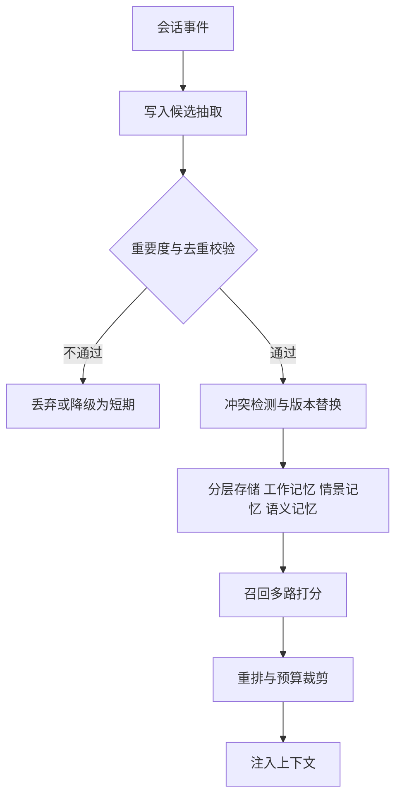

# Agent 长期记忆越用越蠢：写入噪声、召回污染与遗忘策略怎么治

## 为什么会有这个问题

很多团队把 Memory 理解成“把对话 append 进向量库”，结果记忆只增不减：一次性闲聊、过期偏好、重复摘要全被写入，召回时又只按向量相似度取 top-k，最终无关记忆挤占上下文、旧事实覆盖新事实，模型表现随使用时长下降。Memory 的难点不在存，而在写入准入、冲突消解、分层 TTL 与召回预算控制；只加向量库不解决污染，反而放大成本与延迟。

## 怎么做

1. 先分层：working memory 只保留当前任务槽位；episode 存带时间戳的交互摘要；semantic 存实体-属性-值事实。三类分开 TTL、召回权重与存储，禁止全部塞进同一向量集合。
2. 写入前置闸门：候选记忆先过重要度阈值、去重相似度、敏感信息过滤；episode 设更高阈值，避免把寒暄写进长期库。抽取时保留 provenance（会话 id、来源消息），便于回溯和按用户删除。
3. 冲突消解：semantic 记忆以 entity+attribute 为唯一键，新值写入时把旧值置为 superseded 而非物理删除；召回只取 active 版本，保留变更历史用于审计。
4. 召回打分融合 relevance、importance、recency，再按 token 预算裁剪；低于相关性阈值的不注入，防止无关记忆稀释当前指令。
5. 评估与淘汰：离线看 recall@k 与端到端答案正确率，线上做“关闭长期记忆”的 A/B；定期把低频 episode 压缩成摘要，用 TTL 淘汰，监控记忆注入 token 占比与采纳率。

## 关键代码

```python
import time
from dataclasses import dataclass

@dataclass
class Mem:
    text: str
    kind: str
    importance: float
    created_at: float
    ttl: float | None = None
    active: bool = True

def admit(cand, existing, sim, min_imp=0.55, dup=0.92):
    if cand.importance < min_imp:
        return None
    if cand.kind == 'episode' and cand.importance < 0.7:
        return None
    for e in existing:
        if e.active and sim(cand.text, e.text) > dup:
            return None
    return cand

def recall(qvec, items, embed, cosine, now=None, k=5):
    now = now or time.time()
    out = []
    for m in items:
        if not m.active:
            continue
        if m.ttl and now - m.created_at > m.ttl:
            continue
        rel = cosine(qvec, embed(m.text))
        if rel < 0.35:
            continue
        rec = 0.5 ** ((now - m.created_at) / 86400 / 30)
        score = 0.62 * rel + 0.23 * m.importance + 0.15 * rec
        out.append((score, m))
    out.sort(key=lambda x: -x[0])
    return [m for _, m in out[:k]]
```

## 真实场景

某项目 Agent 上线两个月后用户反馈“它记得乱七八糟的偏好”，同时首 token 延迟上升、context token 持续增长。抽样被召回的记忆发现：同一偏好有多个措辞重复条目、旧偏好没有失效、一次性闲聊被写成长期记忆，且注入的记忆 token 占比明显上升。排查路径是先把召回结果按来源和写入时间分组，统计重复率与过期率，再回看写入日志确认闸门缺失；修复后改为分层存储、写入去重和 entity+attribute 版本替换，并加召回预算裁剪。

## 示意图



## 面试官追问

1. **Q：** 用户说“以后都用中文回答”，这类偏好和临时指令怎么区分？

   **A：** 偏好写入 semantic memory，带 scope（全局/项目/会话）与 source；临时指令只进 working memory。召回时按 scope 过滤，冲突时项目级覆盖全局级，会话级指令默认不落长期库。

2. **Q：** 记忆删除与合规怎么做？

   **A：** 每条记忆带 subject_id 与 provenance，支持按用户/会话级联删除；向量库与原文库双删，删除走异步任务并记录墓碑，防止重建索引时复活。


来源：https://github.com/guocong-bincai/ai-interview-guide/blob/main/docs/22-agent-planning-reflection/README.md
