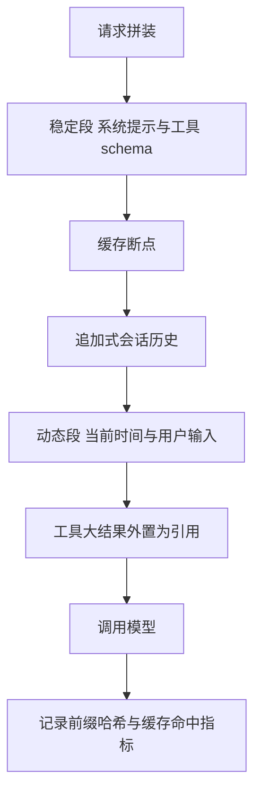

# Prompt Caching 命中率骤降：上下文拼装顺序与工具大结果外置怎么改

## 为什么会有这个问题

Prompt Caching 按前缀逐字节匹配，只有稳定前缀完全一致才命中；很多实现把当前时间、用户额度、随机 id 拼进 system，或工具 schema 由未排序 dict 序列化，导致每轮前缀都变，缓存写入有溢价却几乎不命中。另一个常见错误是让 MCP 工具返回的大 JSON 原样进历史，后续每轮重复计费并挤占上下文。缓存不是打开开关就省钱，它依赖上下文拼装纪律。

## 怎么做

1. 给每次请求算稳定前缀哈希（system、工具 schema、few-shot、历史），日志记录 prefix_hash 与 cache_read/cache_creation token；采样两轮请求做首个差异位置 diff，定位是谁在污染前缀。
2. 重排上下文：静态 system 与工具定义放最前，工具按 name 稳定排序；历史 append-only；当前时间、用户配额、随机 id 等动态字段后置到 user 消息；会话中不改 system。
3. 在稳定段末尾设置 cache breakpoint（按 provider 支持），保证断点前内容逐字节一致；工具 schema 走规范化 JSON 序列化，避免 dict 顺序漂移。
4. 工具大结果外置：超过阈值（如 8KB）落对象存储，上下文只放摘要、句柄与关键字段；需要细节时通过单独的 fetch 工具按行号/JSONPath 取片段。
5. 监控缓存命中率与单位请求成本并设回归告警；多租户场景缓存键要带 tenant，防止跨租户复用与数据泄露。

## 关键代码

```python
from hashlib import sha256

def render_tools(tools):
    return '\n'.join(f"{t['name']}: {t['description']}" for t in tools)

def build_prompt(system_static, tool_schemas, history, user_input):
    tools = sorted(tool_schemas, key=lambda t: t['name'])
    msgs = [
        {'role': 'system', 'content': system_static},
        {'role': 'system', 'content': render_tools(tools)},
    ]
    msgs.extend(history)
    msgs.append({'role': 'user', 'content': user_input})
    return msgs

def compact_tool_result(text, store, limit=8000):
    if len(text) <= limit:
        return text
    key = sha256(text.encode()).hexdigest()[:16]
    store.put(key, text)
    head = text[:limit]
    return f'ref={key} total={len(text)}\n{head}'

def log_prefix_hash(msgs):
    blob = ''.join(m['content'] for m in msgs)
    return sha256(blob.encode()).hexdigest()[:12]
```

## 真实场景

某项目接入 Prompt Caching 后账单没有下降，p50 延迟反而上升，监控里 cache_read_input_tokens 长期接近于零。抓两轮请求体做 diff，发现 system 中拼了当前时间和用户额度，工具 schema 每次由未排序 dict 序列化；另有一个 MCP 工具返回大 JSON 直接进历史，后续每轮重复计费。排查路径是记录 prefix_hash、定位首个差异字节、改上下文顺序并规范化 schema，同时把大结果外置为句柄，命中率恢复后单位请求成本才下降。

## 示意图



## 面试官追问

1. **Q：** 外置后模型需要看完整结果怎么办？

   **A：** 增加 fetch 工具，用 handle + 行号/JSONPath 分段读取，单次返回有上限；对高频小结果不落盘，设阈值和命中统计，避免为省 token 增加一轮工具调用。

2. **Q：** 缓存写入有溢价，怎么判断值不值？

   **A：** 按 cache_creation 与 cache_read 的单价和 TTL 算盈亏平衡次数；长 system、多轮工具调用场景收益明显，短会话或前缀不稳定时关闭。用 prefix_hash 命中率和单位请求成本做灰度对照。


来源：https://github.com/guocong-bincai/ai-interview-guide/blob/main/docs/12-frameworks-tools/README.md
