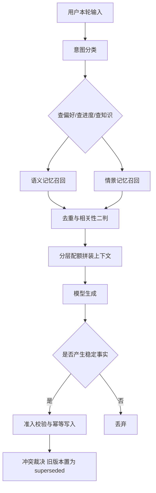

# Memory 检索预算被长会话吃穿：召回窗口、压缩与写回时机怎么权衡

## 为什么会有这个问题

Agent 的 Memory 常被误当成「把历史都塞进向量库就行」，真实工程里它同时受三方面挤压：一是 token 预算固定而会话轮次线性增长，召回条目与系统提示、工具结果争抢同一窗口；二是写入端没有准入标准，模型随手生成的总结、失败的工具调用残留、用户的口误全被固化，后续召回被这些噪声占满；三是召回端用同一套 top-k 应对所有问题，导致「查偏好」拿到一堆流程日志，「查进度」却只拿到闲聊。更隐蔽的是写入时机：多数实现让 Agent 在每轮结束时异步总结，若总结任务与主流程共享同一份上下文快照，重试或并发会让同一事实写入多份互相矛盾的版本，召回时冲突无人裁决。

## 怎么做

1. 先给 Memory 分层并明确各层的预算上限：工作记忆（当前会话窗口，按 token 硬上限计算，如占模型窗口的 60%）、情景记忆（会话摘要 + 关键事件，按条数与字节双限）、语义记忆（用户偏好、稳定事实，条数少但要求高置信）。每层独立配额，任一层的溢出不得挤占其它层。
2. 写入端做准入闸门：只有满足「事实性、稳定性、可复用」三条的内容才允许持久化；工具原始返回、报错堆栈、模型臆测统一丢弃。写入前做实体与谓词归一化（如把「喜欢简短回答」「回复要短一点」归到同一 key），用 (entity, predicate) 做幂等键，冲突时按时间戳 + 来源可信度裁决，旧版本置为 superseded 而不是删除。
3. 召回端改成按意图路由的多路召回，而不是固定 top-k：先用一个轻量分类（或规则）判断本轮是查偏好、查历史进度、还是查外部知识，各路使用不同的检索器与配额；召回结果必须过一次重排与去重，再做「与当前问题是否相关」的 LLM 二判，剔除噪声后再拼进上下文，且拼装顺序固定（稳定事实在前、易变状态在后）以保住前缀缓存。
4. 压缩策略要在会话内周期性触发而不是等到超窗报错：保留最近 N 轮原文 + 一份滚动摘要，摘要只写决策、结论、未完成事项与用户明确约束，不写过程；摘要本身标记为派生数据，可重算，避免成为不可回滚的污染源。
5. 设置可观测指标并设回归用例：记录每次召回的命中率（召回条目被模型实际引用）、噪声率（被判不相关而丢弃的比例）、每轮平均 memory token 占比、冲突裁决次数。用一组固定脚本会话做回归，改动写入或召回策略后重跑，比较答案正确率与 token 成本。

## 关键代码

```python
def build_context(user_query, session, mem_store):
    kind = classify_intent(user_query)
    routes = {
        "preference": ("semantic", 5),
        "progress":   ("episodic", 3),
        "fact":       ("semantic", 3),
    }
    layer, k = routes.get(kind, ("episodic", 3))

    cands = mem_store.search(layer, user_query, top_k=k * 3, status="active")
    cands = dedup_by_key(cands)
    kept = [c for c in cands if judge_relevant(user_query, c)][:k]

    stable = [c for c in kept if c["layer"] == "semantic"]
    volatile = [c for c in kept if c["layer"] != "semantic"]
    recent = session.recent_turns(n=3)
    summary = session.rolling_summary()

    return assemble(system=session.system_prompt,
                    facts=stable,
                    state=summary,
                    turns=recent,
                    volatile=volatile,
                    budget=session.token_budget)

def maybe_write(session, fact, source):
    if not is_stable_fact(fact):
        return
    key = normalize(fact)
    old = mem_store.get(key)
    if old and old["value"] == fact.value:
        return
    mem_store.upsert(key, fact.value, source=source,
                     supersedes=old["id"] if old else None)
```

## 真实场景

某项目把 Agent 的 Memory 直接接到向量库，写入端每轮自动总结、召回端固定 top-8。上线一个月后出现典型症状：会话到第 15 轮左右开始答非所问，用户重复说过的偏好在被纠正后仍然出现旧版本；同一批回归用例上，memory 相关 token 占比从十二三成涨到占满上下文，首字延迟明显上升，但人工抽查发现召回的条目大半和当前问题无关。排查路径：先按层拆分 token 占比，确认是情景记忆无限膨胀而非系统提示变长；再抽样 50 条写入记录，发现大量工具原始返回与失败调用被总结成「用户希望重试」这类伪事实；最后复现出冲突场景——同一 key 存在三条不同值的 active 记录，检索时按向量相似度取到了旧的那条。改为分层配额 + 写入准入 + 按意图路由召回后，无关召回比例与每轮 memory token 都明显下降，纠正后的偏好能稳定生效。

## 示意图



## 面试官追问

1. **Q：** 滚动摘要和原始对话冲突时，模型该信哪一个？你怎么在上下文里表达这种优先级？

   **A：** 优先原始近期对话，摘要是派生数据、只作背景。实现上在拼装时给两类内容加显式区段标题（如「以下是较早会话的摘要，可能不完整」与「以下是最近的实际对话」），并在系统提示里声明冲突时的取值顺序；同时对摘要里提到的关键结论保留原文引用（消息 id 或时间戳），当模型引用摘要结论时可回溯到原始消息校验。若摘要与原文矛盾且影响到最终答案，则触发一次轻量重算，用原始消息重建摘要而不是让模型自行调和。

2. **Q：** 如果为了省 token 把 memory 检索做成异步预取，会不会引入「用了上一轮上下文」的错误？

   **A：** 会，这是典型的时序错配。关键在于区分「与当前 query 无关、可预取的稳定层」和「必须依赖当前 query 的召回」：语义记忆中的用户画像、权限、长期偏好在会话开始即可一次性载入，属于可预取部分；而意图相关的召回必须在本轮 query 确定后同步执行。预取结果要打上 session 版本号，若本轮已经发生写入导致版本前进，则丢弃预取结果回退到同步召回，宁可多一次检索延迟也不要答错。


来源：https://github.com/guocong-bincai/ai-interview-guide/blob/main/docs/22-agent-planning-reflection/README.md
