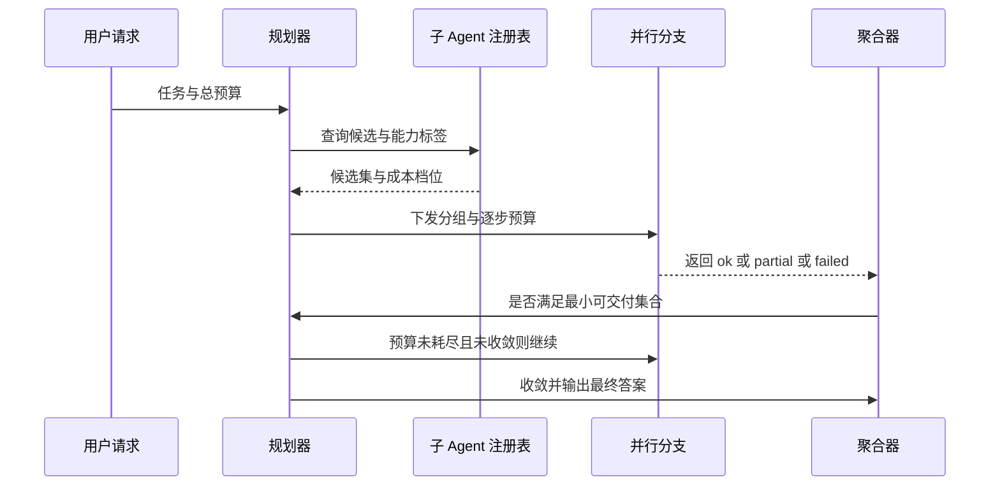

# 运行时动态编排的 Agent 花在选择上：路由漂移、并行收益与预算回收怎么控

## 为什么会有这个问题

固定拓扑的多 Agent 容易调，但覆盖不了任务复杂度差异巨大的流量，于是很多团队引入运行时动态编排：由一个规划器在每一步决定调用哪个子 Agent、串行还是并行、要不要追加一轮。问题随之而来。第一，路由决策本身是不稳定的——同一输入在不同时刻可能被分到不同子 Agent，温度、工具描述微调、上下文顺序变化都会让分布漂移，线上表现为「同样的工单昨天走两个 Agent，今天走五个」。第二，规划器只看语义不看预算，容易把可并行的子任务串行化，或在已经拿到足够信息后继续追加验证轮，延迟与成本随步数指数式放大。第三，并行分支的失败语义不统一：一个分支超时到底算整体失败还是降级返回部分结果，没有约定就会出现半成品答案被当成完整答案输出。第四，动态拓扑让 trace 无法对齐，出了问题只能看到一串无层级的调用，无法归因到是哪次路由决策导致的劣化。

## 怎么做

1. 把「动态」限制在可控空间里：预先声明可用的子 Agent 集合、每个 Agent 的能力标签、输入输出契约与成本档位（模型、平均 token、典型耗时），规划器只能在这个注册表里做选择，不能凭空生成新角色。路由决策输出结构化对象（agent_id、并行分组、预算上限），而不是自由文本。
2. 给每次编排设总预算与逐步预算：总预算按 token 与 wall-clock 双维度设上限，每进入一步先扣减；当剩余预算低于某个比例时，规划器被强制切换到「收敛模式」（只允许调用最快的 Agent 或直接由主模型作答）。并行分组要有扇出上限，避免一个分组把全部 Agent 拉起来。
3. 统一并行分支的失败语义：把分支结果建模为 ok / partial / failed 三态并携带置信与缺失字段；聚合器按契约判断是否满足最小可交付集合，不满足则降级为「说明缺失 + 给出部分结论」，绝不把 partial 当 ok 输出。超时分支不阻塞已经完成的分支，但要在答案里显式标注未完成部分。
4. 把路由决策变成可评估对象：为编排过程记录每一步的输入摘要、候选集、被选中的 Agent、理由、实际耗时与产出质量。用离线回放 + 小流量灰度对比「动态编排」与「固定拓扑」的成功率、P95 延迟、单任务成本三条线，任何一条显著劣化就回退。判据写死，不靠感觉。
5. 引入决策稳定性约束：对同一输入的重复请求，在同样的上下文下应尽量得到同样的路由；可通过降低规划温度、对候选集排序取确定性 top-1、以及对路由结果做缓存（以任务特征指纹为 key，带 TTL）来实现。漂移检测用路由分布的散度指标，超出阈值即告警。
6. 治理 trace：给每次编排分配 orchestration_id，每一步的 span 上带 orchestration_id + step_index + agent_id + 并行分组号，让同一棵调用树可在追踪系统里完整还原，出问题时能直接定位到「在哪一步、由谁决定、为什么」。

## 关键代码

```python
REGISTRY = {
    "researcher": {"tags": ["search"], "cost": 2, "p95_ms": 4000, "fanout_ok": True},
    "coder":      {"tags": ["code"],   "cost": 3, "p95_ms": 9000, "fanout_ok": False},
    "critic":     {"tags": ["review"], "cost": 1, "p95_ms": 2500, "fanout_ok": True},
}

def orchestrate(task, budget):
    steps, trace = [], []
    while budget.left_tokens > budget.floor and len(steps) < budget.max_steps:
        plan = planner(task, steps, REGISTRY, budget, temperature=0.0)
        groups = plan["groups"]
        for g in groups:
            agents = [a for a in g["agents"] if budget.can_afford(REGISTRY[a]["cost"])]
            if len(agents) > 1 and not all(REGISTRY[a]["fanout_ok"] for a in agents):
                agents = agents[:1]
            results = run_parallel(agents, g["task"]) if len(agents) > 1 else [run_one(agents[0], g["task"])]
            for r in results:
                r.state = classify(r) if r.state is None else r.state
                budget.charge(r.cost)
                trace.append({"step": len(steps), "agent": r.agent, "state": r.state,
                              "latency_ms": r.latency_ms})
            steps.append({"task": g["task"], "results": results})
        if should_stop(steps):
            break
    return aggregate(steps, trace), trace

def aggregate(steps, trace):
    if not meets_min_contract(steps):
        return {"answer": best_partial(steps), "partial": True, "missing": what_missing(steps)}
    return {"answer": compose(steps), "partial": False}
```

## 真实场景

某项目把工单处理 Agent 从固定流水线改成运行时动态编排，规划器可自选调研、写代码、评审三类子 Agent，并行分组自由决定。上线后出现几类典型现象：同一类工单的调用步数方差很大，简单工单偶尔被拆成六七步，P95 延迟翻倍；部分请求返回的答案只覆盖了工单的一半，追问后才发现某个并行分支超时被吞掉，聚合器当作成功处理；成本侧按天看总量尚可，但个别租户的单个任务成本极高，定位时发现规划器在已经拿到结论后仍追加了两轮评审。排查路径：先在 trace 里按 orchestration_id 还原调用树，确认步数膨胀集中在「评审」分支反复被选中的场景；再把历史请求离线回放，对比固定拓扑与动态编排的成功率与 P95，发现动态编排在简单任务上收益为负；最后核对聚合逻辑，确认分支失败态只有一个布尔值，partial 结果被误判为 ok。补齐注册表约束、预算回收与三态聚合后，步数方差与成本长尾收敛。

## 示意图



## 面试官追问

1. **Q：** 怎么判断动态编排带来的质量提升是真实的，而不是聚合器把更多分支内容拼进答案带来的「看起来更全」？

   **A：** 把评估拆成「结论正确性」和「覆盖完整性」两个独立维度，并且用不依赖字面长度的判据：结论正确性用带标准答案集的离线评测（对关键字段做精确匹配或规则校验），覆盖完整性用「必须回答的子问题清单」逐项勾选。同时做一个反事实对照——把动态编排的多分支输出交给同一个聚合器合成，与固定拓扑的单分支输出做同条件比较，若两者在正确性上无差异，说明收益来自拼装而非编排本身。另外抽样人工盲评，隐藏来源标签，避免评审者被答案长度误导。

2. **Q：** 如果规划器在收敛模式下仍被允许调用子 Agent，预算控制是不是形同虚设？

   **A：** 是，收敛模式必须改变的是「可选项集合」而不是「建议」。实现上把预算水位映射为能力白名单：预算充足时白名单包含全部 Agent，低于阈值时白名单收敛为最快的一到两个，耗尽时白名单为空、强制主模型直答。规划器的输出要在这个白名单上做交集校验，越界直接拒绝并重新规划一次，第二次仍越界则走兜底路径。这样预算约束是硬边界的，而不是提示词里的软性建议。


来源：https://github.com/guocong-bincai/ai-interview-guide/blob/main/docs/13-multi-agent-systems/README.md
