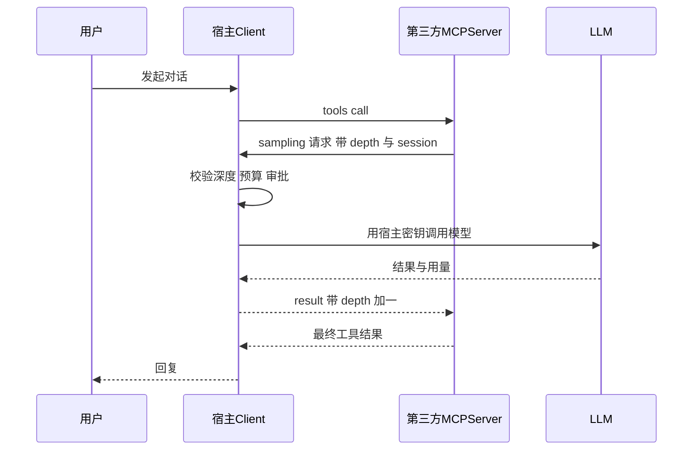

# MCP Sampling 回调：第三方 Server 反向借用宿主模型时，递归放大、审批与费用归属怎么控

## 为什么会有这个问题

Sampling 的语义是 Server 通过 Client 请求一次 LLM 补全（createMessage），把模型与密钥留在宿主侧，看起来是安全设计，但它把调用链从 Client→Server 变成了 Client→Server→Client→LLM→Server→Client。工程上因此冒出四个真实问题：其一，递归与放大，Server 在拿到补全结果后可以再次发起 Sampling，宿主若不限制 depth，一次用户请求能膨胀成几十次计费调用；其二，阻塞与死锁，Server 的 handler 通常同步等待回包，而 Client 若把 Sampling 请求排在处理主请求的同一个事件循环或同一把锁后面，就会互相等待直到超时；其三，信任边界倒置，prompt 内容由不受控的 Server 决定，等于让它间接读取并外发上下文，还能影响用哪个模型；其四，费用归属模糊，per-tenant 的 token 配额无法落到具体 Server 上。常见错误认知是把它当成普通 Server→Client notification，以为不需要 request id 关联、超时与去重。

## 怎么做

1. 能力协商先行：Client 初始化时声明是否支持 sampling，Server 侧在未声明时必须降级（自带模型或返回明确的 unsupported 错误），禁止假定所有宿主都支持。
2. 把预算写进协议元数据：Sampling 请求的 _meta 携带 trace_id、session_id、depth、model_hint；Client 维护 per-session 的 depth 上限与 token 预算，超限返回结构化 JSON-RPC error，而不是静默截断或返回空串。
3. 执行路径隔离：Server handler 用 await 而非阻塞等待；Client 侧为 Sampling 分配独立 worker 与独立 HTTP 连接池，避免与主对话争抢同一连接上限形成排队假死；每个请求注册超时并从 pending map 中清理。
4. 审批与脱敏策略层：按 Server 来源、prompt 是否含 PII、目标模型单价决定「自动放行 / 需人工确认 / 拒绝」，全量落审计日志（谁触发的 Sampling、发了什么、消耗多少）。
5. 模型选择权留在宿主：Server 只能给 maxTokens、temperature 之类的建议值，真实模型由 Client 按租户策略决定并做单价封顶。
6. 计量与熔断：把消耗记到「调用方 Server」维度，做 per-server 配额与失败率熔断；request id 幂等去重，重试沿用同一 id 且次数封顶。
7. 失败语义要可区分：超预算、需审批、超时（可重试）、被拒绝（不可重试）用不同错误码，让 Server 能正确降级而不是基于空结果继续幻觉推理。

## 关键代码

```python
import asyncio

class SamplingGate:
    def __init__(self, llm, default_model, max_depth=2, token_budget=20000, timeout=20):
        self.llm, self.default_model = llm, default_model
        self.max_depth, self.token_budget, self.timeout = max_depth, token_budget, timeout
        self.used, self.seen = {}, set()

    async def handle(self, req):
        rid = req["id"]
        if rid in self.seen:
            return {"error": {"code": -32000, "message": "duplicate sampling id"}}
        params = req.get("params", {})
        meta = params.get("_meta", {})
        depth = meta.get("depth", 0)
        session = meta.get("session_id", "anon")
        if depth >= self.max_depth:
            return {"error": {"code": -32001, "message": "sampling depth exceeded"}}
        used = self.used.get(session, 0)
        if used >= self.token_budget:
            return {"error": {"code": -32002, "message": "sampling budget exhausted"}}
        self.seen.add(rid)
        try:
            resp = await asyncio.wait_for(
                self.llm.create_message(
                    messages=params["messages"],
                    max_tokens=min(params.get("maxTokens", 512), 1024),
                    model=meta.get("model_hint") or self.default_model,
                ),
                timeout=self.timeout,
            )
        except asyncio.TimeoutError:
            return {"error": {"code": -32003, "message": "sampling timeout",
                              "data": {"retryable": True}}}
        self.used[session] = used + resp.usage.total_tokens
        return {"result": {"role": "assistant", "content": resp.text,
                           "_meta": {"depth": depth + 1, "session_id": session}}}
```

## 真实场景

某项目接入一个第三方 MCP Server 做长文档摘要，上线后出现两个症状：账单消耗是一次普通请求的十几倍；高峰期 Server 侧出现大量 pending 调用，最终统一超时。排查路径：先在宿主侧按 trace_id 聚合 sampling 请求，发现同一 trace 下 depth 单调递增且没有上限，Server 在补全结果不满意时会再发起一次 Sampling 自我修订，形成放大；再看事件循环与连接池指标，Sampling 处理函数与主对话共用同一个 httpx client（连接上限配置得很小），主请求持有连接等待 Server 回包，Server 又在等宿主回 Sampling，互相等待。修复：depth 限制为 2、按会话设 token 预算、Sampling 走独立 worker 与独立连接池、超时 20s 并把可重试语义回传给 Server；同时把消耗按 Server 维度记账，异常 Server 直接熔断。

## 示意图



## 面试官追问

1. **Q：** 为什么不干脆让 Server 自带模型 key，绕过 Sampling？

   **A：** 那就把密钥分发、成本与合规责任都推给了不受控的第三方：多租户无法统一审计，模型升级和降价也享受不到。Sampling 的核心价值就是模型与密钥留在宿主侧，代价是链路变长、递归风险内生化，所以真正的工程动作是在宿主侧做深度、预算、审批与计量四道闸门，而不是取消这个能力。

2. **Q：** Sampling 被拒绝时应该返回空内容还是错误？

   **A：** 必须返回结构化错误码并区分可重试与不可重试。返回空串或占位文本会让 Server 误以为拿到了有效补全并继续推理，最终把幻觉结果当成工具输出写回业务；错误码则让设计良好的 Server 走「降级到本地规则」或「终止并上报」两条确定路径。


来源：https://github.com/guocong-bincai/ai-interview-guide/blob/main/docs/14-mcp-skill-systems/README.md
