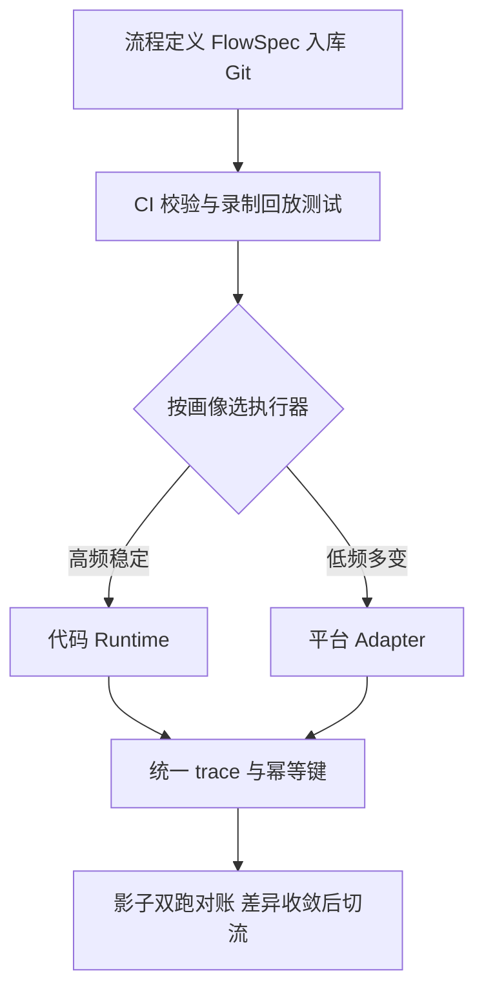

# 从可视化编排平台迁回代码：Agent 工作流的版本化、幂等语义与逃生舱怎么设计

## 为什么会有这个问题

低代码编排平台（Dify、Coze、n8n 这类）在验证期最快，但进入生产后矛盾集中在四处：流程定义只存在于画布与平台数据库，进不了 Git review，改一个分支靠手点、没人能 review diff；没有单测与本地复现能力，故障只能在生产画布上试；平台的重试与循环语义是黑盒，经常和业务幂等冲突（一个「失败重试」把工单建了两遍）；trace 停在平台 UI，无法与自有 APM 的 trace_id 串起来。常见错误认知是把选型当成功能对比表打分，而真实约束是变更频率、参与角色、合规要求与退出成本——尤其是退出成本，选型时几乎没人量化「半年后想搬走要付多少」。

## 怎么做

1. 做工作负载画像再决策：按「调用量 × 变更频率 × 失败后果」把流程分桶。高频稳定、失败后果重的走代码；低频多变、由运营自己改 prompt 的留在平台，不做一刀切。
2. 抽象自有中间表示：定义 FlowSpec（节点类型、边与条件、幂等键、超时、重试上限）作为唯一事实来源，平台与代码 runtime 都只是它的执行器 adapter，避免锁定在某个 DSL 上。
3. 流程定义入库并纳入 CI：FlowSpec 进 Git，CI 做 schema 校验 + 录制回放测试（固定输入、mock 工具，断言节点级输出），发布按 version 灰度分流。
4. 对齐幂等与重试语义：每个写节点显式声明幂等键，重试上限与超时在 FlowSpec 里唯一声明，平台侧配置不得覆盖为默认无限重试。
5. 打通可观测：adapter 统一注入 trace_id 并上报到自有 OTel collector，节点级 span 带上 flow name、version、node id，实现平台与自有服务同一条 trace。
6. 保留逃生舱：同一份 FlowSpec 必须有代码 runtime 可执行，并定期对关键流程做双跑对账（写路径影子执行），差异率达标后才允许切流。

## 关键代码

```python
import asyncio
from dataclasses import dataclass, field

@dataclass
class Node:
    id: str
    kind: str                      # tool / llm / branch / human
    cfg: dict
    idempotency_key: str | None = None
    max_retries: int = 1
    timeout_s: float = 15.0

@dataclass
class FlowSpec:
    name: str
    version: str
    nodes: list[Node] = field(default_factory=list)
    edges: list[tuple[str, str, str]] = field(default_factory=list)

class CodeRuntime:
    def __init__(self, registry, tracer):
        self.registry, self.tracer = registry, tracer

    async def run(self, spec: FlowSpec, inputs: dict, trace_id: str) -> dict:
        ctx, cur = dict(inputs), spec.nodes[0].id
        while cur:
            node = next(n for n in spec.nodes if n.id == cur)
            with self.tracer.span(trace_id, node.id, spec.version) as span:
                try:
                    out = await asyncio.wait_for(self.registry[node.kind](node, ctx),
                                                 node.timeout_s)
                except Exception as e:
                    span.record_error(e)
                    raise
                ctx.update(out or {})
            cur = self._next(spec, cur, ctx)
        return ctx

    # PlatformRuntime 实现同一个 run(spec, inputs, trace_id) 签名，共用 FlowSpec 与录制回放用例
```

## 真实场景

某项目早期用可视化平台搭了二十多条客服与运营流程，半年后同时暴露三个症状：改一个分支要在画布上点几十分钟，且变更没有任何 review 记录，出问题无法回溯「上周谁改了什么」；线上一个循环节点因平台默认重试把同一张工单重复创建，客服侧出现重复回访；排查失败只能看平台 UI 的精简日志，无法和自家服务的 trace 关联。处理方式：先定义 FlowSpec 并把三条高频核心流程迁到代码 runtime，写节点加幂等键、重试上限显式声明；其余流程保留在平台但通过 adapter 统一上报 trace 与版本号；对两条写入类流程做两周影子双跑对账，节点级输出差异率收敛后切流，并把老画布标记为只读。

## 示意图



## 面试官追问

1. **Q：** 双跑对账怎么避免成本和副作用翻倍？

   **A：** 写路径一律影子执行：工具调用走 mock 或只记录不落库，只对读取与决策路径真实双跑，并按采样率降频。对账比较的是节点级结构化输出差异率（分支走向、字段值），而不是最终自然语言答案文本是否一致，否则噪声会淹没真实回归。

2. **Q：** 什么情况下应该继续留在平台，而不是迁走？

   **A：** 参与方是非工程角色、业务方需要自己高频改 prompt 与分支、流量低且失败可人工兜底，这几种情况自研 runtime 的维护成本高于锁定成本。判断标准是「变更频率 × 变更者是否是工程师」，而不是平台能力清单有多长。


来源：https://github.com/guocong-bincai/ai-interview-guide/blob/main/docs/12-frameworks-tools/README.md
