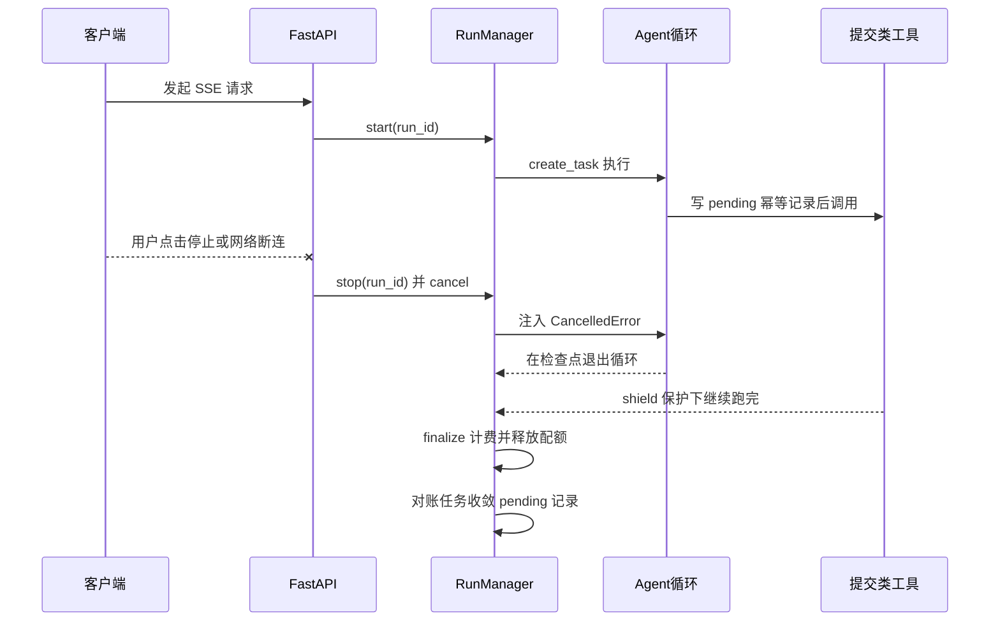

# 用户点了停止，Agent 还在花钱：SSE 断连后的取消传播、不可中断工具与副作用收敛

## 为什么会有这个问题

Agent 的一次 run 往往挂在 HTTP 请求的协程上，通过 SSE 流式返回。常见的错误认知有三个：一是认为「客户端断开就等于任务结束」，但在流式生成器里不主动检测断连时，服务端协程会继续 await LLM 和工具；二是认为 asyncio.CancelledError 一定能传到工具层，实际上 run_in_executor 包住的同步 SDK、自定义的 except BaseException 重试、以及在 finally 里再次 await 被取消的清理逻辑，都会让取消停在半路；三是把「取消」当成「回滚」，可写类工具一旦提交就无法撤销，此时取消只能阻止后续步骤，已经产生的副作用必须靠幂等键和对账收敛。进一步说，网络抖动引起的断连与用户主动停止混为一谈，会导致正常任务被误杀；而 run 结束后如果计费、配额释放、事件落库不走同一条 finalize 路径，取消路径就会成为资源泄漏和账单对不上账的主要来源。

## 怎么做

1. 把一次 Agent 执行抽象成带 run_id 的后台任务，由 RunManager 持有，SSE 只是订阅者。区分两种终止语义：用户显式 stop 触发 cancel；传输层断连只进入 N 秒 grace 窗口，期间允许携带 Last-Event-ID 重订阅，超时才取消。
2. 在执行循环的每个 await 点设置取消检查点（LLM 调用前、工具调用前、每次状态写回后），并让整个 run 带 wall-clock 预算和 token 预算，超时与取消走同一个收敛出口。
3. 把工具按副作用语义分两类：只读工具允许被中断；提交类工具（创建工单、发消息、扣款）先用 asyncio.shield 保护到底，再通过「intent 记录 + 幂等键（run_id:step_id）」保证最多一次生效。
4. 发起提交类工具前先写 pending intent，成功后置 done；取消或超时后由后台对账任务扫描超时 pending，以工具侧的查询结果为准补写终态，绝不靠猜测。
5. 所有终止路径（正常结束、取消、超时、异常）统一走 finalize：写 usage、释放并发信号量、上报 metrics、发送 run 结束事件。finalize 本身也要 shield + suppress，避免清理阶段被二次取消。
6. 用混沌测试验收：在随机 await 点注入 cancel，断言没有泄漏的 Task、没有重复的业务副作用、计费条数与 run 数一一对应。

## 关键代码

```python
import asyncio, contextlib

class RunManager:
    def __init__(self, repo, agent, budget_s=180):
        self.repo, self.agent, self.budget_s = repo, agent, budget_s
        self.tasks: dict[str, asyncio.Task] = {}

    def start(self, run_id, user_id, goal):
        t = asyncio.create_task(self._run(run_id, user_id, goal), name=f"run:{run_id}")
        self.tasks[run_id] = t
        t.add_done_callback(lambda _: self.tasks.pop(run_id, None))
        return t

    async def _run(self, run_id, user_id, goal):
        try:
            async with asyncio.timeout(self.budget_s):
                await self.agent.loop(run_id, user_id, goal)
        except asyncio.CancelledError:
            await asyncio.shield(self.repo.mark_cancelled(run_id))
            raise
        finally:
            with contextlib.suppress(Exception):
                await asyncio.shield(self.finalize(run_id))

    async def stop(self, run_id, grace=2.0):
        task = self.tasks.get(run_id)
        if not task:
            return
        task.cancel()
        await asyncio.wait({task}, timeout=grace)

async def call_writer_tool(repo, run_id, step_id, tool, args):
    key = f"{run_id}:{step_id}"
    await repo.upsert_intent(key, "pending")
    res = await asyncio.shield(tool(**args))
    await repo.upsert_intent(key, "done")
    return res
```

## 真实场景

某项目的客服 Agent 上线后，用户点击「停止」后仍有工单被创建，并且后台又追加了两次 LLM 调用。典型症状是：SSE 断连日志与 run 结束日志之间存在数十秒错位，前端显示的会话数明显少于实际计费条数，某个租户的 token 消耗异常偏高。排查路径是：先比对断连时间与 finalize 时间定位生命周期错位；再查 intent 表中 pending 堆积，确认提交类工具在取消后继续执行；最后定位到一个 retry 装饰器用 except BaseException 吞掉了 CancelledError，导致取消在工具层失效，run 继续按原计划推进。修复后，把「断连不等于取消」和「finalize 单出口」两条写成 RunManager 的硬约束，并补充了注入式取消的混沌用例。

## 示意图



## 面试官追问

1. **Q：** 为什么不让断连直接等价于取消？

   **A：** 移动网络切换、SSE 自动重连、代理超时都会造成假断连，直接取消会造成大量无辜失败和用户看到「回答到一半没了」。正确做法是断连只标记 detached，进入 grace 窗口并缓冲事件，重连后按 run_id/Last-Event-ID 续传；只有显式 stop、超过 grace 或超出预算才真正 cancel。代价是要维护事件缓冲与状态，需要设置硬上限防止缓冲区无限增长。

2. **Q：** 取消之后怎么保证不会重复建单或重复计费？

   **A：** 两点：语义上承认取消只阻止「继续发起」，不能回滚「已提交」；机制上用 run_id:step_id 作为幂等键，提交前写 pending intent，最终以工具侧查询结果作为真实状态写回 done，后台对账任务扫描超时 pending 收敛。计费走 finalize 单出口，按实际发生的 token 与工具调用记账，并给 run 加唯一结算标识防止重复入账。


来源：https://github.com/guocong-bincai/ai-interview-guide/blob/main/docs/22-agent-planning-reflection/README.md
