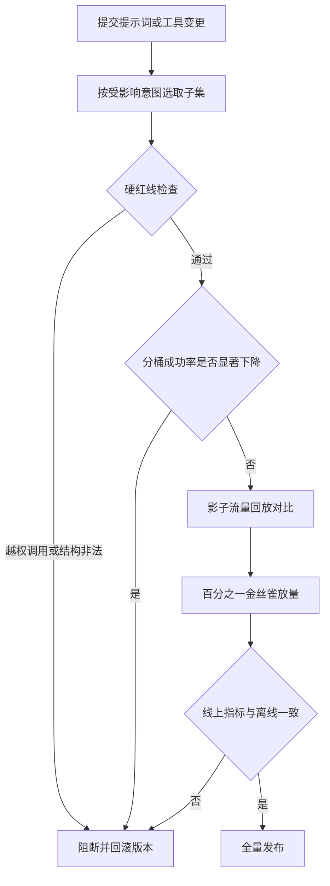

# Prompt 改一行就上线：Agent 回归门禁、eval 过拟合与金丝雀放量怎么定

## 为什么会有这个问题

Agent 的输出是一条轨迹，而不是单个答案，同一句 prompt 变化可能影响工具选择顺序、步数、成本和安全性，单测和人工试用都覆盖不到。工程上常见的三个错误认知是：只比较最终答案相似度，忽略工具调用序列、冗余步数与 P95 成本；用同一批手写 case 反复调 prompt，把这批样本调成过拟合，离线全绿线上照样翻车；把 LLM-as-judge 的绝对打分当作真值，而 judge 存在位置偏置、长度偏置和自我偏好，与被测模型同源时分数系统性地虚高。更深一层的问题是分布不一致：手写 case 集中在主路径，线上长尾意图（查订单、催发货、投诉）样本极少，一旦某个桶退化，整体指标会被主路径的增长掩盖。

## 怎么做

1. 定义分层指标：可规则判定的任务成功（结构化字段正确、工具返回被正确引用）、轨迹指标（首步工具选择准确率、冗余步数、无效重试次数）、成本与延迟分位、安全红线（越权工具调用、敏感信息外泄）。能用断言判定的绝不用 judge。
2. 治理数据集：从线上采样脱敏后按意图分桶，每桶样本量设下限；划分固定的 holdout 集合，只在发版前跑，禁止用于调 prompt，并按季度轮换，避免长期记忆化。
3. 校准 judge：改绝对打分为匿名成对比较并随机左右顺序；judge prompt 与 rubric 版本化；用人工标注子集算一致率，低于阈值时 judge 结果只能作为参考，不能作为门禁依据。
4. 做门禁时用区间而非点估计：小样本成功率用 Wilson 置信区间判断「是否显著下降」，设置硬红线（任何越权调用即阻断）与软阈值（分桶成功率下降超过容差则阻断，成本上涨超阈值仅告警）。
5. 节省成本：只跑受影响的子集（工具 schema 未变则跳过工具相关 case），全量 eval 放 nightly；用缓存固定住检索与工具返回，保证对比时只变被测变量。
6. 发布节奏：影子流量回放对比，再按百分之一金丝雀放量，按意图分桶看线上指标是否与离线一致，不一致自动回滚 prompt 版本（用 feature flag 控制版本切换，而不是重新发版）。

## 关键代码

```python
def wilson(k, n, z=1.96):
    p = k / n
    d = 1 + z * z / n
    c = (p + z * z / (2 * n)) / d
    m = z * ((p * (1 - p) / n + z * z / (4 * n * n)) ** 0.5) / d
    return c - m, c + m

RED_LINES = {"unsafe_tool_call": 0, "schema_invalid_rate": 0.02}

def gate(baseline, candidate, tol=0.03, cost_ratio=1.2):
    verdict = {"block": [], "warn": []}
    for metric, limit in RED_LINES.items():
        if candidate[metric] > limit:
            verdict["block"].append(f"red line {metric}={candidate[metric]}")
    for bucket, base in baseline["by_intent"].items():
        cand = candidate["by_intent"].get(bucket)
        if not cand or cand["n"] < 20:
            verdict["warn"].append(f"{bucket}: 样本不足，结论不可用")
            continue
        lo, hi = wilson(cand["ok"], cand["n"])
        base_rate = base["ok"] / base["n"]
        if hi < base_rate - tol:
            verdict["block"].append(f"{bucket}: 成功率显著下降")
    if candidate["cost_p95"] > baseline["cost_p95"] * cost_ratio:
        verdict["warn"].append("cost_p95 上涨超过阈值")
    return verdict
```

## 真实场景

某项目给客服 Agent 的系统提示词补了一句「回答前优先调用知识库检索」，离线六十条 case 通过率上升，于是直接全量发布。上线后典型症状是：整体满意度基本持平，但订单查询类意图成功率下降，工具调用步数从三步涨到六步，P95 延迟和单次成本明显上升。排查路径是：先按意图分桶看指标，发现退化集中在订单类；再对比轨迹 diff，看到检索工具被无条件前置，把原本直接查订单的路径也拖长；最后定位到「优先检索」被模型理解成强制检索，缺少条件分支。修复方式是把检索决策交回路由层并补充该意图的 case，同时把「分桶指标不得显著下降」写成发版门禁。

## 示意图



## 面试官追问

1. **Q：** 为什么不能直接用同一个 LLM 打分来做门禁？

   **A：** judge 有位置、长度和自我偏好，同源模型打分还会系统性偏高，分数变化未必对应真实质量变化。可行做法是成对比较加随机左右顺序、rubric 版本化、用人工标注子集校准一致率；关键路径尽量换成可执行断言，例如工具序列、JSON schema 校验、必填字段比对，把主观判断压缩到最小范围。

2. **Q：** 怎么避免 eval 集被调成过拟合？

   **A：** 三层措施：固定 holdout 集只用于发版判定、禁止用于调 prompt；按意图分桶并定期从线上采样轮换，让分布跟着真实流量走；把目标从「这批 case 全过」改成「分布指标不退化 + 硬红线不触碰」，同时把每次线上回归事故的样本反哺进对应桶，形成闭环。
