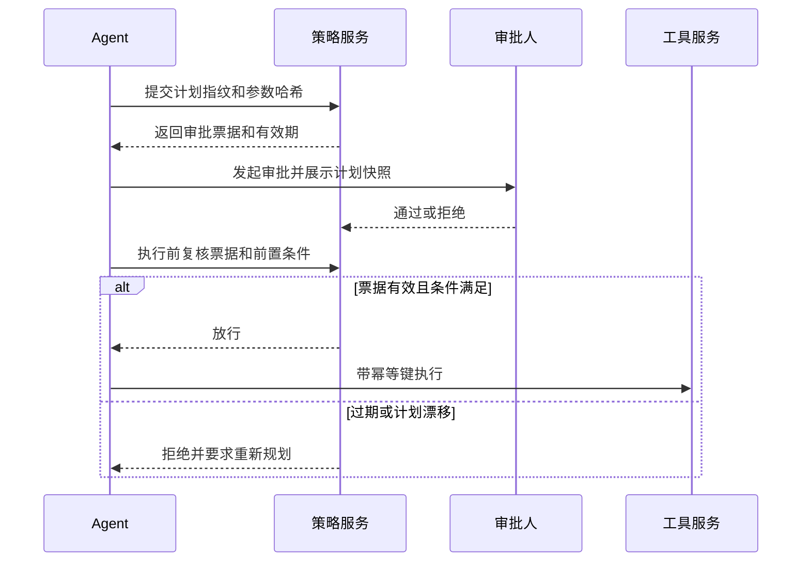

# HITL 审批排队期间计划已漂移：票据过期、参数哈希与旧快照执行怎么防

## 为什么会有这个问题

HITL 的工程本质不是弹窗确认，而是把高风险副作用放进可审计、可拦截的闸门。审批是异步的：人可能在几分钟甚至几天后响应，而 Agent 的计划、工具参数、资源状态、权限和预算都可能变化。如果审批只返回一个 approved=true，执行端没有把审批绑定到具体计划快照和参数，就会出现 TOCTOU：人批准的是 A，执行的是 B。常见错误认知是「审批通过就安全」，忽略票据有效期、执行前复核和重复执行。

## 怎么做

1. 审批对象分级：只读、可逆、低风险操作走自动策略和采样审计；资金、外发、删除、权限变更等高风险工具必须做步骤级审批，计划级审批只用于可逆批量任务。
2. 票据绑定快照：ticket 至少包含 plan_hash、step_id、tool_name、args_hash、tool_schema_version、resource_version、approver、expires_at；任一字段变化票据立即失效。
3. 执行前 preflight：重新拉起资源版本，校验权限、预算、参数 schema 和业务前置条件；不满足就拒绝执行并进入 replan，不允许静默改参数。
4. 幂等与副作用账本：以 ticket_id 作为幂等键传给工具，记录 intent、executed、committed 状态；不可幂等工具用 outbox 或两阶段确认，避免审批后重放导致重复副作用。
5. 过期与拒绝处理：TTL 按风险分级；过期后把审批时快照与当前状态差异展示给审批人重新签发，不自动续期；拒绝则回退计划重写。
6. 审计与指标：记录审批快照、执行快照和 diff；监控 approval_latency、stale_ticket_reject_rate、duplicate_side_effect、replan_rate；异常升高时暂停该类工具并人工排查。

## 关键代码

```python
from dataclasses import dataclass
from hashlib import sha256
import json, time

@dataclass(frozen=True)
class Ticket:
    ticket_id: str
    plan_hash: str
    args_hash: str
    expires_at: float
    approved_by: str = 'pending'

def digest(obj):
    raw = json.dumps(obj, sort_keys=True, ensure_ascii=False)
    return sha256(raw.encode()).hexdigest()

def issue(plan, step, ttl=600):
    return Ticket(
        ticket_id='apr_%s_%d' % (step['id'], time.time()),
        plan_hash=digest(plan),
        args_hash=digest(step['args']),
        expires_at=time.time() + ttl,
    )

def execute(ticket, plan, step, approver, precheck):
    if ticket.approved_by != approver:
        raise PermissionError('not approved')
    if time.time() > ticket.expires_at:
        raise PermissionError('expired')
    if ticket.plan_hash != digest(plan):
        raise PermissionError('plan drifted')
    if ticket.args_hash != digest(step['args']):
        raise PermissionError('args drifted')
    if not precheck(step):
        raise RuntimeError('precondition failed')
    return step['call'](idempotency_key=ticket.ticket_id)
```

## 真实场景

某项目做退款和工单处理 Agent，审批队列积压，人工在较晚时间点才点通过；等待期间用户取消订单或金额变化，Agent 仍按审批时的旧参数调用退款工具，出现重复退款或越权操作。排查发现日志里只有 approved=true，没有 plan_hash 和 args_hash，执行端也无法判断票据是否过期。修复后票据绑定计划与参数哈希，执行前复核资源版本，过期票据进入 replan，重复副作用才被收敛。

## 示意图



## 面试官追问

1. **Q：** 审批粒度太细会让人工成为瓶颈，怎么平衡？

   **A：** 按风险分级：低风险自动执行加采样审计，中风险做计划级审批或批量审批，高风险做步骤级审批；用金额、数据敏感度、可逆性、外发对象动态升级。审批界面只展示关键 diff 和证据，同时监控积压，超过阈值时转异步或直接拒绝，不能默认放行。

2. **Q：** 审批通过后 precheck 失败，能不能让 Agent 自动调整参数再执行？

   **A：** 不能静默调整。参数变化意味着审批对象变了，必须重新签发票据；可以让 Agent 生成新计划并展示差异，走快速审批。若业务有容差，必须在策略里显式定义容差范围并记录审计，不能由模型自行判断。


来源：https://github.com/guocong-bincai/ai-interview-guide/blob/main/docs/22-agent-planning-reflection/README.md
