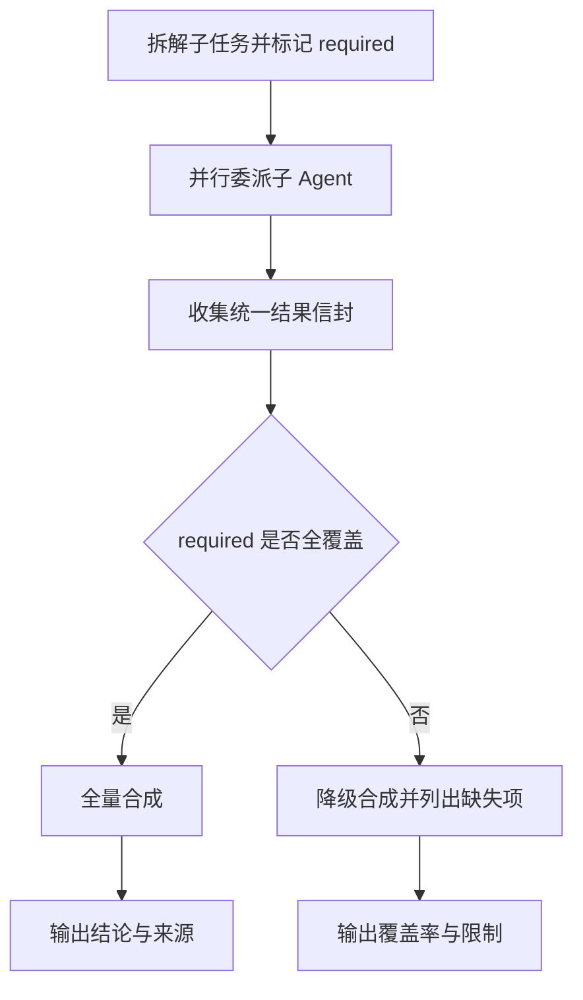

# 并行子 Agent 部分失败被合成成全量成功：覆盖率契约、可信度与降级结论怎么设计

## 为什么会有这个问题

fan-out 并行子 Agent 能降时延，但部分失败是常态：超时、限流、工具报错、子 Agent 返回空结果。问题常出在收集与合成阶段：异常被 except 吞掉，results 里只 append 成功项，模型看到的是「看起来完整」的上下文，于是把部分覆盖当成全量覆盖，输出确定结论。另一种错误是把「成功但空」和「失败」混为一谈，或者对所有失败无脑重试，放大成本和重复副作用。

## 怎么做

1. 子任务契约：拆解时标记 required/optional、是否幂等、超时预算、可重试错误类型；required 决定是否允许降级。
2. 统一结果信封：每个子 Agent 返回 task_id、status、data、error_class、coverage、source_refs、trace_id；禁止只返回裸 data 或字符串。
3. 收集阶段不吞异常：用 gather(return_exceptions=True) 或等价机制，把异常转成 failed/timeout 信封，保留失败原因和已耗时。
4. 确定性 gate：合成前计算 coverage；required 未全覆盖进入 degraded 模式，缺失项单独列出；optional 缺失可继续，但输出必须标注。
5. 重试策略：只对 retryable 且幂等的子任务重试，预算随链递减；权限拒绝、业务拒绝不重试；重试仍失败则固化结果，不无限重入。
6. 合成约束：给模型的输入包含 coverage 和 missing，prompt 明确禁止推断缺失项；输出 schema 要求每个结论带 source_task_id，后置校验 unsupported claim。
7. 降级输出与接管：degraded 结果附带覆盖率、限制和下一步建议；高风险结论进入 HITL 或二次补采，不直接对外。

## 关键代码

```python
import asyncio
from dataclasses import dataclass
from enum import Enum

class Status(str, Enum):
    OK = 'ok'
    FAILED = 'failed'
    TIMEOUT = 'timeout'

@dataclass
class Envelope:
    task_id: str
    required: bool
    status: Status
    data: dict | None = None
    error: str | None = None

async def run_one(task, agent):
    try:
        data = await asyncio.wait_for(agent(task), timeout=task.timeout)
        return Envelope(task.id, task.required, Status.OK, data)
    except asyncio.TimeoutError:
        return Envelope(task.id, task.required, Status.TIMEOUT)
    except Exception as e:
        return Envelope(task.id, task.required, Status.FAILED, error=type(e).__name__)

async def collect(tasks, agent):
    return await asyncio.gather(*(run_one(t, agent) for t in tasks))

def synthesis_gate(results):
    missing = [r.task_id for r in results if r.required and r.status is not Status.OK]
    coverage = sum(r.status is Status.OK for r in results) / max(len(results), 1)
    if missing:
        return {'mode': 'degraded', 'missing': missing, 'coverage': coverage}
    return {'mode': 'full', 'coverage': 1.0}
```

## 真实场景

某项目做行业研究 Agent，并行拆出财报、新闻、招聘、专利等子任务，其中部分子任务超时；合成模型仍输出完整结论和确定数字，用户追问时发现关键数据没有来源。排查发现收集阶段把异常吞掉，失败子任务没有进入 results，synthesis prompt 也没有 missing 字段。修复后每个子任务返回统一信封，required 缺失时进入降级合成并列出缺失项，结论必须带 source_task_id；同时监控 subtask_success_rate、synthesis_coverage、unsupported_claim_rate 和重试成本。

## 示意图



## 面试官追问

1. **Q：** required 子任务失败时，应该阻塞等待还是先输出降级结果？

   **A：** 看时效、风险和补采成本：可补采且预算允许时做有限重试或换源；否则输出降级结果并明确缺失，不阻塞整个会话。对外高风险结论走 HITL。关键是不能让模型把缺失当已知。

2. **Q：** 如何避免合成模型编造缺失项？

   **A：** 输入结构化，只给 covered data，missing 单独字段；prompt 明确禁止推断；输出 schema 强制 source_task_id；后置规则校验无来源断言；必要时用模板化合成替代自由生成。


来源：https://github.com/cdavid817/agent-interview/blob/main/docs/02-capabilities/multi-agent/evaluation.md
