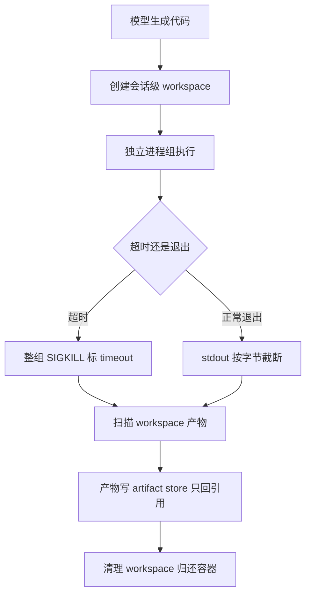

# 代码执行 Agent 的沙箱：超时残留、容器复用污染与产物回灌怎么控

## 为什么会有这个问题

代码解释器类工具把模型生成的不可信代码直接跑在服务侧，执行时长和资源占用都不可预知，最常见的错误认知是「给个 timeout 就安全了」。实际上有三个坑：一是超时后 kill 只杀了父进程，模型代码里 fork/subprocess 出去的子孙进程仍在跑，形成孤儿进程；二是容器池复用时工作目录和 pip 缓存被跨会话继承，模型读到上一次会话的文件却当作本会话数据；三是产物（csv/图片）被 base64 塞回工具结果，直接把下一轮上下文打爆，表现为请求 400 而不是工具报错。三者都不报异常，线上只看到「Agent 结论怪」或「偶发超限」。

## 怎么做

1. 执行隔离：每次执行创建会话级独立 workspace（mkdtemp），容器根文件系统只读，HOME 指向 workspace，python 用 -I 隔离开环境变量与用户 site-packages，避免上一次会话的模块与数据残留。
2. 进程回收：用 Popen(start_new_session=True) 让执行体独占进程组，超时后 os.killpg 整组 SIGKILL，并在 finally 里再补一次 killpg（吞掉 ProcessLookupError），覆盖模型代码已经 spawn 子进程的场景；内存用容器侧 limit/ulimit 做硬限，不依赖代码自检。
3. 输出与产物契约：stdout/stderr 按字节截断并回传 truncated 标记，让模型知道内容不全；产物一律落 artifact store，工具结果只返回 {artifact_id, name, size, preview 若干行}，需要细看时由模型再调用读取工具按需取片段。
4. 错误分类回灌：把 returncode / signal / OOM / timeout 分成不同 reason，回灌给模型的文本不同（超时要提示拆分数据或降低复杂度，OOM 要提示分块处理，语法错误才回 traceback 末尾若干行），避免把整段堆栈塞进上下文引发连锁重试。
5. 可观测与容量：每次执行记录 exec_id、排队等待、执行耗时、peak rss、kill reason；用等待时间占比区分「池容量不足」与「模型代码慢」，前者扩池或排队超时降级，后者改 prompt 或限制单次数据量。
6. 池化复位校验：容器归还前删除 workspace、清 pip 缓存与 /tmp，并对关键目录做一次 diff 校验，防止清理逻辑漏掉路径导致跨会话污染。
7. 压测与回归：用固定的一组恶意样例（死循环、fork 炸弹、写大文件、读上一会话文件）纳入回归，每次改沙箱配置都跑一遍。

## 关键代码

```python
import os, signal, subprocess, tempfile, shutil

OUT_LIMIT = 8 * 1024


def run_python(code: str, timeout: float = 20.0) -> dict:
    workdir = tempfile.mkdtemp(prefix="exec-")
    proc = subprocess.Popen(
        ["python", "-I", "-c", code],
        cwd=workdir,
        stdout=subprocess.PIPE, stderr=subprocess.PIPE,
        start_new_session=True,
        env={"PATH": "/usr/local/bin", "HOME": workdir},
    )
    reason = None
    try:
        out, err = proc.communicate(timeout=timeout)
    except subprocess.TimeoutExpired:
        os.killpg(proc.pid, signal.SIGKILL)
        out, err = proc.communicate()
        reason = "timeout"
    finally:
        try:
            os.killpg(proc.pid, signal.SIGKILL)
        except ProcessLookupError:
            pass
    if proc.returncode in (-9, 137):
        reason = reason or "oom_or_sigkill"
    artifacts = [
        {"name": n, "size": os.path.getsize(os.path.join(workdir, n)),
         "artifact_id": put_artifact(os.path.join(workdir, n))}
        for n in os.listdir(workdir)
    ]
    shutil.rmtree(workdir, ignore_errors=True)
    return {"reason": reason, "returncode": proc.returncode,
            "stdout": out[:OUT_LIMIT].decode("utf-8", "replace"),
            "truncated": len(out) > OUT_LIMIT, "artifacts": artifacts}
```

## 真实场景

某项目的分析类 Agent 挂了代码执行工具。症状一：夜间批量任务偶发把宿主 CPU 打满，排查发现执行超时后主进程被杀，但模型代码里起的多进程仍在跑，killpg 缺失是根因。症状二：容器池复用后，某次会话的分析结论引用了上一轮遗留的 data.csv，数据完全对得上但业务方说「这不是我们的客户」。症状三：工具生成的 csv 被 base64 回填进工具结果，下一轮请求直接超上下文，前端只看到一个 400，链路里没有任何工具层错误。

## 示意图



## 面试官追问

1. **Q：** 为什么不用线程 join(timeout) 或 signal.alarm 做超时？

   **A：** 线程无法被强制终止，join 超时只是放弃等待，执行体仍在跑并继续占 CPU；signal.alarm 只对主线程有效，且与业务侧其他定时器冲突。超时必须落到进程边界：独立进程组 + killpg，资源上限交给 cgroup/ulimit，仅靠 Python 层控制不住。

2. **Q：** 怎么区分「模型写的代码慢」和「沙箱资源不足」？

   **A：** 看三个指标：排队等待时间、执行耗时、peak rss。排队占大头是池容量问题，扩池或加排队超时；执行耗时集中撞 timeout 且 rss 接近上限，是算法或数据量问题，应把提示改成「先采样再聚合」而不是加超时。两类要打不同 reason 标签，否则优化方向会跑偏。
