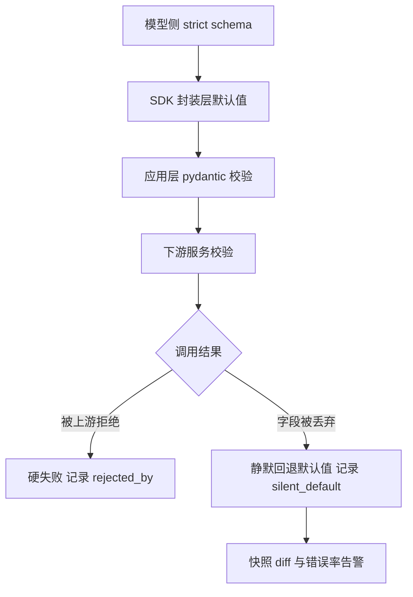

# strict 默认值被封装层翻转后，工具参数三层校验错位：静默回默认与批量拒绝怎么定位

## 为什么会有这个问题

工具参数的约束实际上分散在四层：模型侧的 JSON Schema（strict 模式）、SDK 封装层构造请求时的默认值、应用层 pydantic 校验、下游服务自己的校验。四层语义并不一致，常见错误认知是「有 pydantic 就安全了」。典型错位有两类方向相反的故障：一是封装层或 SDK 升级把 strict 从 false 改为 true，以前能跑的宽松 schema（缺 additionalProperties:false、optional 字段没进 required）被上游直接拒绝，表现为批量 400；二是应用层用 extra=ignore 把模型多给的字段悄悄丢掉，缺失的必填字段又有默认值，工具「成功」返回但参数是默认值。前者是硬失败容易发现，后者静默出错，往往等业务方反馈才发现。

## 怎么做

1. 确立唯一事实源：用 pydantic 模型生成 JSON Schema，生成后显式补 additionalProperties:false，并要求所有字段在 strict 模式下都进入 required，可空字段用 Optional + null 表达，不允许「字段可缺省」这种表达能力。
2. schema 快照测试：把每个工具的最终 spec 存成快照文件，SDK 或模型适配层升级后跑 diff，任何字段类型、required 列表、默认值变化都在 CI 阶段拦住，而不是等线上错误率抬升。
3. 应用层显式严格：模型用 ConfigDict(extra="forbid")，必填字段一律不给默认值；校验失败时不填默认值兜底，而是返回结构化错误（字段名 + 允许值 + 简短原因）回灌给模型，让它自己改参数重试一次。
4. 打 rejected_by 标签：工具结果里区分 model_schema / sdk / app_schema / upstream 四类拒绝来源，以及一个 silent_default 标记（参数由默认值填充而非模型给出），把静默失败变成可统计指标。
5. 灰度与止血：先在 shadow 模式记录「如果按 strict 校验会被拒」的比例，再按工具维度打开 strict；出问题时按工具名 + rejected_by 快速回滚成旧 spec，而不是整体降级 SDK。
6. 兼容不支持 strict 的模型：适配层把统一 spec 降级成自然语言描述 + 应用层强校验，同时记录降级标记，按模型统计参数错误率，超过阈值就禁止该模型接这个工具。

## 关键代码

```python
from typing import Literal
from pydantic import BaseModel, ConfigDict, Field, ValidationError


class CreateTicket(BaseModel):
    model_config = ConfigDict(extra="forbid")
    title: str = Field(min_length=1, max_length=120)
    priority: Literal["low", "mid", "high"]
    assignee: str | None = None


TOOL_SPEC = {
    "name": "create_ticket",
    "description": "创建工单",
    "parameters": {**CreateTicket.model_json_schema(), "additionalProperties": False},
    "strict": True,
}


def handle_tool_call(args: dict) -> dict:
    try:
        payload = CreateTicket.model_validate(args)
    except ValidationError as exc:
        return {
            "ok": False,
            "rejected_by": "app_schema",
            "errors": [{"field": ".".join(map(str, e["loc"])), "msg": e["msg"]}
                       for e in exc.errors()],
        }
    return {"ok": True, "rejected_by": None, "data": create(payload)}
```

## 真实场景

某项目升级 agent SDK 小版本后，create_ticket、search_docs 等带枚举和可选字段的工具错误率一夜抬升，日志里只有下游返回的 invalid_request，本地单测全绿。同期另一批工具看起来正常，但工单 priority 全部落在 low——因为模型多给的字段在应用层被 extra=ignore 丢掉，priority 缺失又走了默认值。两种症状一个硬失败一个静默错误，只有加上 rejected_by 与 silent_default 标签、并做 schema 快照 diff 后，才定位到是封装层 strict 默认值与本地 schema 不完整叠加导致的。

## 示意图



## 面试官追问

1. **Q：** 为什么不在 prompt 里把 schema 写清楚就够了？

   **A：** prompt 不是契约，模型输出会随版本和采样漂移，且不同 provider 的 strict 语义不同。schema 必须由代码生成、做快照、由服务端校验兜底；prompt 只放描述与示例，承担引导作用而不承担正确性。

2. **Q：** 如何兼容不支持 strict JSON Schema 的模型？

   **A：** 对外统一一份严格 spec 作为事实源，适配层对弱能力模型降级成「自然语言描述 + 示例 + 应用层强校验」，并给调用打 model_degraded 标签。按模型统计参数错误率与 silent_default 比例，超阈值就把该模型从这个工具的候选列表里摘掉。


来源：https://github.com/langchain-ai/langchain/issues/35837
