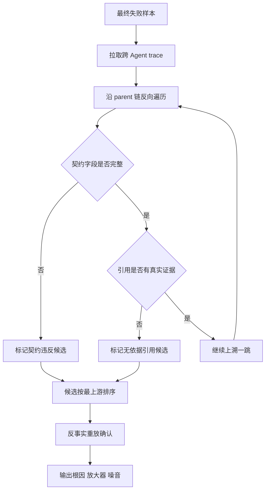

# 多 Agent 失败只有一句最终报错：步骤级证据链与反事实归因怎么建

## 为什么会有这个问题

多 Agent 链路出问题时，线上通常只剩一条顶层失败（空结果、超时、一句「task failed」），而真正的错误往往产生在上游某个 Agent 的中间产物里：检索 Agent 少召回了关键文档、分析 Agent 编造了一个不存在的 doc_id、抽取 Agent 把字段名写成了别名，下游只是忠实复述。常见错误认知有三个：一是认为「trace 打全了就能归因」，但 trace 只记录发生了什么，不记录哪一步的判断是错的；二是把最后报错的 Agent 当成根因，这是就近归因，会导致真正的问题源头永远不被修复；三是用 LLM judge 对每个 step 打分，judge 看不到下游契约，很容易给「读起来通顺但字段缺失」的中间产物打高分。归因的本质不是日志问题，而是要同时具备三样东西——可校验的契约、可追溯的证据、可验证的反事实。

## 怎么做

1. 定义 Agent 间的显式契约：每条委派消息声明 required 字段、证据引用 evidence_ids、来源与置信度；进入下一跳之前做 schema 校验 + 证据存在性校验，把「模型口头保证」换成机器可校验的断言，任何一环不通过就记录为 contract violation 而不是静默修补。
2. 每个 step 落一条结构化记录：输入摘要、输出、tool 调用清单与返回的资源 id、契约校验结果、耗时与 token。关键是记录两件事——该步输出引用了哪些证据 id、这些 id 是否真的出现在本次工具返回里；这是事后归因唯一可靠的明确证据，比自然语言日志强得多。
3. 失败时沿 parent 指针从最终失败点向上游遍历，找出第一个「契约违反」或「引用不可验证」的节点作为候选根因；如果两个节点同时违反，优先取最上游的那个，因为下游往往只是复制上游的错误字段。
4. 对 top-1 候选做反事实重放确认：把该步输出替换成修正版本（或用更强模型只重跑这一步），重放下游，若最终结果恢复则确认它是根因；若替换后仍失败，说明该节点是放大器而非根因，继续上溯。重放成本高，只在静态校验给出多个候选或候选不明确时触发。
5. 归因结论分三类输出：根因 root cause、放大器 amplifier（缺少重试、超时过短、没有降级分支、下游静默补默认值）、噪音；放大器单独统计，因为修放大器通常比修根因便宜，且能同时降低一批同类故障的影响面。
6. 建人工标注的归因评测集（每条样本标注真根因 step），用它衡量自动归因的准确率与误报率，避免自评自演；把新出现的失败样本回灌成回归用例，让「这类错误下次能被静态规则直接抓住」。

## 关键代码

```python
from dataclasses import dataclass, field

@dataclass
class Step:
    sid: str
    agent: str
    parent: str | None
    evidence_ids: set[str]                  # 本步工具返回中真实存在的资源 id
    claims: list[dict]                      # {"text": str, "cites": [id]}
    contract_errors: list[str] = field(default_factory=list)

def ungrounded(step: Step) -> list[str]:
    bad = set()
    for c in step.claims:
        bad |= {cid for cid in c["cites"] if cid not in step.evidence_ids}
    return sorted(bad)

def blame(trace: list[Step], failed_sid: str) -> list[dict]:
    by_id = {s.sid: s for s in trace}
    chain, cur = [], by_id[failed_sid]
    while cur:
        chain.append(cur)
        cur = by_id.get(cur.parent) if cur.parent else None
    hits = []
    for s in reversed(chain):               # 源头 -> 失败点，最上游优先
        if s.contract_errors:
            hits.append({"sid": s.sid, "agent": s.agent,
                         "kind": "contract", "detail": s.contract_errors[:3]})
        miss = ungrounded(s)
        if miss:
            hits.append({"sid": s.sid, "agent": s.agent,
                         "kind": "ungrounded", "detail": miss[:3]})
    return hits

def attribute(trace, failed_sid, replay_fixed):
    hits = blame(trace, failed_sid)
    if not hits:
        return {"root_cause": None,
                "note": "契约与引用均通过，优先排查外部依赖与超时"}
    top = hits[0]
    recovered = replay_fixed(top["sid"])   # 用修正输出重放下游
    return {"root_cause": top, "confirmed": recovered,
            "amplifiers": [h["sid"] for h in hits[1:]]}
```

## 真实场景

某项目的链路是「检索 Agent → 分析 Agent → 报告 Agent」。线上投诉集中在「报告结论和文档对不上」，但告警系统里没有任何异常：没有超时、没有 5xx、每个 Agent 都返回了合法 JSON。排查路径是这样的：先拉跨 Agent 的 trace，发现报告 Agent 只是老实复述了分析 Agent 给的结论；再往上翻，分析 Agent 的 claims 里引用了 doc_17，而检索 Agent 那次调用的工具返回里只有 doc_01 到 doc_09——也就是说 doc_17 是模型编的，但当时没有任何地方校验过 cite 是否存在。原监控只看「调用是否成功」，完全覆盖不到这种静默错误，团队前两轮一直在修报告 Agent 的 prompt，问题自然没解决。加上契约校验 + evidence 存在性校验之后，这条链路的失败能被自动定位到分析 Agent 这一步，并且归因结论反过来把报告 Agent 的两条重试逻辑标成了噪音（它本来就没问题）。

## 示意图



## 面试官追问

1. **Q：** 如果链路里有两个节点都违反了契约，怎么判断谁是真正的根因？

   **A：** 看信息增量：如果下游只是在透传上游的字段（字段名、值完全一致），根因归最上游；如果下游对这个字段做了实质变换（改写、聚合、补默认值），则下游是独立错误。再用反事实重放裁决：只修正上游重放一次、只修正下游重放一次，哪次能让最终结果恢复，哪次才是根因；两次都恢复说明是同一个错误的传导，取最上游并把下游标为放大器。

2. **Q：** 反事实重放要重跑下游整条链，成本很高，线上不可能每条都跑，怎么办？

   **A：** 做分级。零成本的静态校验（契约 + 证据存在性）覆盖 100% 的失败样本，绝大多数问题在这一层就能定位；只有静态校验给出 2 个以上候选、或候选的引用全部合法但结果仍错时，才触发重放。重放按比例采样（比如几个百分点），用途不是当场的归因结论，而是校准静态规则——把重放确认过的模式固化成新的静态判据，让重放的触发率随时间下降。


来源：https://github.com/cdavid817/agent-interview/blob/main/docs/02-capabilities/multi-agent/evaluation.md
