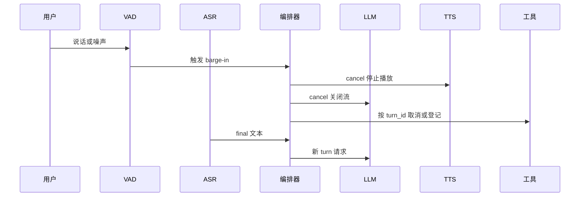

# 语音 Agent 被打断后仍在朗读：VAD 误触发、TTS 回声与半句意图的取消传播怎么处理

## 为什么会有这个问题

语音交互是双工流式系统，并非简单的 ASR→LLM→TTS 串行管道。用户说话、TTS 播放、ASR partial 会同时存在；如果没有 turn 边界和取消传播，旧 turn 的 LLM 流和 tool 调用会继续执行，TTS 回声会触发 VAD 造成自打断，半句 partial 会被误当成完整意图。很多团队只在前端 stop 播放，后端 stream 和工具没停，最终表现为会话历史交错、重复副作用和“用户说停还在花钱”。

## 怎么做

1. 建立 turn 生命周期与事件契约：每轮分配 turn_id、seq、ts、cancel_token；ASR partial 只更新 UI，final 才进入意图识别；所有下游调用携带 turn_id。
2. 做双工门控：用 TTS 参考信号做 AEC；VAD 采用能量与 ASR 置信度双门限；TTS 播放期间动态提高阈值；barge-in 需要连续帧或唤醒词，避免环境噪声自打断。
3. 取消传播要贯穿链路：transport 断开或用户打断 → cancel_token → 停 TTS → 关闭 LLM stream → 取消 tool executor；工具分为可中断与不可中断，不可中断的调用登记 orphaned effect 并对账。
4. 半句意图处理：endpoint 检测加语义完整度分类；低置信度先追问，不对 partial 触发写操作。
5. 时序可观测：trace 记录 VAD、ASR partial/final、TTS chunk、tool start/end，按 turn_id 回放；核心指标包括自打断率、误打断率、取消后副作用率、首包延迟。
6. 用录音回放集覆盖噪声、回声、插话、抢话等场景，按设备与场景分组调阈值，再灰度上线。

## 关键代码

```python
import threading

class Turn:
    def __init__(self, tid):
        self.tid = tid
        self.cancel = threading.Event()
        self.vad_hits = 0

class VoiceSession:
    def __init__(self):
        self.seq = 0
        self.turn = Turn(0)
        self.tts_playing = False

    def new_turn(self):
        self.turn.cancel.set()
        self.seq += 1
        self.turn = Turn(self.seq)
        return self.turn

    def on_vad(self, energy, asr_conf, keyword=False):
        th = 0.75 if self.tts_playing else 0.55
        if energy < th or asr_conf < 0.6:
            self.turn.vad_hits = 0
            return False
        self.turn.vad_hits += 1
        return keyword or self.turn.vad_hits >= 3

    def run_tool(self, tool, args):
        if tool.interruptible and self.turn.cancel.is_set():
            raise RuntimeError("cancelled")
        out = tool.call(args)
        if self.turn.cancel.is_set() and not tool.interruptible:
            ledger.add(self.turn.tid, tool.name, args, out)
        return out
```

## 真实场景

某项目语音助手在 TTS 播报时被室内噪声触发 VAD，前端停止播放并重新收音；ASR 把 TTS 尾音识别成“再查一下”，旧 LLM 流未关闭，两个 turn 同时调用订单查询工具。症状是同一会话出现交错回答、重复工具调用，用户说“停”后仍有写操作。按 turn_id 拉时间线排查，发现 VAD 在 TTS 期间未使用参考信号、cancel 只到 TTS、tool 没有绑定 turn。修复后重点观察自打断率、取消后副作用率和交错率。

## 示意图



## 面试官追问

1. **Q：** 如何评估 barge-in 阈值是否合理？

   **A：** 用录音回放集分成噪声、回声、真打断三类，观察误打断率与打断响应延迟的取舍；线上抽样人工标注，按设备类型和场景分组调阈值。不要只用一个固定能量阈值。

2. **Q：** 不可中断工具已经产生副作用怎么办？

   **A：** 写操作必须带 idempotency key 和审计记录；取消后不直接回滚，而是标记 orphaned effect，在下一轮对账或补偿；同时向用户明确“已执行”，避免静默重放。


来源：https://github.com/guocong-bincai/ai-interview-guide/blob/main/docs/21-multimodal-agents/README.md
