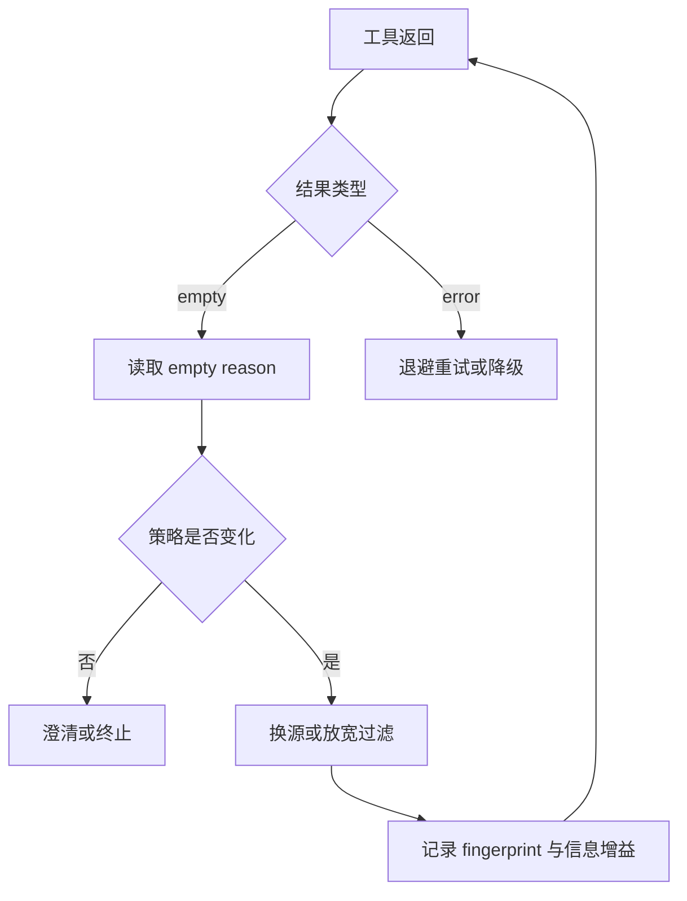

# 工具返回空结果后 Agent 换词重试同一查询：空结果语义、无进展检测与强制收敛怎么设计

## 为什么会有这个问题

空结果既不是错误，也不天然等于“再试一次”。它可能来自数据不存在、过滤条件过严、权限不足、分页游标错误或后端降级。Agent 如果只看到空数组，很容易把原因归为 query 不好，反复同义改写；max_iterations 只能兜底，不能阻止无效消耗。更糟的是工具把 403 或超时吞成空数组，Agent 永远学不到真实原因。

## 怎么做

1. 统一工具返回契约：status 使用 ok、empty、error、partial；empty 必须带 reason，例如 no_match、filtered_out、unauthorized、backend_degraded，并带 query_fingerprint；禁止裸返回空数组。
2. 建立进展度量：每次尝试记录新实体、新文档、新字段数、过滤条件变化和数据源变化；信息增益为 0 且 fingerprint 相同，直接命中缓存返回。
3. 重试分级：同义改写最多一次；权限或过滤类问题优先澄清或换数据源；写操作不因 empty 重试；只有 error 才走退避重试。
4. 预算与终止：全局 step、token、time 预算加连续无进展阈值；触发后输出已尝试路径、缺失信息和下一步建议，而不是继续循环。
5. 可观测：trace 记录 query、filter、结果数、empty reason、fingerprint、信息增益；指标看空结果率、空后重试率、无效重试占比、平均工具调用数。
6. 评估防刷：空结果也计步计费；离线回放构造权限空、过滤空、真无数据三类样本，校准重试策略与终止阈值。

## 关键代码

```python
from dataclasses import dataclass

@dataclass
class ToolResult:
    status: str
    reason: str = ""
    items: list = None
    fingerprint: str = ""

def info_gain(prev, cur):
    if not prev:
        return len(cur.items or [])
    return len(set(map(str, cur.items)) - set(map(str, prev.items)))

def should_retry(prev, cur, streak, strategy_changed, budget_left):
    if not budget_left or cur.status == "error":
        return False, "budget_or_error"
    if cur.status != "empty":
        return False, "has_result"
    if cur.reason in ("unauthorized", "backend_degraded"):
        return False, "clarify_or_degrade"
    if not strategy_changed:
        return False, "same_strategy"
    if prev and cur.fingerprint == prev.fingerprint:
        return False, "same_fingerprint"
    if streak >= 2 and info_gain(prev, cur) == 0:
        return False, "no_progress"
    return True, "changed_strategy"
```

## 真实场景

某项目客服 Agent 查询订单，工具对无权限订单返回空数组；Agent 连续改写订单号、日期、手机号，调用十几次后超时，最后回复“未找到”。排查发现工具层把 403 吞成空数组，empty 没有 reason；编排层只看 max_steps=20。修复方向是结构化 empty reason、fingerprint 去重、连续两次无信息增益转澄清。上线后观察平均工具调用数、空结果后重试率、无效重试占比和澄清率。

## 示意图



## 面试官追问

1. **Q：** 如何区分“该重试”和“该澄清”？

   **A：** 先看 empty reason 和策略是否真的变化；权限或过滤类优先澄清或换数据源；只有可恢复的 no_match 且新 query 带来信息增益才重试。阈值要用回放集校准，不能只看调用次数。

2. **Q：** 空结果也计费会不会让 Agent 不敢用工具？

   **A：** 计费是预算和观测手段，不是惩罚；对高价值查询保留预算，关键是让空结果带原因，减少盲试。可用分场景预算和动态放宽来平衡。


来源：https://github.com/guocong-bincai/ai-interview-guide/blob/main/docs/22-agent-planning-reflection/README.md
