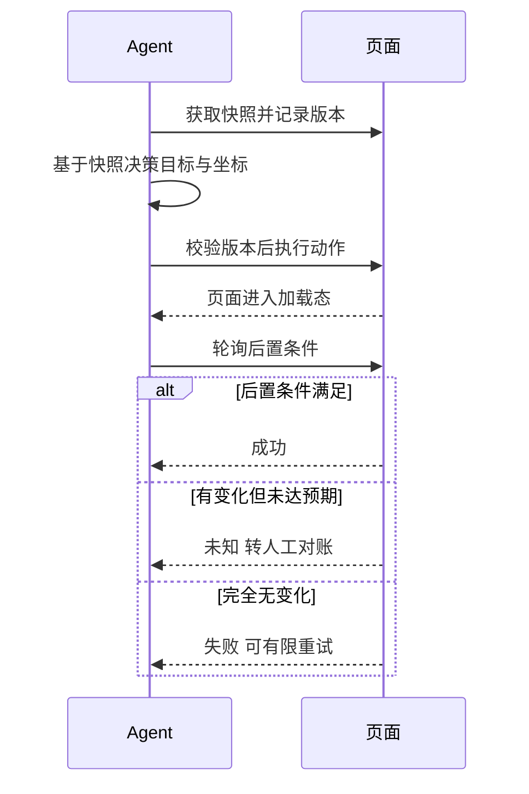

# GUI Agent 动作已执行却判为失败：截图滞后、坐标过期与重复副作用怎么防

## 为什么会有这个问题

GUI Agent 的执行循环是 observe（截图）→ 决策 → act（点击/输入/滚动），但截图是某一时刻的像素快照，动作落地的是坐标或元素引用，两者之间页面可能因动画、异步请求、弹窗而改变。真正的坑不在“点不中”，而在执行器把“没观察到预期变化”直接归类为失败并重试：副作用（提交工单、扣款、发消息）早已发生，重试就变成重复提交。常见错误认知有三个：一是把工具返回 ok 当成业务成功；二是默认 GUI 动作幂等，可以安全重放；三是用固定 sleep 代替状态等待，在慢网络下依然错位。

## 怎么做

1. 把动作结果从二元改成三态：成功 / 失败（明确无变化）/ 未知（有变化但未达预期）。未知态禁止自动重放，只能转人工或进对账队列。
2. 给每个动作绑定后置条件（post-condition）：期望的 URL、选择器出现、文本变化或元素消失，用轮询等待替代固定 sleep，超时才算失败。
3. 坐标与快照版本绑定：动作携带 snapshot_id，执行前校验当前快照版本，过期就重拍重决策，杜绝“按旧图点新页面”。
4. 副作用动作加幂等锚点：提交前用业务唯一键查询是否已存在，或在备注类字段写入 trace id 作为去重键；写操作在 Agent 侧串行化，不做并行重试。
5. 加重复动作熔断：同一 (action_kind, target_signature) 在滑动窗口内重复出现即中断任务并上报，避免 Agent 在同一个按钮上循环。
6. 优先使用 accessibility tree / DOM 选择器，视觉坐标只做兜底；失败样本连同截图回流成回归集。

## 关键代码

```python
ALLOWED = {"click", "type", "scroll"}

def act_with_verify(page, action, expect, max_wait_ms=8000):
    snap = page.snapshot()
    if action.snapshot_id != snap.id:
        return {"status": "stale_snapshot"}          # 快照过期，重拍再决策
    if action.kind not in ALLOWED:
        return {"status": "rejected"}

    before = page.signature(action.target)
    page.dispatch(action)

    if page.wait_until(lambda: expect.match(page), timeout=max_wait_ms):
        return {"status": "ok"}
    if page.signature(action.target) == before:
        return {"status": "failed"}                 # 明确无变化，可有限重试
    return {"status": "unknown", "need": "reconcile"}  # 有变化未达预期，禁止重放
```

## 真实场景

某项目用 GUI Agent 自动在客服后台创建工单。典型症状：后台出现同一工单的重复记录，而 Agent 日志里显示前两次动作“失败后重试成功”。排查路径：先比对动作时间线与截图时间戳，发现重试时使用的截图早于首次点击；再检查页面，按钮点击后进入 loading 态但成功提示延迟出现，等待逻辑用的是固定 sleep；最后看执行器，把“未检测到成功提示”判为失败并立即重放，而写接口本身没有幂等键。修复方向即上面的三态返回 + 后置条件轮询 + 提交前查重，重复记录随之消失；残余的未知态统一进对账任务由人工确认。

## 示意图



## 面试官追问

1. **Q：** 如果后端完全不能改，怎么保证提交类动作不被重复执行？

   **A：** 三层兜底：提交前用业务唯一键做一次查询（读接口通常可加）；把 trace id 写进备注、标题等自由文本字段，重复提交能被业务侧识别与清理；未知态一律不自动重放，落到对账任务由人工或离线脚本按 trace id 去重。同时 Agent 侧对写操作串行化，禁止并行重试。

2. **Q：** 纯视觉方案坐标不稳定，除了换 DOM 还有什么办法？

   **A：** 坐标必须与快照版本绑定并在点击前校验元素签名（区域文本 + 相对位置）；做 devicePixelRatio 与缩放换算；对滚动容器记录滚动偏移而非绝对坐标；把定位失败与误点样本回流成回归集，按页面维度统计定位成功率，长期不达标的页面改用 DOM/accessibility 通道。


来源：https://github.com/guocong-bincai/ai-interview-guide/blob/main/docs/21-multimodal-agents/README.md
