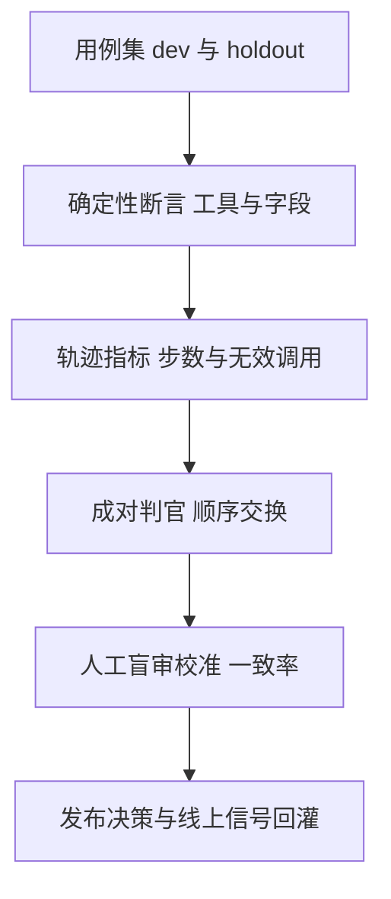

# 离线 eval 分数上涨而线上投诉变多：判官偏差、只判终态与评测口径怎么校准

## 为什么会有这个问题

Agent 的评测很容易做成“自娱自乐”：用同一个模型家族当判官、参考答案也由模型生成，判官天然偏好自己的措辞风格与更长更完整的答案，于是分数上涨不代表质量上涨；只判最终答案，则工具选错、绕路、无效重试这些过程问题被正确答案掩盖。再加上采样 temperature 未固定、用例集被反复用来调 prompt，评测结果既不可复现也早已过拟合。常见错误认知是把 eval 当成一个分数，而不是一套分层、可校准、能定位问题的测量系统。

## 怎么做

1. 建分层评测金字塔：先用确定性断言兜底（必须调用的工具、参数 schema、必填字段、禁止出现的表达），再用轨迹指标（步数、无效工具调用率、单任务 token 与耗时、人工接管率），最后才用判官打分。
2. 判官改成成对比较而非绝对打分，并对同一对做顺序交换：两次结论不一致即记为平局，抵消位置偏差；判官与候选尽量不同家族、不同规模。
3. 固定评测协议：judge 版本、temperature、seed、rubric、上下文长度全部版本化随用例一起存档，报告必须带样本量与置信区间，禁止跨批次比较绝对分。
4. 用人工盲审小样本校准判官，报告判官与人工的一致率；一致率不达标时先修 rubric 和示例，而不是改 prompt 刷分。
5. 用例集切分 dev / holdout，holdout 冻结且定期从线上真实流量抽样换血并去重；只允许在 dev 上看分数迭代。
6. 把线上信号接回来：人工接管率、投诉标签、重试率按版本维度看板化，与离线指标对不齐时优先相信线上。

## 关键代码

```python
def judge_once(client, q, a, b, rubric):
    prompt = f"{rubric}\n问题: {q}\n候选A: {a}\n候选B: {b}\n只输出 A 或 B"
    out = client.chat(prompt, temperature=0, seed=7, max_tokens=4)
    return "A" if out.strip().upper().startswith("A") else "B"

def pair_score(client, q, new, base, rubric, k=3):
    win = 0.0
    for _ in range(k):
        fwd = judge_once(client, q, new, base, rubric)
        rev = judge_once(client, q, base, new, rubric)
        if fwd == "A" and rev == "B":
            win += 1.0          # 两次都判新答案好
        elif fwd == "B" and rev == "A":
            win += 0.0
        else:
            win += 0.5          # 顺序不一致记平局
    return win / k
```

## 真实场景

某项目上线新 prompt 后离线 eval 分数稳步上升，但线上人工抽检的差评变多。排查路径：先看判官配置，发现 judge 与候选同家族、参考答案由模型生成，且长答案得分系统性偏高；再看用例集，发现近几轮迭代的失败 case 已被反复加入 dev 集并被针对性修补，holdout 很久没换；最后看指标口径，只看终态正确率，工具调用序列完全没被断言。整改为分层断言 + 跨家族成对判官 + 顺序交换 + 人工盲审校准后，离线分数与线上差评方向重新一致，并暴露出此前被掩盖的工具误选问题。

## 示意图



## 面试官追问

1. **Q：** 判官和候选是同一模型，自偏好怎么破？

   **A：** 优先换家族或换规模做 judge；用成对比较替代 1–5 分绝对打分；做顺序交换并以一致票为准；用人工标注子集持续测一致率，把一致率作为评测系统本身的健康指标；rubric 里给出正反例，减少对措辞风格的敏感。

2. **Q：** 训练集反复用来调 prompt，怎么防止评测过拟合？

   **A：** dev / holdout 严格隔离，holdout 只在发布决策时跑；holdout 定期从线上抽样换血并做去重与难度分层；对高风险类别加权并单独报告子集指标；报告带置信区间和样本量，避免用小数点后的差异做决策。


来源：https://github.com/guocong-bincai/ai-interview-guide/blob/main/docs/12-frameworks-tools/README.md
