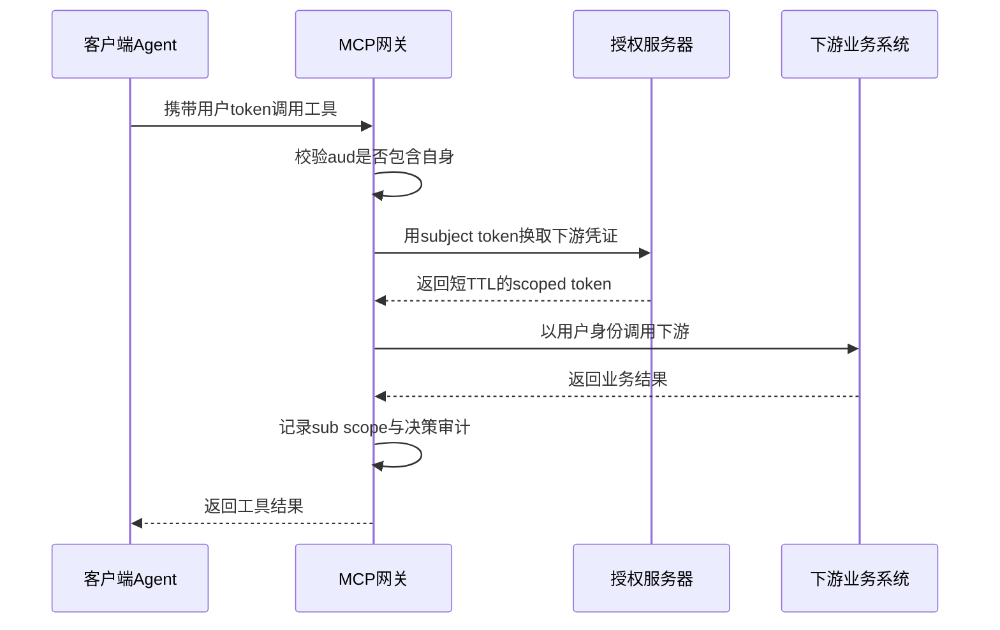

# MCP Server 把用户令牌透传给下游：confused deputy、audience 校验与按用户降权怎么落地

## 为什么会有这个问题

把内部系统封装成远程 MCP Server 时，最省事的实现是：客户端把用户的 access token 交给 MCP Server，Server 原样塞进 Authorization 头转给下游 CRM、工单或数据库。这条链路里 MCP Server 既不是该 token 的受众，又拥有访问内网的全部网络能力，于是变成典型的 confused deputy——下游只看到一个合法 token，无法判断这次调用是替哪个用户发的；当 Agent 被 prompt injection 或错误的工具选择驱动去访问用户本无权访问的资源时，下游会照单全收。MCP 规范明确要求 Server 拒绝任何未把自己声明为受众的 token，即禁止 passthrough。最常见的错误认知是「网关做了 JWT 验签就等于做了授权」：验签只证明 token 没有被篡改，既不证明它签发给了这个服务，也不证明这次具体工具调用在该用户的权限范围内。

## 怎么做

1. 角色分离 + audience 校验：MCP Server 只做 Resource Server，配置自身的 resource indicator，每次请求校验 aud 是否包含自身，缺失或不匹配直接 401，不接受通用 token。
2. 禁止透传，改为换发：客户端 token 只留在网关内存中，用 RFC 8693 token exchange 或 on-behalf-of 换成下游 scoped token，短 TTL、aud 指向具体下游、带 sub 与 actor 声明。
3. 按用户降权执行：工具执行上下文强制携带 subject 与 tenant，下游以用户身份而非服务账号访问，数据层开 RLS；工具所需 scope 在 tools/list 中声明，网关按调用者真实授权做 per-tool 拦截。
4. 出站收敛：MCP Server 的 egress 白名单按工具粒度配置，一个工具只允许打到一个下游 host，避免某工具变成任意内网探测通道。
5. 可回放审计：每次 tools/call 记录 sub、actor、aud、scope、工具名、参数摘要与决策结果，按 sub 聚合做异常告警，保证事后能定位到具体用户。
6. 回归化验证：把「低权限账号 + 诱导性 prompt」做成固定用例，长期跑，防止后续新增工具绕过策略。

## 关键代码

```python
from fastapi import FastAPI, HTTPException, Request
import httpx

RESOURCE = "https://mcp.internal/ticket"
IDP_TOKEN_URL = "https://idp.internal/oauth2/token"

app = FastAPI()

async def exchange_for_downstream(subject_token: str, scope: str) -> str:
    async with httpx.AsyncClient(timeout=3.0) as client:
        resp = await client.post(IDP_TOKEN_URL, data={
            "grant_type": "urn:ietf:params:oauth:grant-type:token-exchange",
            "subject_token": subject_token,
            "subject_token_type": "urn:ietf:params:oauth:token-type:access_token",
            "audience": "https://crm.internal",
            "scope": scope,
        })
    resp.raise_for_status()
    return resp.json()["access_token"]

@app.middleware("http")
async def audience_guard(request: Request, call_next):
    if request.url.path.startswith("/mcp"):
        token = request.headers.get("authorization", "")[7:]
        claims = verify_jwt(token, jwks=JWKS)
        if RESOURCE not in claims.get("aud", []):
            raise HTTPException(401, "audience mismatch")
        request.state.sub = claims["sub"]
        request.state.tenant = claims["tenant"]
        request.state.subject_token = token
    return await call_next(request)

@app.post("/mcp/tools/call")
async def call_tool(request: Request, body: ToolCall):
    allowed = await policy.scopes_for(request.state.sub, body.name)
    if not allowed:
        audit(request.state.sub, body.name, "denied")
        raise HTTPException(403, "tool not permitted")
    downstream = await exchange_for_downstream(request.state.subject_token, allowed)
    return await tools.execute(body, token=downstream, tenant=request.state.tenant)
```

## 真实场景

某项目把工单系统封装成远程 MCP Server，放在公网网关后给内部 Agent 使用。上线一段时间后，安全同学发现下游 CRM 的访问日志里所有请求的调用主体都是同一个服务账号，无法区分真实用户；同期客服反馈某低权限账号通过 Agent 查到了其他租户的工单摘要。排查路径：先比对 MCP 网关收到的 token 与下游 Authorization 头，发现是同一个字符串，透传坐实；再看下游 403 比例几乎为零，说明从未做过用户级鉴权。止血分两步：先在网关补 aud 校验与按租户的 egress 白名单，立刻阻断跨租户工具；再把透传改成 token exchange，让下游按 sub 做 ACL 校验。事后把「低权限账号尝试越权工具」固化进回归集。

## 示意图



## 面试官追问

1. **Q：** 每次工具调用都做 token exchange，延迟和授权服务器压力怎么控？

   **A：** 按 (sub, 下游 audience, scope 集合) 做短缓存，TTL 取 min(换出 token 的 exp, 几分钟)，命中缓存仍要重新校验调用者本次的工具授权；同一次 tools/call 内的多次下游调用复用同一个换出 token，exchange 只在首次触发；授权服务器不可用时降级为拒绝，绝不能回落到服务账号。

2. **Q：** 本地 stdio 启动的 MCP Server 没有 HTTP 头，同样的约束怎么落？

   **A：** 由宿主在初始化握手中注入 credential，Server 侧仍要校验凭证中的 audience/resource 是否指向自己、是否带 sub，而不是信任宿主传入的一切；不要把「本地进程」当信任边界，stdio Server 同样可能被注入的指令驱动去读任意文件或发起外连。


来源：https://github.com/guocong-bincai/ai-interview-guide/blob/main/docs/14-mcp-skill-systems/README.md
