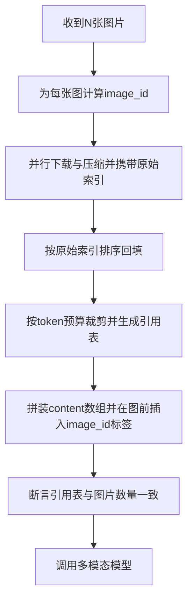

# 多图输入被并行预处理打乱顺序：指代错配、缓存键碰撞与引用表怎么治

## 为什么会有这个问题

多图 Agent 的真实链路上，图片要先经过下载、缩放压缩、可选裁剪、去重、按 token 预算丢弃，这些步骤通常并行执行。很多实现用 asyncio.gather 后直接按返回顺序 append，协程完成顺序不稳定，同一请求两次拼出的 content 数组顺序就不同。而模型对多图只能靠位置指代（第二张、最后一张），顺序一变指代全错；更隐蔽的是缓存层用 URL 或文件名做图片键，同一张图的不同裁剪视图被碰撞成同一条，模型看到的是上一次的视图。常见错误认知是「图片顺序无所谓，模型会自己看内容」——在跨图对比与引用的任务（票据核对、多页合同、UI 前后对比）里，指代错误会直接变成业务结论错误。

## 怎么做

1. 位置与身份解耦：每张图生成稳定 image_id（内容哈希 + 预处理参数），prompt 中用 image_id 指代，content 数组顺序由输入索引决定而不是完成顺序。
2. 并行保序：每个预处理任务携带原始 index 返回，gather 后按 index 排序回填，禁止在协程里直接 append。
3. 缓存键唯一化：键为 hash(内容 + 视图参数如 max_side、crop_box)，视图不同即不同键，杜绝跨视图复用。
4. 预算裁剪显式化：按任务相关性选图，被丢的图保留 OCR 摘要并标注已省略，同时重建 image_id 到序号的引用表。
5. 拼装后断言：图片数量与引用表长度必须一致；在回归集中固定一组多图用例，同输入重复跑多次比较输出一致性。

## 关键代码

```python
import asyncio, hashlib

async def prepare(idx, raw, view):
    data = await compress(raw, view.max_side)
    key = hashlib.sha256(data + view.signature.encode()).hexdigest()[:12]
    return idx, {"image_id": f"img_{key}", "data": data}

async def build_images(raws, view, budget):
    results = await asyncio.gather(*(prepare(i, r, view) for i, r in enumerate(raws)))
    ordered = [item for _, item in sorted(results, key=lambda x: x[0])]

    kept, used, dropped = [], 0, []
    for item in ordered:
        cost = estimate_tokens(item["data"])
        if used + cost > budget:
            dropped.append(item["image_id"])
            continue
        kept.append(item)
        used += cost

    legend = "\n".join(f"[{it['image_id']}] 第{i + 1}张" for i, it in enumerate(kept))
    if dropped:
        legend += "\n以下图片已省略，仅保留文字摘要：" + ",".join(dropped)

    content = []
    for it in kept:
        content.append({"type": "text", "text": f"[{it['image_id']}]"})
        content.append({"type": "image", "data": it["data"]})
    assert len(kept) + len(dropped) == len(raws)
    return legend, content
```

## 真实场景

某项目做费用报销审核 Agent，用户一次上传 6 张票据截图。投诉集中在两点：Agent 把 A 票据的金额安到 B 票据上；同一批图重复提交两次给出不同结论。排查路径：先在拼装处打印每张图的输入索引与最终位置，发现并发较高时两者随机不一致；用给压缩步骤加随机延迟的方式稳定复现，多次重放顺序各不相同；再查缓存命中，按文件名做键导致同一文件不同裁剪视图互相污染；最后发现超预算丢图后没有更新 prompt 里的「第 N 张」映射，模型开始编造被省略图片的内容。指标上表现为同输入重放一致性低，跨图引用类问题的正确率明显低于单图任务。

## 示意图



## 面试官追问

1. **Q：** 加了 image_id 标签模型真的会用吗，怎么验证？

   **A：** 在 system 中明确要求引用图片必须使用方括号中的 ID，并把 ID 文本与图片放在同一 block 紧邻；构造「只有靠 ID 才能答对、靠顺序必然答错」的对抗用例（例如打乱顺序后问 img_x 上的金额），观察准确率；如果模型仍偏向位置指代，就额外给一张 image_id 与序号的映射表做冗余。

2. **Q：** 图片太多 token 预算不够时，丢图策略怎么定才不伤正确率？

   **A：** 先按任务相关性排序（用户显式指定的优先，其次最近上传），被丢的图必须以文本摘要形式保留在上下文并显式标注已省略，禁止让模型猜；关键任务改为多轮分批调用，而不是一次塞满再丢弃。


来源：https://github.com/guocong-bincai/ai-interview-guide/blob/main/docs/21-multimodal-agents/README.md
