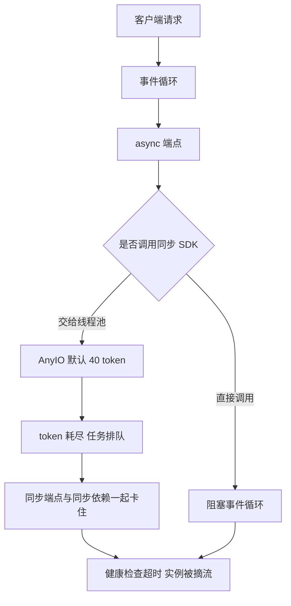

# async def 接口 P99 抖动到秒级：同步 SDK 打满共享线程池，怎么定位并隔离

## 为什么会有这个问题

大家都知道「async def 里不要写阻塞调用」，但真正的坑在另一半：FastAPI 会把 def 端点、以及所有同步依赖（鉴权、DB session、同步 SDK 工厂）自动丢进 AnyIO 的 worker thread 执行，而这个线程池默认只有 40 个 token，且是整个进程共享的。于是同步调用不阻塞事件循环，却把线程池占住；一旦贴顶，后续所有同步端点、所有同步依赖一起排队， síntomas 是 CPU 很低、事件循环 lag 正常、p99 却到秒级。三类常见错误认知：一，认为「改成 async def 就没事」，结果在 async 里直接调同步 SDK，真的把事件循环卡死；二，认为线程池会随并发自动扩容，实际默认上限 40；三，用 run_in_threadpool 包一层以为隔离了，其实用的还是同一个默认 limiter。更常见的是连 timeout 都没设，token 被长期占死。

## 怎么做

1. 先分清是事件循环卡住还是线程池饥饿：容器内 py-spy dump --pid 看有多少线程停在 socket read；把 anyio.to_thread.current_default_thread_limiter().borrowed_tokens 打成 metrics，对照 QPS 看是否贴顶；同时看事件循环 lag 是否正常。
2. 把调用分三类处理：可换 async 客户端（httpx.AsyncClient / 官方 async SDK）的首选换掉；真同步阻塞（旧 SDK、文件 IO）隔离到独立线程池并显式设并发上限；短 CPU 任务留在原地但要有上限。
3. 隔离不要复用默认 limiter：自建 CapacityLimiter 或 ThreadPoolExecutor，上限按「目标 QPS × 平均耗时 ÷ 下游可承受并发」估算，并给 SDK 设明确 timeout 与重试上限，保证 token 一定归还。
4. 同步依赖同样要治：依赖里禁止做网络调用，必须做的改成 async，或用带短超时的本地缓存顶掉高频调用。
5. 健康检查与探针接口必须是 async def 且不依赖任何同步依赖，否则会和业务一起排队，被 K8s 误判摘流，把小抖动放大成雪崩。
6. 出口加三个告警：事件循环 lag、线程池 borrowed/排队数、超时率；压测复现原始曲线，确认隔离后 p99 与 borrowed_tokens 不再相关。

## 关键代码

```python
import anyio
from fastapi import FastAPI, Depends

app = FastAPI()
LIMIT = anyio.CapacityLimiter(8)          # 独立于 AnyIO 默认 40 token


def legacy_client():                       # 同步依赖也占线程池，禁止做网络调用
    return LegacySDK(timeout=5)


@app.post("/answer")
async def answer_bad(q: str, c=Depends(legacy_client)):
    return c.ask(q)                        # 直接阻塞事件循环，最坏情况


async def blocking_ask(q: str) -> str:     # 同步 SDK 包一层，必须有 timeout
    return LegacySDK(timeout=5).ask(q)


@app.post("/answer-ok")
async def answer_ok(q: str):
    try:
        async with LIMIT:                  # 按下游容量做背压
            return await anyio.to_thread.run_sync(blocking_ask, q)
    except TimeoutError:
        return {"code": "upstream_timeout"}   # 快速失败优于排队
```

## 真实场景

某项目把内部 LLM 的同步 HTTP SDK 直接放进 async def 端点，上线后白天 p99 从几百毫秒涨到数秒，但 CPU 只有三成、下游耗时曲线平稳；紧接着 /healthz 也开始超时，触发 K8s 探针失败，实例被反复摘流再拉起，重启能好一阵又复发。排查路径：py-spy dump 看到几十个线程全部停在 requests 的 socket read；borrowed_tokens 指标贴满默认 40；把 /healthz 改成纯 async、无任何依赖后，实例不再被误杀，但 /answer 仍在排队，说明压力来自共享线程池而非事件循环。最终改为 async 客户端 + 独立 CapacityLimiter(8) + 5s 超时，超时直接降级返回，p99 回落且 borrowed_tokens 变成平稳曲线。

## 示意图



## 面试官追问

1. **Q：** 直接把线程池上限调大、或加机器不就行了？

   **A：** 调大只是把压力原样转给下游，还会带来 GIL 争用和上下文切换，尾延迟通常更差；正确做法是按下游容量定上限、超限快速失败（超时/429/降级），并让排队长度可见。加机器能缓解但不解决问题根因。

2. **Q：** run_in_threadpool 和 asyncio.to_thread 有什么区别？

   **A：** 前者用 AnyIO 的默认 limiter（进程内共享，默认 40），后者用 asyncio 默认 executor（默认 min(32, cpu+4)），两者互不共用，所以换一个不等于做了业务隔离；要真正隔离必须自建 limiter 或 executor，否则一条慢链路仍会拖住所有同步调用。
