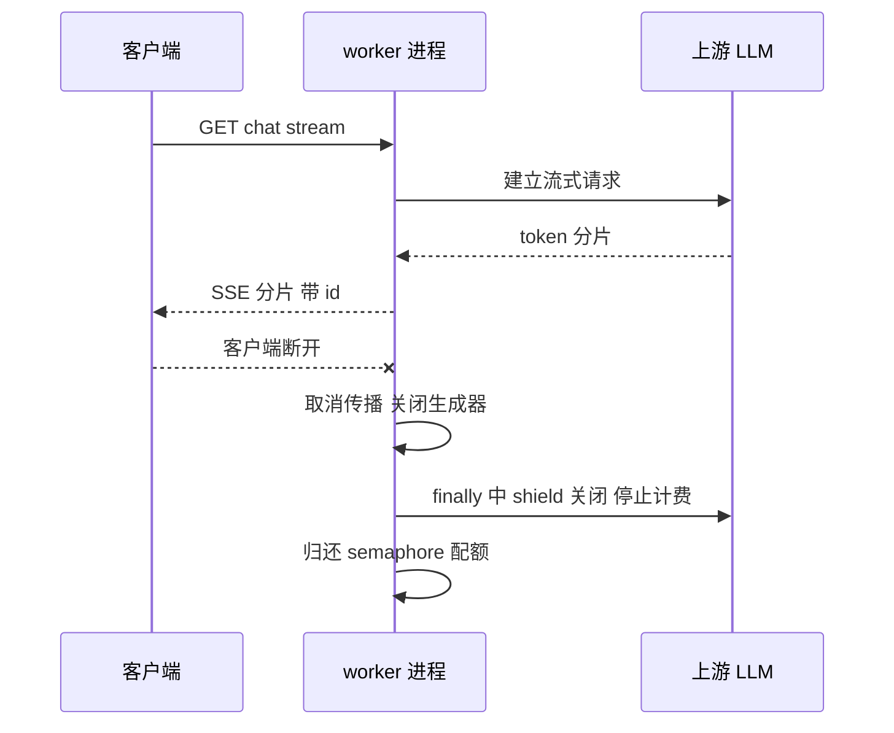

# SSE 流式接口 worker 被长连接占满、客户端断开后仍在计费：多进程部署怎么收口

## 为什么会有这个问题

SSE 在 FastAPI 里只是把一个 async generator 交给 StreamingResponse，能推起来很容易，难的是三件事同时成立：一，连接是长连接，而 worker 是有限资源，一个进程能挂的连接数并不等于能同时跑的生成器数；二，客户端随时会断，但上游 LLM 的生成与计费不会自动停；三，一旦发出 200 和首个分片，后续任何错误都无法再用状态码表达。常见错误认知包括：以为 async for 循环里客户端断了会自然 break（实际上有的路径靠取消传播，生成器被 buffer 卡住或上游还在排队时不会立刻感知）；以为 finally 里可以随便 await 做清理（取消作用域下 await 会立即抛 CancelledError，清理做不完）；以为 asyncio.Semaphore 能做全局限流（它是进程内的，-w 4 就是 4 倍预算）；以为设了 X-Accel-Buffering: no 就万事大吉（还有网关 idle timeout 和 GZip 中间件会把流攒住）。

## 怎么做

1. 断开与清理分层：依赖框架的取消传播（生成器被 close 时在 finally 里释放上游），再加周期性 await request.is_disconnected() 作为兜底；把清理拆成「必须完成」（停上游、归还配额）和「尽力而为」（审计日志），前者用 asyncio.shield 或投递给独立任务，别让它被取消打断。
2. 并发上限按 worker 换算：进程内 asyncio.Semaphore 限制同时在跑的生成器数量，且必须在开始流之前判定（流一旦开始就改不了状态码），超限直接 429；总上限 = worker 数 × 单进程上限，并与上游 RPM/TPM 配额对齐。
3. 响应头与中间件清理：media_type=text/event-stream、Cache-Control: no-cache、X-Accel-Buffering: no；重点检查是否有 GZipMiddleware（会把分片攒起来变成假流式）、CORS 中间件、以及网关的 proxy_read_timeout 与 idle timeout。
4. 把心跳和续传做进协议：用注释行 `: ping` 做心跳，间隔小于所有中间层最短 idle timeout；每个分片带 id: <seq>，客户端用 Last-Event-ID 续传；错误走 data: {"type":"error"} 事件而不是状态码。
5. 部署侧取舍：给流设最大时长和最大 token 硬上限，超时主动发 end 事件关闭；滚动发布时设置 --timeout-graceful-shutdown 并接受旧 worker 会等到长连接结束，或先摘流再等连接自然衰减；连接数指标按 worker 维度看，不要只看整体平均。
6. 测试要覆盖断连：用 httpx.AsyncClient + ASGITransport 或真实 uvicorn 写「中途断开」用例，断言上游 close 被调用、配额已归还；再压测确认 worker 连接数与生成器数线性可控、不随空闲连接膨胀。

## 关键代码

```python
import asyncio, json
from fastapi import FastAPI, Request
from fastapi.responses import StreamingResponse, JSONResponse

app = FastAPI()
SEM = asyncio.Semaphore(64)          # 进程内上限，总量需乘 worker 数


@app.get("/chat/stream")
async def chat_stream(request: Request, q: str):
    if SEM.locked():                 # 必须在开流之前拒绝，开流后改不了状态码
        return JSONResponse({"code": "busy"}, status_code=429)

    async def gen():
        seq, up = 0, None
        try:
            async with SEM:
                up = await request.app.state.llm.open(q, timeout=60)
                async for tok in up:
                    if await request.is_disconnected():
                        break
                    seq += 1
                    yield f"id: {seq}\ndata: {json.dumps({'t': tok})}\n\n"
            yield "data: [DONE]\n\n"
        finally:
            if up is not None:
                await asyncio.shield(up.aclose())   # 必须完成：停生成、归还配额

    return StreamingResponse(gen(), media_type="text/event-stream",
        headers={"Cache-Control": "no-cache", "X-Accel-Buffering": "no"})
```

## 真实场景

某项目把一问一答从一次性返回改成 SSE 后，功能测试全过，上线一周出现三类现象：晚高峰部分实例 CPU 内存都正常，但新建连接要排十几秒才出首字节；账单侧的上游 LLM 调用量明显高于前端实际完成的对话数；滚动发布时客户端报流中断，用户只看到半句话。排查路径：按 worker 维度打连接数与活动生成器数，发现 worker 数 2、单进程 semaphore 设 64，实际总并发翻倍且被长连接占满；用 request_id 对账发现大量生成器在客户端关闭后仍一直跑到上游 60s 超时；再查网关 idle timeout 60s 而心跳间隔 90s，长连接被中间层静默断掉、两端都没立即感知。最终落地：心跳缩短到 15s、分片带 id 支持 Last-Event-ID 续传、清理放 shield、总上限按 worker 数对齐上游配额、给流加最大时长后主动结束。

## 示意图



## 面试官追问

1. **Q：** 客户端断开了，怎么保证上游一定停？

   **A：** 三层防护：框架的取消传播把生成器关掉，在 finally 里 aclose 上游连接；is_disconnected 轮询兜底处理取消没及时传播的路径；最后加服务端最大生成时长与最大 token 的硬上限，即使前两层都失效也会自然收尾。真正的兜底是最后一道，前两层只是让停止更及时。

2. **Q：** 多进程部署下 semaphore 怎么实现全局限流？

   **A：** 进程内 semaphore 只能防单实例被打爆，全局要靠外部：网关或 Redis 令牌桶，或按 worker 数静态切分下游配额；工程上更稳的是两段式，先取全局令牌再开流，取不到直接 429，避免长连接建立起来又被拒绝，浪费连接与首字节等待。
