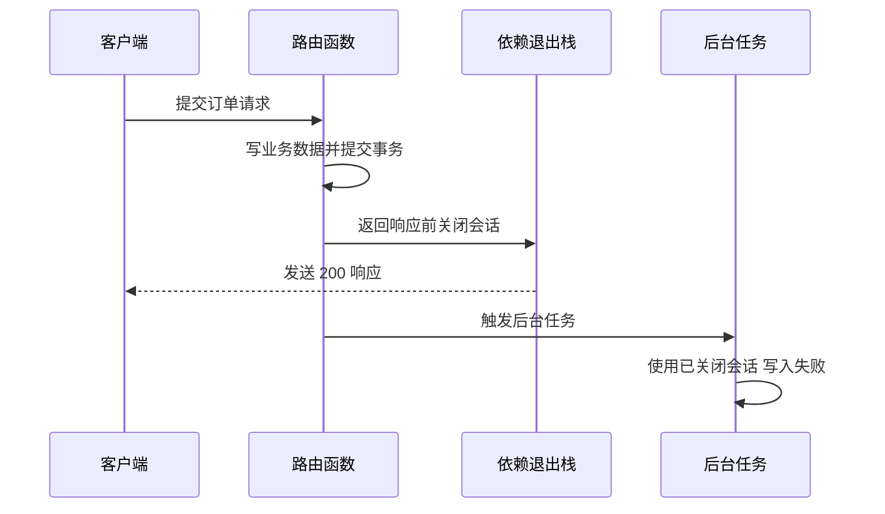

# 返回 200 之后，后台任务写入已关闭的会话：审计记录丢失且没有重试，怎么补

## 为什么会有这个问题

FastAPI 从 0.106 起把 yield 依赖的退出（exit stack 关闭）提前到响应发送之前，请求作用域的 Session、HTTP client 在 BackgroundTasks 真正执行时已经关闭；而 BackgroundTasks 仍跑在同一个 worker 进程内，没有持久化、没有重试、没有背压，任务抛出的异常不会改变已经发出的状态码。很多团队在旧版本上“本来能跑”，升级后变成静默失败：接口全部返回 200，业务数据一条没写入，监控里看不到 5xx，最后靠对账才发现。

## 怎么做

1. 先用时间线确认顺序：在 yield 依赖的 finally 与后台任务的首尾各打一条带 trace id 的时间戳日志，确认会话关闭发生在任务执行之前，并对照 FastAPI 0.106 的 release note。
2. 切断任务对请求作用域资源的依赖：add_task 只传不可变的标量或 DTO（业务键、id、快照字段），绝不传 ORM 实例或 Session，因为实例此时已 detached。
3. 任务内部自建资源：在 lifespan 中创建独立的 engine、sessionmaker 与 httpx client，任务用 async with session_factory() 拿到自己的会话；同时设置连接池上限与获取超时，避免长任务耗尽连接池。
4. 按可丢与不可丢分流：不可丢的副作用改为在同一事务里写 outbox 表，再由独立消费者（定时任务或队列 worker）处理并回写状态；BackgroundTasks 只保留埋点、缓存预热这类可丢动作。
5. 幂等兜底：写入用业务唯一键 upsert，或状态机条件更新（where status='pending'），保证重放与并发都安全。
6. 可观测性单独建：任务失败计数、耗时、积压量单独埋点与告警，不依赖 HTTP 状态码；再加一个对账任务比对业务表与 outbox 的差异。

## 关键代码

```python
from contextlib import asynccontextmanager
from fastapi import BackgroundTasks, Depends, FastAPI, Request
from sqlalchemy.dialects.postgresql import insert as pg_insert

@asynccontextmanager
async def lifespan(app: FastAPI):
    app.state.engine = create_async_engine(DSN, pool_size=5, max_overflow=5)
    app.state.session_factory = async_sessionmaker(app.state.engine, expire_on_commit=False)
    yield
    await app.state.engine.dispose()

app = FastAPI(lifespan=lifespan)

async def write_audit(session_factory, order_id: int, biz_key: str) -> None:
    async with session_factory() as s, s.begin():
        stmt = pg_insert(Audit).values(order_id=order_id, biz_key=biz_key)
        await s.execute(stmt.on_conflict_do_nothing(index_elements=['biz_key']))

@router.post('/orders')
async def create_order(payload: OrderIn, request: Request, bg: BackgroundTasks,
                       session: AsyncSession = Depends(get_session)):
    order = await save_order(session, payload)
    await session.commit()
    bg.add_task(write_audit, request.app.state.session_factory, order.id, payload.biz_key)
    return {'id': order.id}
```

## 真实场景

某项目把 FastAPI 升级到 0.106 以上后上线，订单接口的错误率与 P99 都没有变化（全是 200），但对账发现审计表当天新增为 0；日志里散落着 Session is closed 一类告警，被当成噪音忽略。排查路径：先找后台任务的失败计数（通常没埋点，只能 grep 日志并关联 trace id）→ 在依赖 finally 与任务内部打时间戳，确认会话先关闭、任务后执行 → 最后定位到任务里复用了 Depends 注入的会话，改成任务内自建 sessionmaker 并补上 upsert 幂等。

## 示意图



## 面试官追问

1. **Q：** 把后台任务改成同步阻塞函数，让它赶在依赖关闭前执行，可行吗？

   **A：** 不可行。BackgroundTasks 无论同步还是异步，都在响应发送之后执行，顺序不会改变；同步函数还会占用 anyio 线程池，长任务会拖慢其他请求的依赖执行。正确做法是任务内自建资源，或者换成 outbox 加独立消费者。

2. **Q：** 那为什么不直接用 asyncio.create_task 后台跑？

   **A：** create_task 没有生命周期归属：worker 重启、滚动发布、进程被 SIGKILL 时任务直接丢失；异常没有人去 await 会静默吞掉；也没有背压与并发上限。它只适合可以丢的短副作用，而且要 add_done_callback 记录异常。
