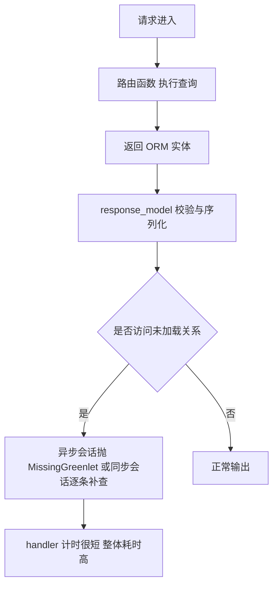

# handler 很快但 P99 高：response_model 在序列化阶段触发隐式懒加载与 N+1，怎么根治

## 为什么会有这个问题

把 ORM 实体直接交给 response_model 时，属性访问被推迟到响应构建阶段。异步会话下，同步懒加载会直接抛 MissingGreenlet 变成 500；同步会话（跑在线程池里的依赖）下，则是每条记录补一次查询，形成 N+1。这两类问题都发生在框架层，应用自身的 handler 计时看起来很短，于是被误判成“查询没问题、框架慢”。再叠加 Pydantic v2 的校验与序列化两遍遍历，大列表的开销会成倍放大。

## 怎么做

1. 分阶段计时：用中间件或自定义 APIRoute 记录请求进入、handler 返回、响应序列化完成三个时间点，把耗时拆成 handler 与序列化两段，先确认慢在哪一段。
2. 统计 SQL 条数：在测试里挂 before_cursor_execute 监听，对每个接口断言 SQL 条数上限（详情类不超过 3、列表类不超过 2），N+1 会在 CI 直接暴露，而不是等到线上 P99 恶化。
3. 显式预加载加显式 DTO：查询用 selectinload 或 joinedload，路由内部把 ORM 实例构造成独立的 Pydantic DTO，schema 不开 from_attributes，从结构上杜绝序列化期的隐式属性访问。
4. 控制 response_model 成本：列表接口强制分页、裁剪字段、避免多层嵌套递归校验；极热路径改用 ORJSONResponse 加 model_dump_json，绕过二次编码。
5. 防回归：路由返回类型里不再出现 ORM 实体，配合 lint 规则或单测断言，review 时一眼能看出谁又返回了实体。

## 关键代码

```python
class ItemOut(BaseModel):
    sku: str
    qty: int

class OrderOut(BaseModel):
    id: int
    items: list[ItemOut]

@router.get('/orders', response_model=list[OrderOut])
async def list_orders(session: AsyncSession = Depends(get_session)):
    stmt = select(Order).options(selectinload(Order.items)).order_by(Order.id).limit(50)
    orders = (await session.scalars(stmt)).all()
    return [
        OrderOut(id=o.id, items=[ItemOut(sku=i.sku, qty=i.qty) for i in o.items])
        for o in orders
    ]

_counter: list[str] = []

@event.listens_for(engine.sync_engine, 'before_cursor_execute')
def _count(conn, cursor, statement, params, context, executemany):
    _counter.append(statement)

def test_list_orders_sql_budget(client):
    _counter.clear()
    assert client.get('/orders').status_code == 200
    assert len(_counter) <= 2
```

## 真实场景

某项目的订单列表在数据量从百级涨到万级后，P99 从毫秒级抬到秒级，但 APM 显示 handler 耗时只占很小一截，慢在框架层，日志里偶发 MissingGreenlet。排查路径：先按请求量对齐 SQL 条数，发现每返回一条 order 就多一次 items 查询 → 确认路由返回的是 ORM 实体而非 DTO → 改成 selectinload 预加载加显式构造 DTO 后，SQL 条数恒定为 2，P99 回落 → 再在 CI 加 SQL 预算断言防止回归。

## 示意图



## 面试官追问

1. **Q：** 直接给 schema 配 from_attributes=True 让它自己读属性不行吗？

   **A：** 能跑通，但把 IO 藏进了序列化：异步会话下直接 MissingGreenlet 报错，同步会话下变成 N+1，而且报错栈指向框架内部，定位成本高。显式构造把这类失败提前到查询阶段，也顺便固定了对外契约。

2. **Q：** selectinload 和 joinedload 怎么选？

   **A：** 一对多并且带分页时用 selectinload，避免 join 造成行膨胀、limit 失真与计数错误；一对一或集合很小时 joinedload 少一次往返。两者都不要和多层嵌套叠加，容易产生笛卡尔积，必要时拆成两次查询在应用层拼装。
