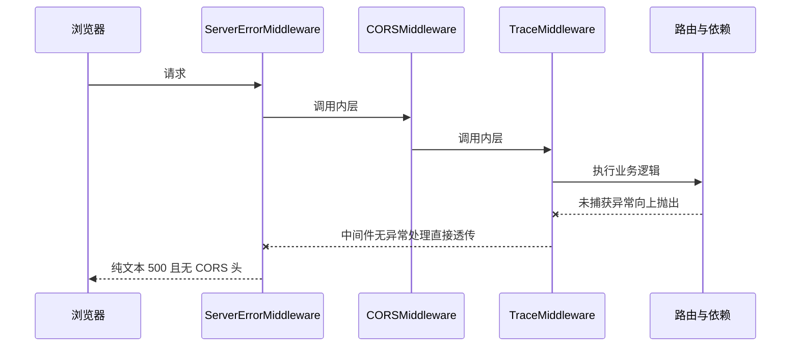

# 中间件注入的 trace_id 在接口里读不到，500 响应还丢了 CORS 头：BaseHTTPMiddleware 的边界与中间件顺序

## 为什么会有这个问题

Starlette 的中间件栈是分层的：最外层 ServerErrorMiddleware，中间是用户通过 add_middleware 注册的中间件（后注册的反而更靠外），再往里是 ExceptionMiddleware，最内是路由。未捕获异常一路向上传递到 ServerErrorMiddleware，由它直接生成一个纯文本 500；此时内层的 CORSMiddleware 根本没见到 http.response.start，因此无法补上 Access-Control-Allow-Origin。浏览器把这次 500 报成跨域错误，真实的堆栈被掩盖。第二个问题来自 BaseHTTPMiddleware：它用 anyio 的 task group 把下游 app 放进独立的 task 里执行，contextvars 在 task 创建时按「向下拷贝」传播——中间件里 set 的值下游可见，但下游 endpoint、依赖、异常处理器里 set 的值不会回流到中间件，导致中间件层的访问日志、耗时统计里 trace_id 时有时无。它还会让流式响应多包一层，客户端提前断开时的取消语义改变，出现 No response returned 之类的怪象。

## 怎么做

1. 固定中间件顺序：CORS 一定最后 add_middleware（最外层）；需要覆盖 500 场景时，用 application = CORSMiddleware(app=app, ...) 把 CORS 包在整个 ASGI app 外面。
2. 把 trace 注入和耗时日志改写成纯 ASGI 中间件，直接包装 send，而不是用 @app.middleware('http') 的 BaseHTTPMiddleware 写法；contextvar 在入口 set、在 finally 里 reset，避免跨请求泄漏。
3. 业务级上下文（用户、租户、trace）优先用 Depends 注入，而不是在中间件里塞 request.state 再指望下游回写。
4. 注册 app.add_exception_handler(Exception, handler) 时要意识到它挂在 ServerErrorMiddleware 上；要么在最外层 CORS 处理，要么在 handler 内手动补 CORS 头和 trace 头。
5. 补两条集成测试把行为锁死：断言未捕获异常返回 500 且响应头含 access-control-allow-origin；断言 endpoint 内 logger 输出的 trace_id 与响应头一致。

## 关键代码

```python
import uuid
import contextvars
from fastapi import FastAPI
from starlette.datastructures import MutableHeaders
from starlette.middleware.cors import CORSMiddleware
from starlette.types import ASGIApp, Scope, Receive, Send

trace_id: contextvars.ContextVar[str] = contextvars.ContextVar("trace_id", default="-")

class TraceMiddleware:
    def __init__(self, app: ASGIApp) -> None:
        self.app = app

    async def __call__(self, scope: Scope, receive: Receive, send: Send) -> None:
        if scope["type"] != "http":
            return await self.app(scope, receive, send)
        incoming = dict(scope["headers"]).get(b"x-trace-id", b"").decode() or uuid.uuid4().hex
        token = trace_id.set(incoming)

        async def send_with_trace(message):
            if message["type"] == "http.response.start":
                MutableHeaders(scope=message)["x-trace-id"] = incoming
            await send(message)

        try:
            await self.app(scope, receive, send_with_trace)
        finally:
            trace_id.reset(token)

app = FastAPI()
app.add_middleware(TraceMiddleware)                       # 内层
app.add_middleware(CORSMiddleware, allow_origins=["*"],   # 后加即更外层
                   expose_headers=["x-trace-id"])
```

## 真实场景

某项目的日志平台按 trace_id 串联前后端，接入后发现约一半请求的访问日志里 trace_id 为空，但接口内部打的日志却有值；同时前端控制台频繁报跨域，后端却只看到零星 traceback。排查路径：先用 curl -i 直打接口，能拿到 500 且响应体是纯文本 Internal Server Error，但没有 access-control-allow-origin 头——说明这次响应由最外层生成、绕过了 CORS；再看中间件写法是 @app.middleware('http')，在中间件里 set contextvar 后立刻打日志，发现下游 endpoint 里额外 set 的字段回流不到中间件，异常路径下更是整个上下文丢失；把中间件换成纯 ASGI 实现、CORS 移到最外层后两个症状同时消失。

## 示意图



## 面试官追问

1. **Q：** 为什么不在 BaseHTTPMiddleware 里 try/except 把所有异常兜住，统一返回 JSON？

   **A：** 能兜住，但必须原样 re-raise 或自己构造完整响应，否则会把 ServerErrorMiddleware 和 ExceptionMiddleware 的职责搅在一起；而且 BaseHTTPMiddleware 给每个请求多建一个 task，流式响应下客户端断开的取消传播会被改变。所以网关级的行为（trace、CORS、限流）用纯 ASGI 中间件，业务级错误用 exception handler，权限用 Depends。

2. **Q：** 后台任务里还能拿到中间件设置的 trace_id 吗？

   **A：** Starlette 的异步 BackgroundTask 在响应发送后、同一个 task 上下文里 await 执行，可以看到；同步后台任务走 anyio 线程池，当前 context 会被复制进去，一般也能看到。但如果任务自己 asyncio.create_task 出去，或在别处新 set，就不会同步，跨进程、跨队列时必须把它显式放进消息体里携带。
