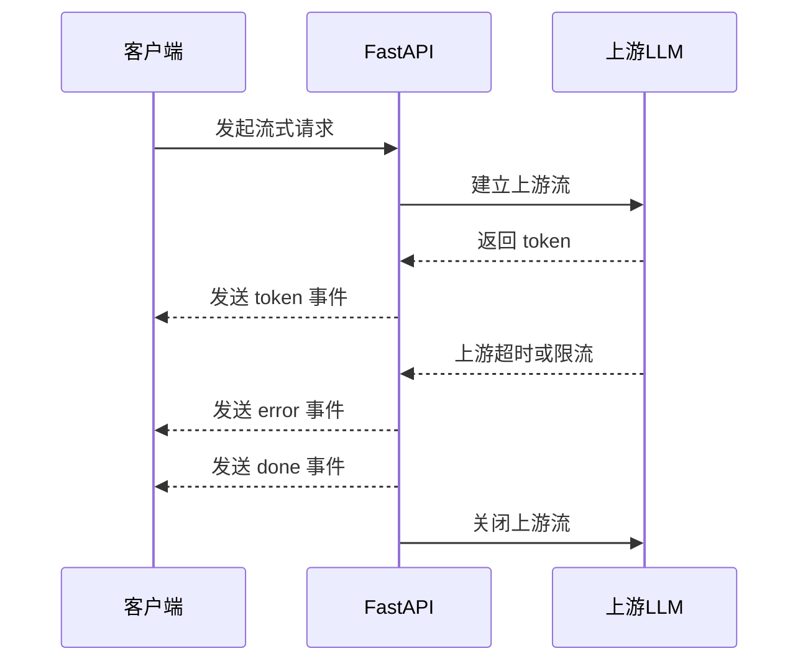

# 流式响应发出 200 后上游报错：SSE 错误帧、结束标记与断开感知怎么补

## 为什么会有这个问题

StreamingResponse 一旦开始发送，HTTP 状态码和 headers 已经写给客户端；如果异常发生在 async generator 内部，Starlette 无法再把响应改成 500，全局 exception_handler 也不会按预期接管。常见错误是直接在 generator 里 raise HTTPException，或者只依赖连接关闭表示结束。结果是客户端收到 200 加半截内容，把截断当正常完成；服务端 5xx 指标几乎不动，但用户重复提交、上游 token 继续计费。

## 怎么做

1. 先定协议：流内至少区分 token、error、done 三类事件，done 是唯一成功结束标志；error 帧带 code、retryable、request_id，客户端据此决定重试还是提示。
2. 在 generator 内部 try/except：上游异常转成 error 帧后正常结束，不要 raise；finally 里关闭上游流并记录 usage，避免已断开还在计费。
3. 显式感知断开：循环中检查 request.is_disconnected()，并捕获 asyncio.CancelledError；断开时 cancel 上游任务，不要只等 finally。
4. 处理代理缓冲：返回 text/event-stream，设置 Cache-Control: no-cache、X-Accel-Buffering: no，对 event-stream 关闭 gzip，并周期性发心跳注释帧。
5. 观测口径：单独统计首 token 延迟、流时长、error 帧比例、客户端断开率；不要把流内 error 混进 5xx 告警，否则故障不可见。

## 关键代码

```python
from fastapi import FastAPI, Request
from fastapi.responses import StreamingResponse
import asyncio, json

app = FastAPI()

async def gen(req: Request, prompt: str):
    upstream = None
    try:
        upstream = await open_llm_stream(prompt)
        async for token in upstream:
            if await req.is_disconnected():
                break
            yield 'data: ' + json.dumps({'type': 'token', 't': token}, ensure_ascii=False) + '\n\n'
        yield 'data: ' + json.dumps({'type': 'done'}) + '\n\n'
    except asyncio.CancelledError:
        raise
    except Exception as e:
        yield 'data: ' + json.dumps({'type': 'error', 'retryable': True, 'msg': str(e)[:200]}) + '\n\n'
    finally:
        if upstream is not None:
            await upstream.aclose()

@app.get('/chat/stream')
async def chat_stream(request: Request, q: str):
    return StreamingResponse(
        gen(request, q),
        media_type='text/event-stream',
        headers={'Cache-Control': 'no-cache', 'X-Accel-Buffering': 'no'},
    )
```

## 真实场景

某项目的 LLM 流式接口偶发上游 429 或读超时。前端表现为 HTTP 200、答案输出到一半后 loading 不结束；服务端 5xx 指标接近零，网关只看到连接被重置。用户以为失败重复提交，费用和下游压力一起上涨。排查路径：先确认流式响应状态码始终是 200，再在 generator 内打点看异常是否被抛出，检查客户端是否以 done 帧作为完成条件，最后看断开后上游 stream 是否被 aclose/cancel。

## 示意图



## 面试官追问

1. **Q：** 流式接口还能做上游重试吗？

   **A：** 只能在首 token 发出前重试：用有限次数加指数退避和 jitter，并设置总预算；一旦已经 yield token 就不能透明重试，否则客户端会收到重复内容，正确做法是发 error 帧让客户端带 request_id 重新生成，计费侧用幂等键去重。

2. **Q：** 为什么本地 curl 能看到流，线上经过网关就变成一次性返回？

   **A：** 常见是代理缓冲和压缩：Nginx 默认 proxy_buffering 会攒包，gzip 也会缓冲 event-stream；需要关闭对应缓冲、设置 X-Accel-Buffering: no，并保证读超时大于心跳间隔。还要注意长连接会占用 worker，流式接口最好独立部署或限制并发。
