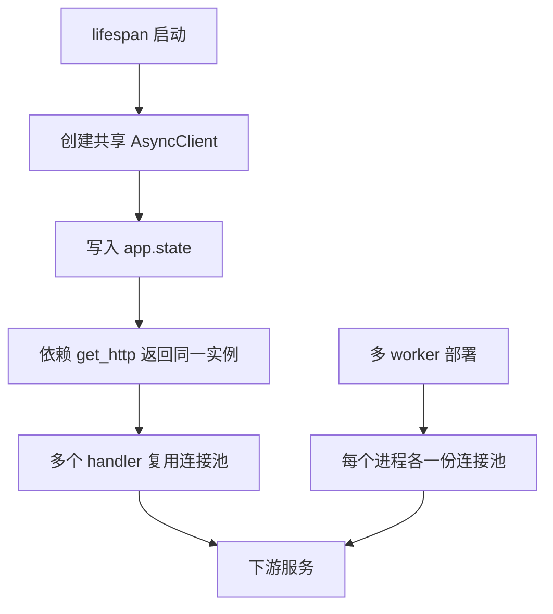

# 每个请求都新建 AsyncClient：连接池复用失效、TIME_WAIT 飙升与多 worker 配额失控

## 为什么会有这个问题

httpx.AsyncClient 不是轻量对象，它内部维护连接池、keep-alive 和 TLS 会话。如果在每个 handler 或每个请求的依赖里 async with AsyncClient()，连接无法复用，TCP/TLS 握手成本被摊到每次调用上，容易出现 TIME_WAIT 堆积和 P99 抖动。更隐蔽的是多 worker 部署：每个进程各有一份池，总连接数约等于 workers 乘 pool_size，扩容 worker 反而可能打爆下游连接配额或触发限流。常见错误认知是“用了 async 就一定快”，忽略客户端生命周期和配额。

## 怎么做

1. 在 lifespan 中创建共享 AsyncClient，写入 app.state；shutdown 时 await aclose()，保证在同一个事件循环内创建和关闭。
2. 用依赖 get_http(request) 返回同一实例；禁止在请求内 new client；不同下游按 base_url 分池，避免一个慢下游占满所有连接。
3. 按下游配额反推 limits：workers 乘 max_connections 要小于下游连接上限并留安全余量；max_keepalive_connections 和 keepalive_expiry 要对齐下游 idle timeout。
4. 超时要拆开：connect、read、write、pool 分别设置；pool timeout 要短，快速失败并暴露连接池等待指标，而不是让请求无限排队。
5. 多 worker 下的限流、缓存、计数器不能只用进程内状态；需要 Redis 或网关集中限流，readiness 检查依赖可用性，滚动发布时避免流量打到未初始化完的 worker。

## 关键代码

```python
from contextlib import asynccontextmanager
from fastapi import FastAPI, Depends, Request
import httpx

@asynccontextmanager
async def lifespan(app: FastAPI):
    app.state.http = httpx.AsyncClient(
        limits=httpx.Limits(max_connections=50, max_keepalive_connections=20, keepalive_expiry=30),
        timeout=httpx.Timeout(connect=1.0, read=10.0, write=5.0, pool=0.5),
    )
    try:
        yield
    finally:
        await app.state.http.aclose()

app = FastAPI(lifespan=lifespan)

def get_http(request: Request) -> httpx.AsyncClient:
    return request.app.state.http

@app.get('/proxy')
async def proxy(http: httpx.AsyncClient = Depends(get_http)):
    r = await http.get('https://downstream.example/api')
    return r.json()
```

## 真实场景

某项目把内部服务调用写成每个接口里 async with httpx.AsyncClient()。流量上来后下游看到大量短连接，服务端 TIME_WAIT 升高，TLS 握手 CPU 上升，P99 从几十毫秒抖到几百毫秒；扩容 worker 后下游连接数按进程数成倍增长，开始出现 429 和连接拒绝。排查路径：看 netstat 的 TIME_WAIT、下游按来源 IP 的连接数、应用日志里的 pool timeout，再对照 workers 与 pool_size 的乘积；修复为 lifespan 共享 client 并调整 limits 后，连接数和 P99 才稳定。

## 示意图



## 面试官追问

1. **Q：** 为什么不直接把 AsyncClient 定义成模块级全局变量？

   **A：** 模块导入时创建可能不在目标事件循环里，测试或多 loop 场景容易踩 attached to a different loop；而且没有明确的关闭时机。lifespan 能保证在应用启动的事件循环内创建、在 shutdown 时关闭，测试里也更容易用依赖覆盖或 lifespan 管理。

2. **Q：** 多 worker 下想做全局限流，进程内令牌桶为什么不够？

   **A：** 每个 worker 独立计数，实际总速率是 workers 乘单进程限额；worker 重启还会清零。要么把限额按 worker 数分摊并留余量，要么用 Redis 或网关做集中限流；同时 readiness 要检查下游依赖，避免滚动发布时新 worker 还没建好连接池就接流量。
