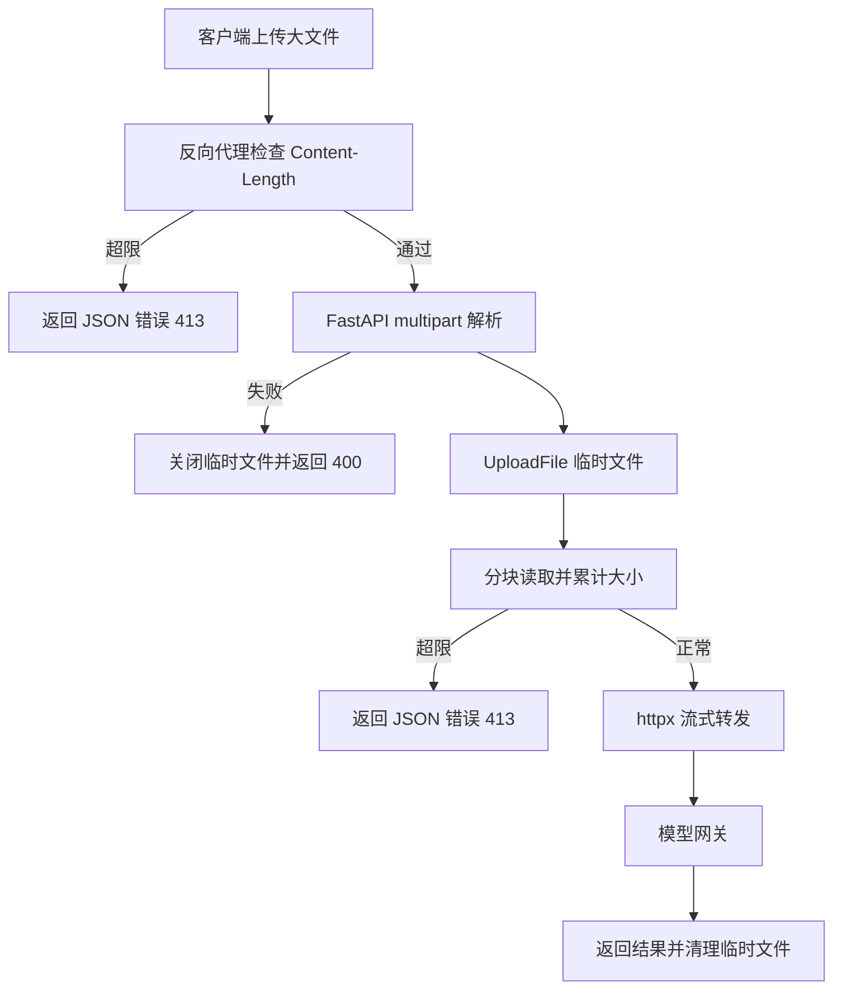

# 上传大文件到模型网关，接口内存随并发线性上涨：UploadFile 落盘阈值、流式转发与 413 边界怎么定

## 为什么会有这个问题

UploadFile 底层是 SpooledTemporaryFile，超过阈值会落临时文件，但这只解决了“接收后放哪里”，不等于全链路流式。很多实现会在路由里 await file.read() 整体读入，再作为 bytes 传给 httpx，或者用 Pydantic 的 bytes 字段接收，导致每个并发请求在内存里保留完整文件副本。反向代理的 client_max_body_size 与应用层限制不一致时，413 还可能由代理直接返回 HTML 或重置连接，客户端拿不到可解析错误。

## 怎么做

1. 入口做双层限制：反向代理限制粗粒度包体，应用层在分块读取时累计字节数并设置业务上限，超限返回统一 JSON 错误带 request id。
2. 接收端只用 UploadFile，禁止 await file.read() 一次性读取，也避免用 bytes 字段接收大文件；按固定 chunk 读取并立即转发。
3. 转发端用 httpx.AsyncClient 的流式请求，把异步生成器作为 content 传给模型网关，设置连接、读、写超时和并发上限，避免上游慢导致 worker 堆积。
4. 在 finally 中显式 await file.close()，并监控进程 RSS、临时目录文件数、并发上传数、413 比例和上游超时率。
5. 压测时用不同文件大小和并发梯度验证内存曲线，确认代理层与应用层阈值一致，并检查 chunked 上传场景下 Content-Length 校验是否失效。

## 关键代码

```python
from fastapi import FastAPI, UploadFile, HTTPException
import httpx

CHUNK = 1024 * 1024
MAX_BYTES = 200 * 1024 * 1024

class TooLarge(Exception):
    pass

@app.post("/v1/files")
async def upload(file: UploadFile):
    total = 0
    try:
        async with httpx.AsyncClient(timeout=httpx.Timeout(60.0, read=300.0)) as client:
            async def body_iter():
                nonlocal total
                while chunk := await file.read(CHUNK):
                    total += len(chunk)
                    if total > MAX_BYTES:
                        raise TooLarge
                    yield chunk
            try:
                resp = await client.post(
                    "http://model-gateway/v1/files",
                    content=body_iter(),
                    headers={"content-type": file.content_type or "application/octet-stream"},
                )
            except TooLarge:
                raise HTTPException(status_code=413, detail="file too large")
        if resp.status_code >= 400:
            raise HTTPException(status_code=502, detail="gateway error")
        return {"bytes": total}
    finally:
        await file.close()
```

## 真实场景

某项目做文档解析和模型网关，上传 PDF 到 /v1/files，单文件上限 200MB。并发上传到二十路时，worker 的 RSS 从几百 MB 涨到数 GB 后被 OOM kill；nginx 对超大文件直接返回 413 HTML，前端解析失败。排查发现路由里先 await file.read() 拿到完整 bytes，再传给 httpx，UploadFile 的临时文件优势被抵消；同时代理层 client_max_body_size 与应用层限制不一致。改为分块读取、流式转发并统一 413 JSON 后，内存曲线随并发保持平稳。

## 示意图



## 面试官追问

1. **Q：** 已经用了 UploadFile，为什么进程内存还会涨？

   **A：** UploadFile 只把超过阈值的部分落临时文件，不代表全链路流式。如果代码里整体读取、把 bytes 传给 httpx、或者 multipart 解析时复制，仍会占内存；并发高时临时文件 I/O 和多个副本也会放大。需要分块读、分块转发，并限制单请求大小和并发数。

2. **Q：** 413 应该由 nginx 还是 FastAPI 返回？

   **A：** 代理层做粗粒度保护，防止大包进入应用；应用层做业务限额并返回统一 JSON 错误。两者阈值要一致并留余量。代理层返回 HTML 413 时，前端需要兼容，或者配置自定义错误页；关键是让客户端拿到可解析的错误和 request id。
