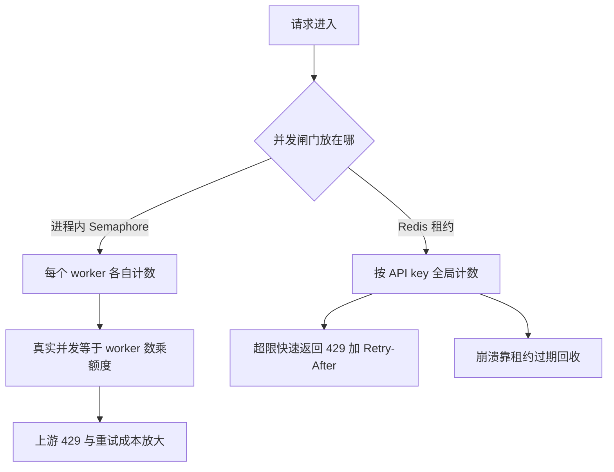

# 进程内 Semaphore 控上游并发，扩到 4 个 worker 后 429 与账单一起翻倍：全局闸门该放哪一层

## 为什么会有这个问题

很多人把 asyncio.Semaphore(20) 当成全局并发上限，但 uvicorn --workers 4 和 gunicorn 多 worker 是彻底独立的进程，内存、信号量、计数器都不共享，真实并发是 4×20；如果跑在 K8s 上再乘副本数，滚动发布时新旧 Pod 并存还会瞬时翻倍。上游按 API key 限流，于是表现为：单机压测完全正常，一上线就 429 飙升，重试进一步放大调用量与费用。更隐蔽的是每个进程自己的 in-flight 指标都只有 20，监控上看不出超限，排查方向容易被带到上游或网络。另一种常见错误是用 threading.Semaphore 或全局 dict 计数，前者只跨线程不跨进程，后者在 fork 后各写各的，同样失真。

## 怎么做

1. 先确认闸门目标：要保护的是上游配额，key 必须是配额主体（API key / tenant / model），而不是进程或 Pod。
2. 量化失真：启动日志打 pid 与 worker 序号，把 in-flight、等待时长按实例聚合后再求和，对比上游返回的 429 与配额用量。
3. 用 Redis 做租约式信号量：ZSET 存 token + 过期时间，acquire 时先按 score 清理过期租约再判断基数，release 时 ZREM；进程崩溃靠租约过期自动回收，长请求用心跳续期。
4. 保留本地 Semaphore 作为每进程保险丝，值取全局额度除以最大进程数再留余量，防止 Redis 抖动时完全失去保护。
5. 排队策略要有界：等待 2~3 次即可快速失败，返回 429/503 加 Retry-After，不要让请求在应用层无限排队占住连接与内存。
6. 重试要有预算：最多一次、指数退避加 jitter，且重试同样过闸门；对计费类调用加幂等键去重。
7. 流式与长连接单独计量：SSE 只在首 token 前占上游并发名额，之后按活跃 stream 数单独限，避免长连接把名额长期占死。
8. 观测闭环：全局 in-flight、闸门等待 P99、429 率、每 key 单位时间消耗，任一越阈值告警。

## 关键代码

```python
import asyncio, time, uuid
import redis.asyncio as redis

ACQUIRE_LUA = """
local k = KEYS[1]
local now = tonumber(ARGV[1])
local ttl = tonumber(ARGV[2])
local limit = tonumber(ARGV[3])
local id = ARGV[4]
redis.call('ZREMRANGEBYSCORE', k, '-inf', now)
if redis.call('ZCARD', k) >= limit then return 0 end
redis.call('ZADD', k, now + ttl, id)
redis.call('PEXPIRE', k, ttl * 2)
return 1
"""

class Busy(Exception):
    pass

class RedisGate:
    def __init__(self, r, key, limit, ttl_ms=30_000):
        self.r, self.key, self.limit, self.ttl = r, key, limit, ttl_ms
        self.token = ''

    async def __aenter__(self):
        self.token = uuid.uuid4().hex
        for _ in range(3):
            ok = await self.r.eval(ACQUIRE_LUA, 1, self.key,
                                   int(time.time() * 1000),
                                   self.ttl, self.limit, self.token)
            if ok:
                return self
            await asyncio.sleep(0.05)
        raise Busy(f'gate {self.key} full')

    async def __aexit__(self, *exc):
        await self.r.zrem(self.key, self.token)
```

## 真实场景

某项目的模型网关用单 worker 开发，lifespan 里建 asyncio.Semaphore(20) 包住上游调用，压测时上游并发稳定在 20，一切正常。改成 uvicorn --workers 4 后，白天高峰上游 429 从偶发变成持续，重试把调用量又抬高，费用曲线同步上扬；但看应用指标，每个进程 in-flight 都没超过 20，值班同学先怀疑上游容量，直到把四个进程的 in-flight 相加才看到真实并发长期在 60 以上。滚动发布当天更差，旧 Pod 未摘流量、新 Pod 已就绪，短时并发再翻一倍。

## 示意图



## 面试官追问

1. **Q：** 每次都访问 Redis 会不会让 Redis 成为新瓶颈？

   **A：** 会。两条路：一是把额度分段预取到本地令牌桶，一次拿 N 个，用不完按过期归还，精度换吞吐；二是把全局配额控制下沉到网关或上游 SDK 侧，应用内只保留本地保险丝。关键是明确可接受的超额比例，比如允许短时超出 10%。

2. **Q：** SSE 长连接要不要一直占着全局名额？

   **A：** 不该。占名额的应该是上游正在处理的请求，而不是连接时长。做法是首 token 返回后释放并发租约，另建活跃 stream 计数做二级限制，否则几个慢速客户端就能把整个租户的额度占死。
