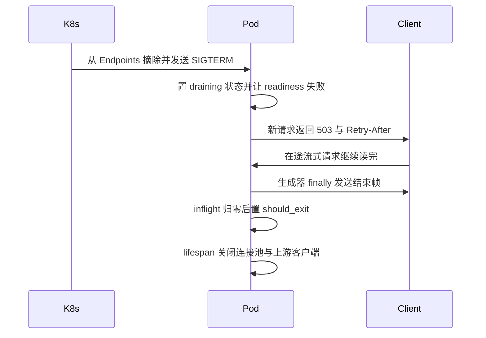

# 滚动发布时 LLM 流式响应被拦腰截断：SIGTERM 到 lifespan shutdown 之间，在途请求和后台任务谁来兜

## 为什么会有这个问题

多数人默认「容器收到 SIGTERM 会自动优雅退出，等请求跑完」，这套假设在流式 LLM 接口上几乎必然失效。第一，uvicorn 排空连接的等待上限由 timeout-graceful-shutdown 决定，老版本甚至没有该参数；Gunicorn 侧还有 HTTP 流的 graceful-timeout，超时直接 SIGKILL。LLM 一次生成长回答常在几十秒到几分钟，正好落在被强杀的时间窗口里。第二，lifespan 的 shutdown 阶段只在连接排空后执行，被 SIGKILL 的进程一行 shutdown 代码都不会跑，连接池没关、进程内 BackgroundTasks 全部丢失，而且不会有错误日志。第三，K8s 从 Endpoints 摘除和发送 SIGTERM 是并行发生的，存在新请求仍打到正在退出 pod 的窗口期。最恶劣的症状是客户端拿到 200 和半截正文：重试逻辑不触发、前端只表现为一直转圈，比直接 503 难排查一个数量级。

## 怎么做

1. 先摘除流量再退出：单独提供 /healthz/ready，draining 置位后返回 503，readiness probe 因此失败；同时 ASGI 层对新的业务请求直接返回 503 和 Retry-After，避免窗口期接到新请求。
2. 在 preStop 里 sleep 的时间要不少于摘除流量在负载均衡各节点的传播时间，保证 SIGTERM 到达前新请求已停；stuck 的 preStop 会拖慢发布，需要与 rollout 的 progressDeadline 对齐。
3. 把 timeout-graceful-shutdown 与 Gunicorn 的 graceful-timeout 显式设为大于流式请求 P99.9 的值，不要使用默认值；两个参数的先后关系要理清：Gunicorn 的值必须大于 uvicorn 的值，否则在 worker 还活着时就被强杀。
4. 自己做排空：在 ASGI 中间件层统计在途请求数，进入 draining 后等待计数归零或达到上限，再置 server.should_exit 交给 uvicorn 走正常退出；不要指望 lifespan 里等待，那时排空已经结束，或者根本没有执行。
5. 流式生成器要在 finally 里补结束帧或 error 帧，让客户端能区分「正常结束」和「被截断」，否则只能靠超时兜底。
6. 耗时不可控的任务（长文档处理、批量 embedding）不要塞进请求进程，改成任务 ID 加队列，前台轮询或重连；进程内 BackgroundTasks 只用于可丢弃的事。
7. lifespan 内按反序关停：先确认 draining、再等 in-flight 清零、随后 aclose 上游 client、最后关闭 DB pool 并写一条 shutdown 完成日志；线上排查时最重要的证据就是这条日志是否存在。

## 关键代码

```python
import asyncio
from fastapi import FastAPI
from fastapi.responses import JSONResponse

class Drain:
    def __init__(self):
        self.draining = False
        self.inflight = 0
        self.idle = asyncio.Event(); self.idle.set()
    def enter(self):
        self.inflight += 1; self.idle.clear()
    def exit(self):
        self.inflight -= 1
        if self.inflight == 0: self.idle.set()

DRAIN = Drain()

async def drain_mw(app, scope, receive, send):
    if scope['type'] != 'http' or scope['path'].startswith('/healthz'):
        return await app(scope, receive, send)
    if DRAIN.draining:
        resp = JSONResponse({'error': 'draining'}, status_code=503,
                            headers={'Retry-After': '5'})
        return await resp(scope, receive, send)
    DRAIN.enter(); done = False
    async def send_wrapper(msg):
        nonlocal done
        if msg['type'] == 'http.response.body' and not msg.get('more_body'):
            done = True; DRAIN.exit()
        await send(msg)
    try:
        await app(scope, receive, send_wrapper)
    finally:
        if not done: DRAIN.exit()  # 客户端中断或异常路径

async def drain_and_exit(server, timeout: float = 180):
    DRAIN.draining = True
    try:
        await asyncio.wait_for(DRAIN.idle.wait(), timeout=timeout)
    finally:
        server.should_exit = True
```

## 真实场景

某项目用 Gunicorn 加 uvicorn worker 部署 4 进程，接口是流式问答。每次滚动发布，监控都能看到一小部分请求返回 200，但正文明显不完整，前端一直停在加载态；同时后台用 BackgroundTasks 写的会话摘要记录，在发布窗口内出现丢失。排查路径：先把 SIGTERM 时间点与网关侧 ingress 日志对齐，发现 pod 收到 TERM 后仍有新请求进来，说明摘除流量存在延迟窗口；再看进程退出日志，一部分 pod 完全没有 shutdown 阶段的记录，判定为 graceful timeout 到期后被 SIGKILL；最后核对配置，Gunicorn graceful-timeout 是默认值，明显小于流式响应的 P99 时长。

## 示意图



## 面试官追问

1. **Q：** 为什么不能用 @app.middleware('http') 里的 call_next 前后计数在途请求？

   **A：** @app.middleware('http') 底层是 BaseHTTPMiddleware，await call_next 返回的是 Response 对象，此时响应体还没真正发出去，尤其是 StreamingResponse 的 body 会在之后异步迭代。用它做计数会在流式响应刚开始时就减一，排空判断提前成立，结果还是被截断。要通过包装 ASGI 的 send，以最后一个 more_body 为 False 的 http.response.body 帧作为真正结束标志。

2. **Q：** 进程被强杀时，除了请求被截断还有什么隐患？

   **A：** lifespan 的 shutdown 不执行，上游 AsyncClient 和 DB 连接池没有关闭，连接在服务端仍然保留到超时，重连风暴会打到刚起来的 pod；进程内的 BackgroundTasks、定时清理、指标 flush 全部丢失且没有痕迹。所以凡是有副作用的写入，都不能只依赖后台任务，要在请求内完成持久化，或者投递到持久队列。
