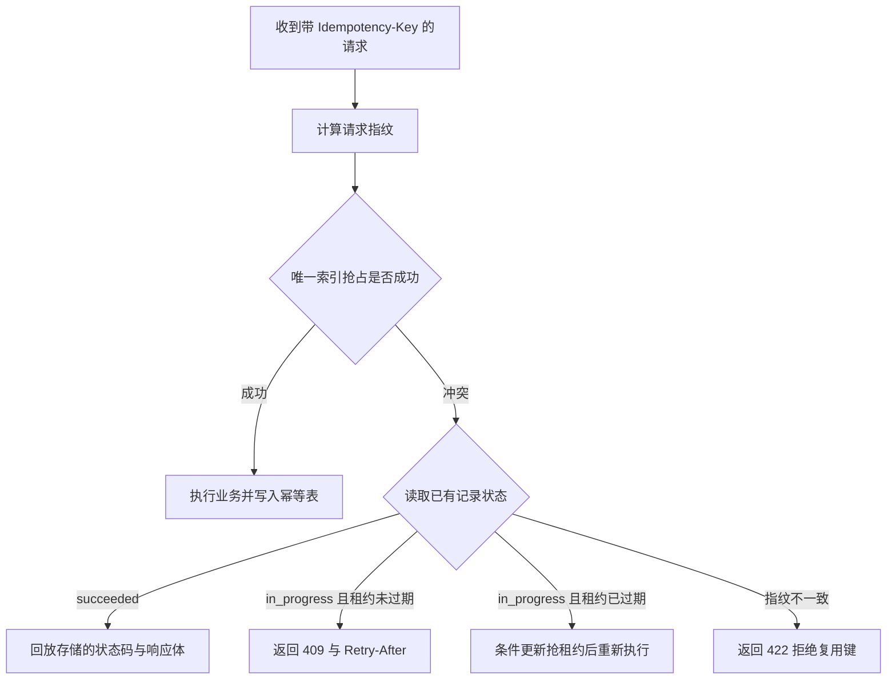

# 客户端超时重发，同一次问答扣了两次费、写了两条会话：幂等键、请求指纹与在途并发怎么收口

## 为什么会有这个问题

超时不等于失败。移动端 SDK 或网关在 60 秒拿不到响应时会重发，此时服务端第一次请求可能还在跑，也可能已经成功只是响应慢，没有幂等键就只能当成两次独立请求处理：两次调用 LLM、两份账单、两条会话。常见错误认知是用请求体哈希做去重，这有三个坑：用户先后问同样的问题是合法业务，应该计费两次；请求体里带 timestamp 或 nonce 时哈希永远不命中；哈希无法表达去重的时间窗口。第二个坑是并发同键：两个相同 key 同时到达，双方都判定「记录不存在」，然后都执行，或者唯一索引冲突直接冒泡成 500。第三个坑是流式场景，第一次已经吐了一半 token，重试时既不能续上也不能重放半截内容。

## 怎么做

1. 定契约：客户端必须带 Idempotency-Key（建议 UUID，一次用户动作生成一次，重试沿用），服务端用 (tenant, key) 做唯一索引；缺失时按非幂等路径处理或直接 400，取决于产品能否接受重复计费。
2. 建幂等表：key、tenant、route、fingerprint、status（in_progress / succeeded / failed_retryable）、status_code、response_body、updated_at、expires_at。写入与业务数据放同一个库，保证能在同一事务里提交，跨服务调用再补 outbox。
3. 抢占用 INSERT ... ON CONFLICT DO NOTHING，看影响行数决定是执行者还是观察者；观察者按状态分流：succeeded 直接回放存储的状态码和 body；in_progress 且租约未过期返回 409 加 Retry-After；租约过期则用带条件的 UPDATE 抢占，防止进程崩溃后这条键永久卡住。
4. 拿到执行权后必须校验指纹：同 key 换了请求体说明客户端复用错了，返回 422，绝不能用旧结果冒充新请求的响应。指纹用 route 加规范化后的 body 计算，并排除签名、时间戳这类易变字段。
5. 业务成功与幂等表置 succeeded 在同一事务提交，或者在 handler 里先写 usage 记录再更新状态；调用上游 LLM 时把幂等键透传成上游的 request 标识，上游侧再去一次重，形成双保险。
6. 流式接口不缓存 token 流，只落最终全文与 usage；重试方拿到 409 后改为轮询 GET /runs/{key} 或依赖 SSE 的 Last-Event-ID 续传，避免在半截流上做幂等。
7. 过期清理由定时任务批量删除，同时在幂等表上监控 in_progress 超期比例，这个指标能直接暴露进程崩溃和上游卡死。

## 关键代码

```python
import hashlib
from datetime import timedelta
from fastapi import Depends, Header, HTTPException, Request

LEASE = timedelta(seconds=120)

async def idempotency(
    request: Request,
    key: str | None = Header(default=None, alias='Idempotency-Key'),
    db=Depends(get_db),
):
    if key is None:
        yield None
        return
    body = await request.body()
    fp = hashlib.sha256(request.url.path.encode() + body).hexdigest()
    row = await claim_or_get(db, key, fp, LEASE)  # INSERT ON CONFLICT DO NOTHING
    if row.status == 'succeeded':
        raise ReplayResponse(row.status_code, row.response_body)
    if row.status == 'in_progress':
        raise HTTPException(409, headers={'Retry-After': '2'})
    if row.fingerprint != fp:
        raise HTTPException(422, 'Idempotency-Key reused with different payload')
    try:
        yield row
    except Exception:
        await mark_failed(db, key)
        raise
    await mark_succeeded(db, key,
                         request.state.idem_status,
                         request.state.idem_body)

# 路由里：先 request.state.idem_status/body 落值，再 return
# 部署侧：网关对 POST 的重试必须透传 Idempotency-Key
```

## 真实场景

某项目接入移动端 SDK，SDK 默认超时 60 秒并对 POST 重试 3 次。上线长回答功能后，账单里出现同一段 prompt 连续多次调用，会话表中也有多条内容一致但 id 不同的记录。排查路径：先按用户 ID 拉出同一分钟的入站日志，发现同一个业务动作对应多条 X-Request-Id，说明是客户端重发而不是上游重试；再看第一次请求的耗时分布，多数超过 60 秒且最终成功，确认是「成功的慢请求」被客户端判为失败；核对请求头，POST 上没有携带任何幂等键，服务端也没有去重表。压测阶段还复现了并发同键双双执行、以及崩溃后同一键永久卡在 in_progress 两种边界。

## 示意图



## 面试官追问

1. **Q：** 业务已经把 LLM 调成功，但在更新幂等表之前进程崩了，重试会怎样？

   **A：** 这条键会停在 in_progress，租约过期后重试方会抢占并再次执行，于是重复扣费。缓解要三道：一是调用上游时把幂等键透传成上游可识别的 request 标识，让上游也去重；二是把扣费落到独立的 usage 表，以业务键做唯一索引，重复写入自然冲突；三是 in_progress 超期的记录不要自动重放，转入告警与对账流程，宁可让用户重试一次，也不要静默重复计费。

2. **Q：** 为什么不用 Redis SETNX 直接把 key 锁住，而要落库？

   **A：** Redis 可以做第一层锁压低数据库压力，但它不能作为权威记录：主从切换或淘汰策略可能丢键，过期后重试方拿不到上次的结果，只能重新执行，幂等就退化成限流。正确做法是 Redis 承担短时并发控制、数据库承担持久状态，并且幂等结果要和业务写入保持同源，才能在一个事务里提交。
