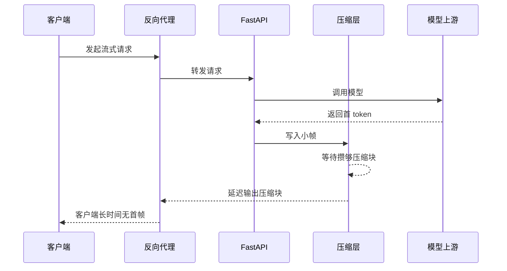

# 开启 GZip 后流式接口首 token 延迟从百毫秒级涨到数秒：压缩中间件与代理缓冲的边界怎么定

## 为什么会有这个问题

流式响应的价值在于每产生一个 token 就尽快 flush 到客户端，但压缩层和代理层都倾向于按块缓冲：GZip 需要攒够数据才能形成压缩块，反向代理的 proxy_buffering 也会等响应体达到阈值再转发。常见错误认知是「设置了 text/event-stream 就不会被压缩或缓冲」，实际上 FastAPI 的 GZipMiddleware 是全局 ASGI 中间件，代理也不看应用的 media_type；BaseHTTPMiddleware 还会把流包装成迭代器，进一步破坏逐帧 flush。结果是首 token 被压在缓冲区里，客户端看到的是长时间无数据、最后一次性吐出。

## 怎么做

1. 先分层定位：客户端记录 TTFB 和首帧时间，在生成器 yield 前后打时间戳，用 curl --no-buffer 直连 uvicorn 端口绕过代理，再逐层加回代理或网关，观察首帧延迟在哪一层出现。
2. 检查响应头：Content-Encoding 是否为 gzip、X-Accel-Buffering 是否被代理改写、Cache-Control 是否允许 no-transform；对比关闭压缩前后的首帧时间。
3. 应用侧按路径或响应类型跳过压缩：SSE 或流式路径不要进入 GZipMiddleware，普通 JSON 仍可压缩；不要用 BaseHTTPMiddleware 包裹流式响应。
4. 给流式响应补头：Cache-Control: no-cache, no-transform、X-Accel-Buffering: no，并确保生成器每帧主动 flush，不要做不必要的聚合。
5. 代理侧对该 location 关闭 gzip 和 proxy_buffering，或让网关按 Content-Type 跳过压缩；滚动发布时确认新旧实例配置一致。
6. 回归验证：压测慢客户端和并发流，断言首帧 P95、帧间隔和连接存活时长；把首帧时间纳入监控而不是只看总耗时。

## 关键代码

```python
from fastapi import FastAPI
from fastapi.responses import StreamingResponse
from starlette.middleware.gzip import GZipMiddleware
from starlette.types import ASGIApp, Scope, Receive, Send

class SelectiveGZip:
    def __init__(self, app: ASGIApp):
        self.app = app
        self.gzip = GZipMiddleware(app, minimum_size=1024)

    async def __call__(self, scope: Scope, receive: Receive, send: Send):
        if scope.get('type') == 'http' and not scope.get('path', '').startswith('/v1/chat/stream'):
            return await self.gzip(scope, receive, send)
        return await self.app(scope, receive, send)

app = FastAPI()
app.add_middleware(SelectiveGZip)

@app.get('/v1/chat/stream')
async def stream():
    async def gen():
        yield 'data: first\n\n'
        yield 'data: second\n\n'
    return StreamingResponse(gen(), media_type='text/event-stream', headers={
        'Cache-Control': 'no-cache, no-transform',
        'X-Accel-Buffering': 'no',
    })
```

## 真实场景

某项目给所有接口统一开了 GZip，普通 JSON 正常，聊天流式接口上线后首 token 从百毫秒级变成数秒，偶发整段结束后一次性吐出。上游模型首 token 监控正常，worker CPU 也不高。排查时直连 uvicorn 端口正常，经过网关就异常；响应头带 Content-Encoding: gzip，关闭压缩或对 SSE 路径跳过后恢复。最终定位为应用压缩层攒块加代理缓冲叠加。修复后重点看首帧 P95、帧间隔和慢客户端下的连接存活时长。

## 示意图



## 面试官追问

1. **Q：** 为什么不能只靠 media_type='text/event-stream' 判断是否压缩？

   **A：** 压缩发生在 ASGI 中间件和代理层，media_type 只是应用写出的响应头；中间件可能已经按全局配置决定压缩，代理也不解析 FastAPI 的 media_type。要在路径、Content-Type 和响应头多个层面显式关闭，并验证实际响应头。

2. **Q：** 怎么证明是压缩或代理缓冲而不是上游模型慢？

   **A：** 在生成器 yield 前后打时间戳，直连 server 绕代理，再用 curl --no-buffer 观察首帧；对比关闭压缩、关闭 proxy_buffering 的差异，并抓包看首帧到达时间。若应用已写出首帧但客户端迟迟收不到，问题就在中间层。
