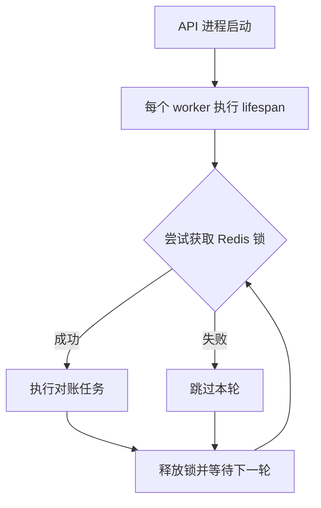

# 多 worker 下每个进程都跑对账定时任务：重复扣费与重复消息，单实例调度该放哪一层

## 为什么会有这个问题

FastAPI 的 lifespan 或 startup 只保证在当前进程内执行一次，不保证在整个服务内执行一次。uvicorn 或 gunicorn 用 --workers N fork 出多个独立进程，每个进程都会完整执行启动逻辑，于是写在 lifespan 里的定时任务会跑 N 次；滚动发布时新旧进程叠加，重复窗口更大。常见错误认知是「lifespan 是全局单例」或「加个进程判断就能防重」，但 worker pid 不可预知，扩缩容后判断条件也会变。对账、发券、扣费这类任务一旦重复执行，轻则重复消息，重则资损。

## 怎么做

1. 先量化症状：同一任务同一时间窗口出现多条启动日志，数据库出现重复流水；把 worker 数与任务执行次数对齐，确认不是重试导致。
2. 选型优先拆进程：定时任务不要放在 API worker 内，改用独立 scheduler 进程、K8s CronJob 或独立 deployment；API 只保留手动触发接口。
3. 若必须内嵌，用 Redis 或 etcd 分布式锁做 leader election：SET key token NX PX ttl，只有抢到锁的 worker 执行；长任务要续租，释放时用 Lua 比对 token 防误删。
4. 任务本身必须幂等：业务唯一键加唯一索引或去重表，写入用 upsert 或先查后写；重复执行不能产生第二次副作用。
5. 处理发布窗口：旧进程退出前停止调度器并释放锁，新进程启动后延迟抢锁；设置合理的 graceful timeout，避免旧任务被截断后重跑。
6. 验证与监控：本地起多 worker 观察执行次数，注入 kill 测锁过期自愈；监控任务执行次数、锁持有时间、重复流水数和任务延迟。

## 关键代码

```python
import asyncio, os, uuid
from contextlib import asynccontextmanager
from fastapi import FastAPI
from redis.asyncio import Redis

redis = Redis.from_url(os.environ['REDIS_URL'])
LOCK_KEY = 'job:reconcile:leader'
TOKEN = uuid.uuid4().hex

async def acquire() -> bool:
    return await redis.set(LOCK_KEY, TOKEN, nx=True, px=30_000)

async def release():
    await redis.delete(LOCK_KEY)  # 生产用 Lua 比对 token

async def loop():
    while True:
        if await acquire():
            try:
                await run_reconcile()  # 任务内部幂等
            finally:
                await release()
        await asyncio.sleep(60)

@asynccontextmanager
async def lifespan(app: FastAPI):
    task = asyncio.create_task(loop())
    yield
    task.cancel()
    await redis.aclose()

app = FastAPI(lifespan=lifespan)
```

## 真实场景

某项目把订单对账任务写在 lifespan 里，部署 4 个 worker。上线后发现同一批订单被重复发券，日志里同一分钟出现 4 条任务开始；部分表有唯一键没出问题，没有唯一键的流水表出现重复记录。滚动发布时重复次数短时翻倍。排查确认 worker 数等于任务执行次数，不是上游重试。修复为独立 Job 执行，任务内补业务唯一键和 upsert，内嵌触发路径再加分布式锁兜底；之后重点看任务执行次数、重复流水数和锁持有时间。

## 示意图



## 面试官追问

1. **Q：** 在 startup 里用 os.getpid() 或环境变量判断主进程，能防住重复吗？

   **A：** 不能稳定防住。worker pid 不可预知，扩缩容和滚动发布会改变进程集合；环境变量若所有副本相同也无效。要么把任务拆出 API 进程，要么用分布式锁或 leader election，并保证任务幂等。

2. **Q：** 分布式锁 TTL 怎么定？任务执行超过 TTL 怎么办？

   **A：** TTL 要大于任务 P99 执行时间并留余量；长任务必须续租，否则锁过期后另一个 worker 会并发执行。释放时用 token 比对避免误删别人的锁；进程崩溃后靠 TTL 自愈，所以任务必须幂等。
