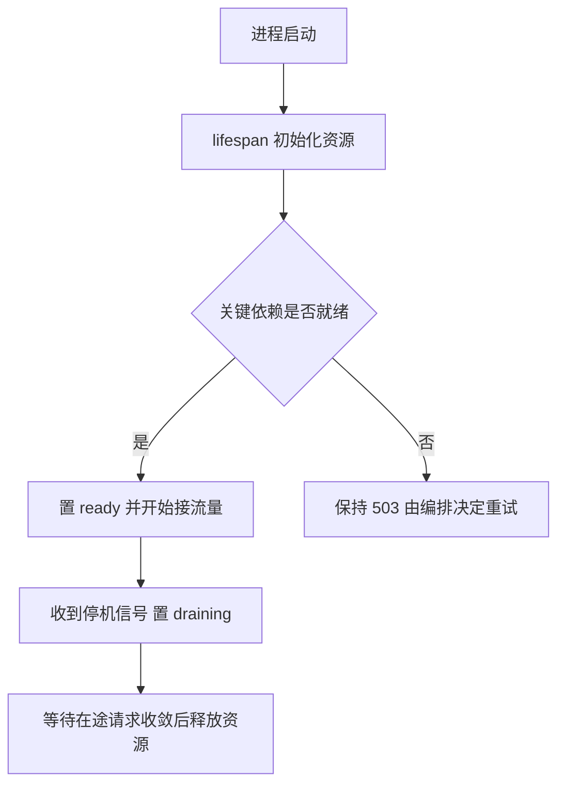

# 扩容后新实例探针已通过，请求却成片 5xx：lifespan 就绪窗口、探针分工与冷启动闸门

## 为什么会有这个问题

FastAPI 里 lifespan 的 startup 阶段与「能不能接流量」这件事没有天然绑定。很多人把 /healthz 写成固定 return {"ok": True}，编排系统（K8s 的 readinessProbe、网关的健康检查、SLB 后端探测）就会在连接池、模型客户端、配置缓存都还没建好时把实例挂进后端列表，前若干请求直接超时或 500。另一侧同样常见：livenessProbe 与 readinessProbe 复用同一路径与同一套依赖，探针本身通过 Depends(get_db) 每个周期创建一次真实连接，Pod 数一多，探针就成了一条稳定占用连接池的流量；下游抖动时探针超时，编排系统把全线实例同时摘流，抖动被放大成全站不可用。核心认知错误是把「进程起来了」等同于「服务可用了」，并且让探针依赖业务资源。

## 怎么做

1. 拆分三类端点，各司其职：/healthz 只验证进程与事件循环存活（不查任何外部依赖）；/readyz 只读进程内状态机（starting / ready / draining），未就绪返回 503；下游深度检查放到低频的独立路径或后台巡检，绝不放 K8s 高频探针上。
2. 用 lifespan 维护显式状态机并在 app.state 上落状态：启动开始置 starting，关键资源（DB 池）建好后再置 ready；收到停机信号先置 draining，再等待在途请求收敛并释放资源。readyz 只读这个状态，不碰数据库和上游。
3. 非关键依赖做降级而不是阻塞就绪：例如 rerank 服务、缓存预热失败，标记 degraded 并上报指标，仍允许 ready；关键依赖（DB 池）失败则保持 503，让编排系统决定重试或把实例踢掉，不要在代码里静默吞掉后宣告 ready。
4. 给冷启动留预算：配置 startupProbe（failureThreshold × periodSeconds 覆盖最坏启动时间），livenessProbe 的 initialDelaySeconds 不要压进启动窗口，否则启动慢的实例会被反复 kill，形成重启循环且日志看不到完整启动序列。
5. 多 worker / 多副本错峰预热：启动时加随机 jitter，预热请求走进程内并发闸门（1–2 并发），避免一次扩容把下游配额瞬间打满；预热结果进缓存，别让第一批真实用户请求承担建连成本。
6. 观测闭环：把 startup 各阶段耗时、ready 前后收到的请求数、5xx 时间分布与 Pod 创建时间做关联看板，出问题时第一眼能判断是「没就绪就接流量」还是「就绪后依赖挂了」。

## 关键代码

```python
import asyncio, random, logging
from contextlib import asynccontextmanager
from fastapi import FastAPI, Response, status

log = logging.getLogger("boot")

@asynccontextmanager
async def lifespan(app: FastAPI):
    app.state.phase = "starting"
    await asyncio.sleep(random.uniform(0.5, 5))       # 多 worker 冷启动错峰
    app.state.db = await create_pool(timeout=10)      # 关键依赖，失败即不就绪
    try:
        app.state.llm = await build_llm_client(timeout=5)
    except Exception:
        log.exception("llm init failed, degraded mode")
        app.state.llm = None                          # 非关键，降级不阻塞
    app.state.phase = "ready"
    yield
    app.state.phase = "draining"                      # 先停接新流量
    await asyncio.sleep(5)                            # 等在途请求收敛
    await app.state.db.close()

app = FastAPI(lifespan=lifespan)

@app.get("/healthz")
async def healthz():
    return {"ok": True}                               # 只证明进程活着

@app.get("/readyz")
async def readyz(response: Response):
    ready = app.state.phase == "ready"
    response.status_code = 200 if ready else status.HTTP_503_SERVICE_UNAVAILABLE
    return {"phase": app.state.phase, "llm": app.state.llm is not None}
```

## 真实场景

某项目的模型编排服务在 K8s 上滚动扩容，readinessProbe 和 livenessProbe 都指向同一个 /healthz（固定返回 ok）。典型现象：扩容瞬间新实例 2–3 秒内就被判 ready，但此时 DB 连接池与模型客户端仍在初始化，前一批用户请求大量超时，5xx 的时间分布与 Pod 创建时间高度重合；同时启动较慢的实例因为 livenessProbe 初始延迟太短被反复 kill，日志里 startup 序列没打完就收到 SIGTERM，看起来像「启动崩溃」。排查路径：对齐 Pod 创建时间与 5xx 时间轴；比对 uvicorn 的 Application startup complete 时间戳和该实例第一条业务请求日志的先后；再统计探针路径的建连次数，确认探针本身是否在占用连接池。修复后端点上分成 liveness/readiness/深度巡检三条路径，冷启动 jitter 加预热闸门，扩容期间的 5xx 消失，重启循环也一并消失。

## 示意图



## 面试官追问

1. **Q：** readiness 里要不要顺手查一下数据库，确保真的可用？

   **A：** 不建议放在高频探针上。查下游会把下游的抖动原样放大成整集群摘流量，形成雪崩；而且探针周期短、Pod 多，本身会成为一条持续的连接与 QPS 来源。正确做法是浅探针只看进程内状态（是否完成初始化、是否处于 draining），深度检查放到低频的独立路径或后台巡检，用指标而不是探针去驱动告警。

2. **Q：** 多副本同时冷启动，怎么避免一起打爆下游配额？

   **A：** 三层：启动加随机 jitter 拉开时间；预热请求走进程内并发闸门并且有超时，失败就保持 degraded 而不是无限重试；预热结果缓存复用（例如模型列表、embedding 维度的探测结果），让真实请求不必重复建连。如果下游配额本身是全局的，还得在网关或独立服务层做全局令牌，进程内 Semaphore 跨副本无效。
