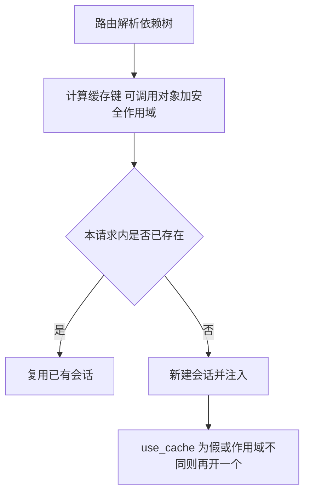

# 一次 /chat 请求打开三个数据库会话：Depends 缓存键、Security 与 use_cache 的边界

## 为什么会有这个问题

FastAPI 的依赖缓存只在「同一个可调用对象 + 同一个 security_scopes 集合 + use_cache 为真」时才命中，作用域仅限单次请求。但业务代码通常把 session、当前用户、配额这类东西分散写在多个依赖里：有人用 Depends(get_session)，有人为了「确保拿到新连接」加了 use_cache=False，有人用 Security(get_session, scopes=[...])，还有人用 lambda 包一层再 Depends。这些写法在字典语义上都是 session，在 FastAPI 眼里却是不同的缓存键，于是一次请求开出多个 session、多个事务。后果不是报错而是静默的数据问题：A 依赖里的写入在 B 依赖的事务里读不到，commit 分散在不同连接上导致半成功；连接池消耗变成 QPS 的整数倍，先表现为 pool timeout，再表现为数据不一致。

## 怎么做

1. 先量化而不是猜：在 get_session 里打印 request_id 与 id(session)，或用一个请求级计数器，聚合出「单请求 session 创建次数」的分布；同时看数据库侧活跃连接数与业务 QPS 的比值，比值明显大于 1 就基本可以确认。
2. 收敛唯一入口：全项目只保留一个 get_session 可调用对象，并导出 Annotated 别名（SessionDep），业务依赖只声明这个别名。禁止业务层再写 Depends(lambda: SessionLocal()) 这类包装，因为它每次都是新缓存键。
3. 统一 Depends 与 Security 的用法：scopes 只在一处声明，其余地方复用同一个依赖对象；不要在 session 这种基础设施依赖上用 use_cache=False，那等于主动放弃请求级复用。鉴权可以在拿到同一个 session 后做 scope 校验，而不是靠 Security 的 scopes 参数制造第二个实例。
4. 把事务边界显式化：改成 UoW 风格，依赖只负责提供 session 和关闭，commit / rollback 只在路由或服务层显式执行，避免多个依赖各自 commit 造成半成功。
5. 注意依赖体系之外的旁路：中间件、BackgroundTasks、定时任务里没有 Depends，必须显式打开独立会话并显式关闭，不要从 app.state 里拿一个长生命周期 session 共用。
6. 加回归守卫：写一个用例断言单个请求只创建一次 session（计数器 + TestClient），并在压测环境观察连接池占用 ≈ QPS，而不是几倍 QPS。

## 关键代码

```python
from typing import Annotated
from fastapi import Depends, Security, APIRouter
from sqlalchemy.ext.asyncio import AsyncSession

# 反例：同一请求三个不同缓存键，开出三个 session 与三个事务
async def bad_a(s: AsyncSession = Depends(get_session)): ...
async def bad_b(s: AsyncSession = Depends(get_session, use_cache=False)): ...
async def bad_c(s: AsyncSession = Security(get_session, scopes=["chat"])): ...

# 正例：唯一入口 + Annotated 别名，业务依赖只声明 SessionDep
SessionDep = Annotated[AsyncSession, Depends(get_session)]

async def current_user(s: SessionDep) -> User:
    return await resolve_user(s, token=raw_token)

UserDep = Annotated[User, Depends(current_user)]

async def quota(s: SessionDep, user: UserDep) -> Quota:
    return await load_quota(s, user.id)

QuotaDep = Annotated[Quota, Depends(quota)]

@router.post("/chat")
async def chat(s: SessionDep, user: UserDep, q: QuotaDep) -> ChatOut:
    s.add(Message(user_id=user.id, role="user", text=body.text))
    await s.commit()          # 事务边界只在路由层，依赖里不 commit
    return ChatOut(reply="...")
```

## 真实场景

某项目的 /chat 接口有鉴权、配额、会话三个依赖，分别用 Depends(get_session)、Depends(get_session, use_cache=False)、Security(get_session, scopes=[...]) 取库。压测时数据库活跃连接数约等于三倍业务 QPS，先出现连接池等待超时，随后出现更难查的问题：用户消息落库了，助手消息却回滚，前端看到会话只有半条记录。排查路径：入口注入 request_id，在 get_session 里记录 id(session) 与请求耗时，聚合后确认单请求创建了 3 个 session；再对照数据库侧按 application_name 统计的连接数，与 QPS 呈三倍关系。改成唯一别名入口、事务边界移到路由后，连接数回落到 QPS 量级，半条记录的问题同时消失。

## 示意图



## 面试官追问

1. **Q：** 为什么有时候两处 Depends(get_session) 只创建一次，有时候创建多次？

   **A：** 缓存键是「可调用对象 + security_scopes 集合」，且只在单次请求内有效。同一个函数对象、没加 scopes、use_cache 默认为真时才会复用；一旦用 Security 带了不同 scopes、写了 use_cache=False、或者用 lambda / functools.partial 包了一层，可调用对象或 scopes 变了，缓存就 miss，各建一个。

2. **Q：** 那能不能干脆整个应用共用一个全局 session 提升性能？

   **A：** 不行。session 与连接都不是并发安全对象，跨请求共享会让不同协程互相干扰，还会长期持有事务快照和连接、放大锁与膨胀；多 worker 下也无法协调。正确粒度是请求级：一次请求一个 session，请求结束显式关闭，连接池负责真正的连接复用。
