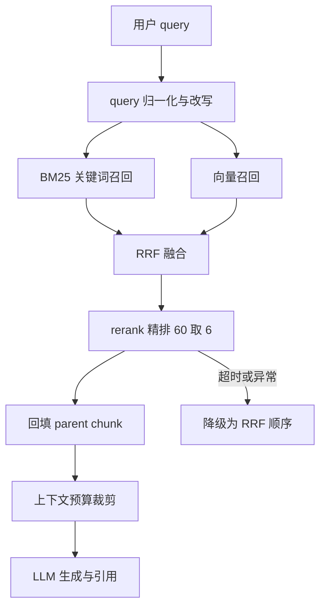

# 加了 rerank 和混合召回，p95 延迟翻倍但答案没变好：怎么定位瓶颈并量化收益

## 为什么会有这个问题

向量召回用的是 bi-encoder，query 和 chunk 各自独立编码，属于粗粒度语义近似；对错误码、型号、订单号、专有名词这类「字面必须命中」的 query 天然不敏感，所以只靠 dense 召回时，黄金证据经常根本进不了 top-k。rerank 用 cross-encoder 做 query-doc 联合打分，精度更高，但代价是 O(N) 次前向推理，延迟随候选数线性增长。常见错误认知有两个：一是把 rerank 当成「加上就提分」的开关，候选 50 条全精排、top 20 全塞进 prompt，结果 token 成本和噪声一起涨，LLM 反而被干扰；二是用「召回率@k」作为唯一指标，但真正决定答案质量的是「进入 prompt 的上下文是否包含正确证据，并且没有挤爆预算」。另有隐蔽坑点：BM25 与向量分数的量纲完全不同，直接加权融合等于让某一路分数统治排序。

## 怎么做

1. 先建分层离线评估集：200 条左右真实 query，标注 gold chunk id 与 gold answer，按类型分桶（精确词、口语化、多跳、无答案）。
2. 分离测量：召回层看 recall@k（正确 chunk 是否在候选集内），排序层看 nDCG@k / context precision，先判断瓶颈在召回还是在排序，再决定加不减 rerank。
3. 召回层用 BM25 + dense 双路并行，融合用 RRF 而非分数加权，避免量纲问题；两路各自 limit 取大一些（如 80），保证 gold 能进候选。
4. rerank 只对融合后的前 40–60 条做精排，取 top 5–8 进 prompt；rerank 服务必须设超时（如 600ms）+ 熔断，超时降级为 RRF 原始顺序，不能让主链路 5xx。
5. chunk 策略改成「小 chunk 召回 + 大 chunk 或 parent/sentence-window 回填喂 LLM」：检索粒度小保精度，生成粒度大保上下文完整，同时控制 token。
6. 上下文预算显式裁剪：按 rerank 分数与 token 数做 knapsack 式取舍，去重相邻 chunk，并保留引用 id 便于回答后归因。
7. 埋点与 A/B：分别记录召回、融合、rerank 各段 p95、进入 prompt 的 chunk 数、总 token 数，用端到端正确率与单次回答成本做联合判据，而不是只看排序指标。

## 关键代码

```python
RRF_K = 60

def rrf_fuse(*rankings, k=RRF_K, top_n=60):
    scores = {}
    for ranking in rankings:
        for rank, doc_id in enumerate(ranking):
            scores[doc_id] = scores.get(doc_id, 0.0) + 1.0 / (k + rank + 1)
    return [d for d, _ in sorted(scores.items(), key=lambda x: -x[1])[:top_n]]

async def retrieve(query, tenant, top_k=6):
    flt = {"tenant": tenant}
    dense, sparse = await asyncio.gather(
        vdb.search(await embed(query), limit=80, flt=flt),
        bm25.search(query, limit=80, flt=flt),
    )
    fused = rrf_fuse([c.id for c in dense], [c.id for c in sparse])
    try:
        ranked = await asyncio.wait_for(reranker.rank(query, fused[:60]), timeout=0.6)
        picked = [c.id for c in ranked[:top_k]]
    except (asyncio.TimeoutError, RerankError):
        metrics.inc("rerank_fallback")
        picked = fused[:top_k]
    return [await expand_to_parent(cid) for cid in picked]
```

## 真实场景

某项目的知识库问答上线「BM25 + 向量 + rerank」后，检索段 p95 从约 800ms 涨到 2s 以上，但人工抽检的答案正确率没有提升，个别类型还下降了。排查路径：第一步按 query 类型分桶重跑评估集，发现精确词类 query 的 recall@50 只有一半左右——dense 召回阶段 gold chunk 就没进候选，rerank 再强也救不回来；第二步看 prompt 组装日志，rerank top 20 全被塞进上下文，平均 token 数接近原来的 3 倍，长文档里的干扰段落挤掉了关键句；第三步看网关指标，rerank 服务在流量高峰偶发超时，重试把主链路拖成 5xx。改成「双路召回扩到 80 → RRF 融合 → rerank 只排 60 取 6 → parent chunk 回填 → 超时降级」后，延迟回到可接受区间，精确词类 query 的命中明显改善。

## 示意图



## 面试官追问

1. **Q：** 为什么融合用 RRF 而不是把 BM25 分数和余弦相似度加权求和？

   **A：** 两路分数分布完全不同，BM25 无上界且随语料长度漂移，余弦相似度集中在很窄的区间，直接加权等于让其中一路主导排序，而且权重需要随语料变化重新调。RRF 只用名次信息，对分数量纲不敏感、无需调参、对单路异常也更鲁棒；只有在两路都是同源可比的分数（同模型同归一化）时，加权求和才有意义。

2. **Q：** 什么情况下你会决定不上 rerank？

   **A：** 候选集本来就只有几十条、延迟预算很紧（如在线补全场景）、或者 reranker 与业务语料领域不匹配（专业词表、代码、长表格）导致精排反而不如原始顺序。这时优先做混合召回、字段过滤、query 改写和 chunk 切分优化，收益/成本比更高；rerank 可以作为离线重排或高价值 query 的分级策略按需开启。


来源：https://github.com/cdavid817/agent-interview/blob/main/docs/02-capabilities/rag/embedding-vector-1.md
